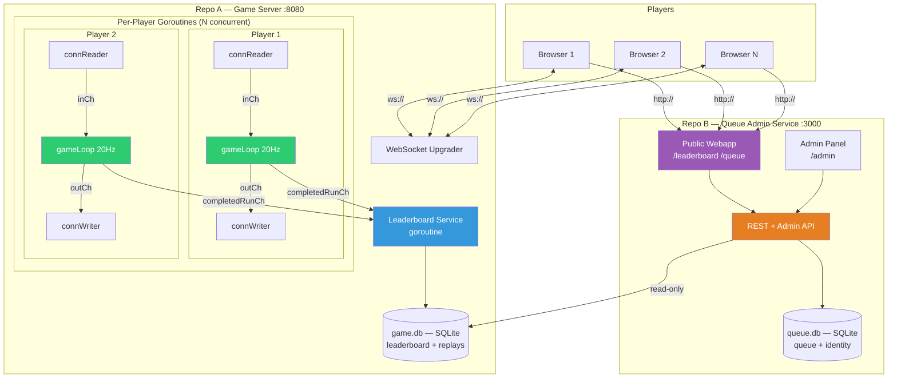
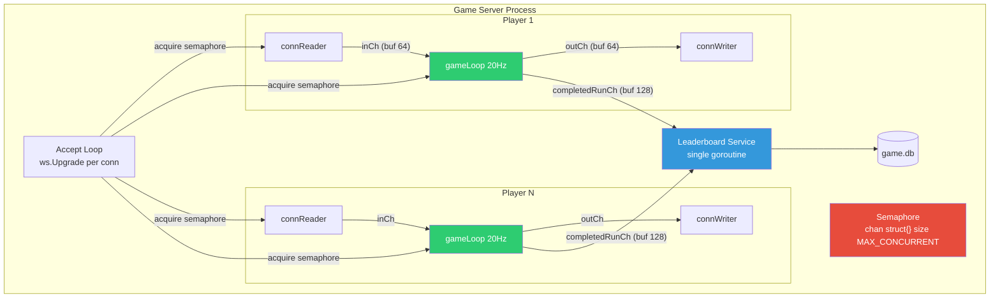
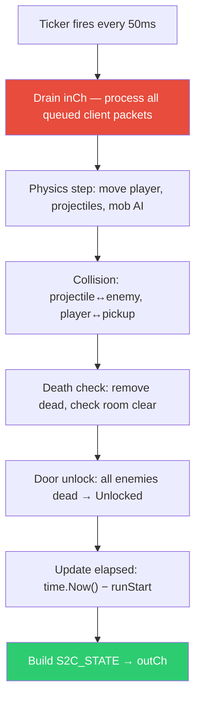
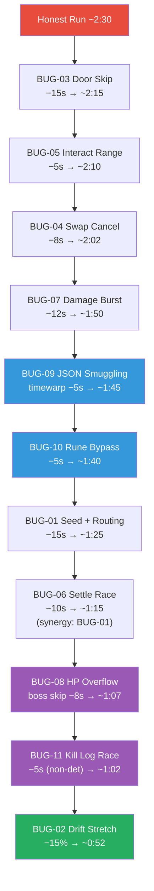
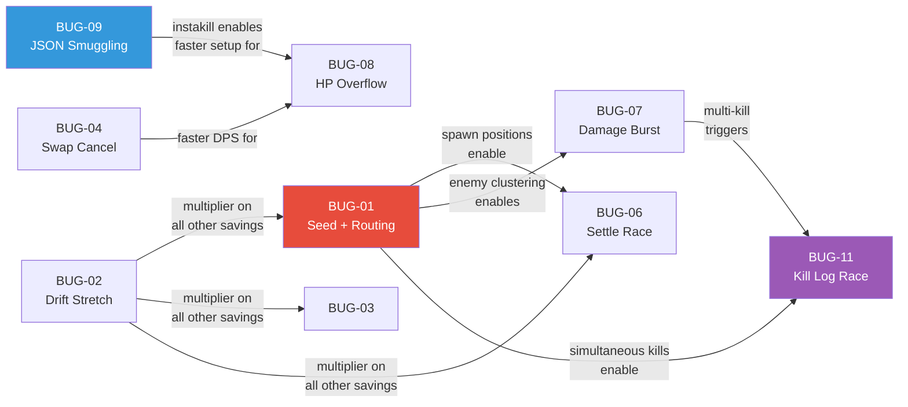
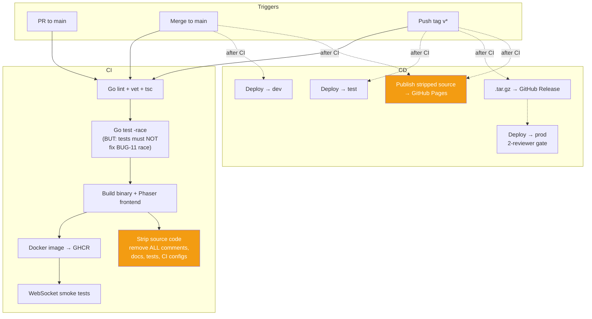
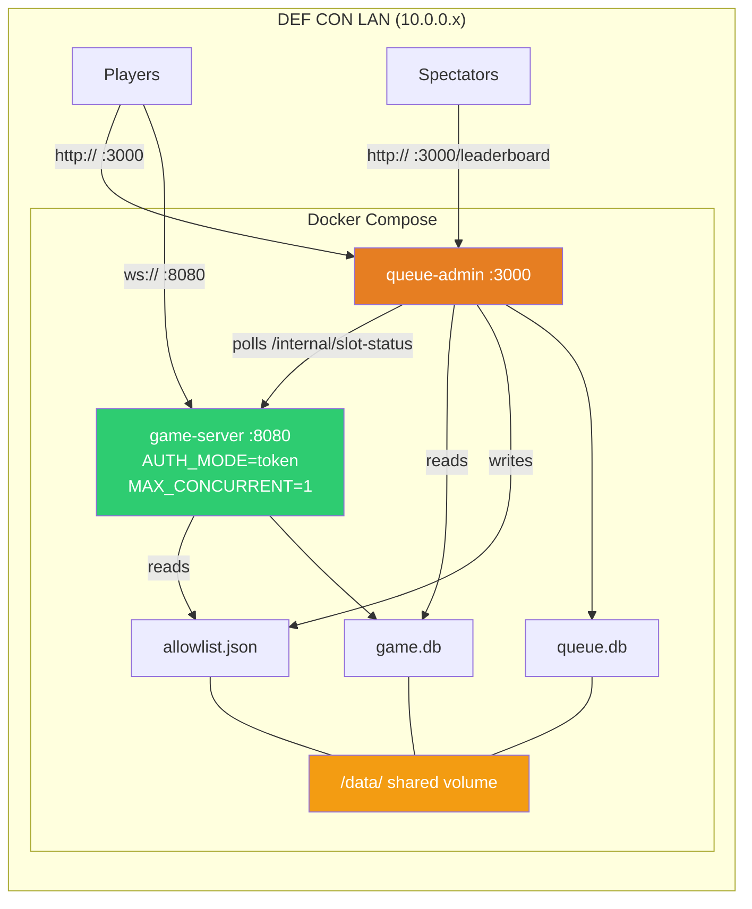

# 🏴‍☠️ NUS Greyhats DEFCON Dungeon Speedrun — Spec Sheet (DRAFT v0.9)

## Overview

Single-player dungeon-crawler speedrun with a shared leaderboard. Players clear rooms of enemies, traverse doors to new single-screen maps, and post completion times. The real competition: exploiting protocol-level bugs to shave seconds off your run. Each exploit is a **small incremental advantage** — stacking them is the path to #1.

**Format:** Individual speedrun + exploitation | **Stack:** Go backend, Phaser 3 frontend, WebSocket transport

---

## System Architecture

Two independent services. The **game server** is self-contained and always supports concurrent players (capped by env var). The **queue admin service** is a separate repo that manages turn-taking in production, hosts the public-facing leaderboard/queue webapp, and handles player identity.



### Service Separation

| Concern            | Game Server (Repo A)                                                                                             | Queue Admin Service (Repo B)                                                      |
| ------------------ | ---------------------------------------------------------------------------------------------------------------- | --------------------------------------------------------------------------------- |
| **Responsibility** | Game logic, WebSocket, leaderboard writes, replays                                                               | Queue FIFO, player identity, public webapp, admin tools                           |
| **Concurrency**    | `MAX_CONCURRENT` env var. Unlimited in dev/test, `1` in prod                                                     | N/A — manages queue, doesn't run games                                            |
| **Database**       | `game.db` — leaderboard, completed runs, replay data                                                             | `queue.db` — queue entries, identity. **Reads** `game.db` for leaderboard display |
| **Auth**           | `AUTH_MODE=open` (dev/test): any connection. `AUTH_MODE=token` (prod): require valid hex player ID in `C2S_AUTH` | Issues hex player IDs, manages queue, provides admin panel                        |
| **Repo**           | `defcon-dungeon/game-server`                                                                                     | `defcon-dungeon/queue-admin`                                                      |
| **Deployed**       | Always                                                                                                           | Prod only (optional in test for queue testing)                                    |

---

## Player Identity System

No accounts. No sessions. No JWTs. Just a **hex ID + password hash**.

### How It Works

```mermaid
sequenceDiagram
    participant P as Player
    participant Q as Queue Admin :3000
    participant G as Game Server :8080

    P->>Q: POST /api/register<br/>{ display_name, contact, password }
    Q->>Q: Generate player_id = crypto/rand 16 bytes → hex (32 chars)<br/>Store bcrypt(password), encrypt(contact)
    Q->>P: { player_id: "a4f9c2e8..." }

    Note over P: Player writes down player_id

    rect rgb(40, 40, 60)
        Note over Q: PROD ONLY — Queue flow
        P->>Q: POST /api/queue/join { player_id, password }
        Q->>Q: Verify bcrypt(password) matches stored hash
        Q->>P: { position: 3, est_wait_ms: ... }
        Q-->>P: (polling/SSE) position updates
        Note over Q: Front of queue + slot free
        Q->>P: { status: "your_turn" }
    end

    P->>G: WebSocket connect
    P->>G: C2S_AUTH { player_id: "a4f9c2e8..." }
    G->>G: AUTH_MODE=open → accept anyone, record player_id<br/>AUTH_MODE=token → validate against allowlist
    G->>P: S2C_AUTH_OK { display_name }
```



### Data Model

```
Player {
    PlayerID        string      // 32-char hex, server-generated, crypto/rand
    DisplayName     string      // plaintext, shown everywhere public
    PasswordHash    []byte      // bcrypt(password), for identity proof
    ContactInfo     []byte      // AES-256-GCM encrypted at rest
    RegisteredAt    time.Time
}
```

### Player-Facing Experience

1. **Walk up to kiosk / open phone browser** → go to `http://10.0.0.x:3000`
2. **Register:** Enter display name, contact (email/phone/discord), choose a password → get back a **32-char hex player ID** displayed prominently ("**Write this down. You need it to play and to claim prizes.**")
3. **Join queue** (prod): Enter player_id + password → get position → wait
4. **Play** (when it's your turn or in dev/test anytime): Open game URL, enter player_id → play
5. **Claim prize** (post-event): Organizer contacts winners via decrypted contact info. Dispute → provide password matching bcrypt hash for that player_id.

---

## Queue Admin Service (Repo B)

### Public Pages & API

| Endpoint                       | Method | Purpose                                                 |
| ------------------------------ | ------ | ------------------------------------------------------- |
| `/api/register`                | POST   | `{ display_name, contact, password }` → `{ player_id }` |
| `/api/queue/join`              | POST   | `{ player_id, password }` → `{ position, est_wait_ms }` |
| `/api/queue/status/:player_id` | GET    | Current position                                        |
| `/api/queue/:player_id`        | DELETE | `{ password }` — leave queue                            |
| `/api/leaderboard`             | GET    | Rankings from `game.db`                                 |
| `/api/replay/:replay_id`       | GET    | Replay data from `game.db`                              |
| `/api/health`                  | GET    | Service health                                          |

### Admin Panel (auth-protected)

- `/admin/queue` — reorder, kick, advance, pause
- `/admin/leaderboard` — flag, remove entries
- `/admin/winners` — decrypt + export contact info
- `/admin/slot` — force-free slot, adjust `MAX_CONCURRENT`

### Queue ↔ Game Server

Queue admin polls `GET /internal/slot-status` on game server every 2s. When a slot is free + player is at front, queue admin writes player_id to shared allowlist (file or endpoint). Game server checks `C2S_AUTH` player_id against allowlist.

### Queue Rules

| Rule                  | Detail                            |
| --------------------- | --------------------------------- |
| **TTL per turn**      | 5 min. Must start run within 60s. |
| **Max runs per turn** | 3 attempts. Best time kept.       |
| **Re-queue**          | After turn → back of queue.       |
| **AFK kick**          | No run within 60s → forfeit.      |
| **Disconnect grace**  | 15s before slot freed.            |

---

## Goroutine Architecture (Game Server)



### Goroutine Responsibilities

| Goroutine       | Owns                                           | Lifecycle       |
| --------------- | ---------------------------------------------- | --------------- |
| **connReader**  | Nothing — stateless decoder                    | Per connection  |
| **gameLoop**    | All player + room state (sole owner, no mutex) | Per connection  |
| **connWriter**  | Nothing — stateless encoder                    | Per connection  |
| **leaderboard** | Rankings, DB writes, broadcast                 | Server lifetime |

No shared game state between players. Only cross-player touchpoint: `completedRunCh` → leaderboard.

### Game Loop Tick (20Hz)



---

## Packet Definitions

### Client → Server (C2S)

Envelope: `{ "type": uint8, "seq": uint32, "ts": int64, "data": { ... } }`

| Type | Name                | `data` Fields                  |
| ---- | ------------------- | ------------------------------ |
| 0x01 | `C2S_AUTH`          | `{ player_id: string }`        |
| 0x02 | `C2S_START_RUN`     | `{ start_time: int64 }`        |
| 0x03 | `C2S_INPUT`         | `{ dx: float32, dy: float32 }` |
| 0x04 | `C2S_SHOOT`         | `{ aim_angle: float32 }`       |
| 0x05 | `C2S_SWITCH_WEAPON` | `{ weapon_id: uint8 }`         |
| 0x06 | `C2S_INTERACT`      | `{ target_id: uint32 }`        |
| 0x07 | `C2S_ENTER_DOOR`    | `{ door_id: uint32 }`          |
| 0x08 | `C2S_USE_ITEM`      | `{ item_name: string }`        |

### Server → Client (S2C)

Envelope: `{ "type": uint8, "seq": uint32, "server_ts": int64, "data": { ... } }`

| Type | Name                | `data` Fields                                                           |
| ---- | ------------------- | ----------------------------------------------------------------------- |
| 0x81 | `S2C_AUTH_OK`       | `{ display_name }`                                                      |
| 0x82 | `S2C_RUN_STARTED`   | `{ seed: int64, room: RoomData }`                                       |
| 0x83 | `S2C_STATE`         | `{ elapsed_ms, player: PlayerSnapshot, entities: [], projectiles: [] }` |
| 0x84 | `S2C_ROOM_LOAD`     | `{ room_index, room: RoomData, split_ms }`                              |
| 0x85 | `S2C_RUN_COMPLETE`  | `{ total_ms, rank, splits: [] }`                                        |
| 0x86 | `S2C_LEADERBOARD`   | `{ entries: [] }`                                                       |
| 0x87 | `S2C_ERROR`         | `{ code, message }`                                                     |
| 0x88 | `S2C_DOOR_UNLOCKED` | `{ door_id }`                                                           |
| 0x89 | `S2C_ENTITY_DIED`   | `{ entity_id }`                                                         |

### Sub-Structures

| Structure          | Fields                                                                                        |
| ------------------ | --------------------------------------------------------------------------------------------- |
| `RoomData`         | `{ room_index, tilemap_id, enemies: []EnemySpawn, pickups: []PickupSpawn, doors: []DoorDef }` |
| `EnemySpawn`       | `{ entity_id, type, x, y, hp }`                                                               |
| `PickupSpawn`      | `{ entity_id, type, x, y }`                                                                   |
| `DoorDef`          | `{ door_id, x, y, target_room, locked }`                                                      |
| `PlayerSnapshot`   | `{ x, y, hp, weapon_id, ammo, inventory: []string }`                                          |
| `EntitySnapshot`   | `{ entity_id, type, x, y, hp, state }`                                                        |
| `ProjSnapshot`     | `{ proj_id, x, y, angle, owner }`                                                             |
| `SplitData`        | `{ room_index, time_ms, kills }`                                                              |
| `LeaderboardEntry` | `{ rank, display_name, total_ms, splits, seed, replay_id }`                                   |

---

## Game State

### Per-Player State (Owned by `gameLoop` goroutine)

```
RunState {
    Status          enum { Idle, Running, Completed }
    PlayerID        string
    DisplayName     string
    RunStartTime    time.Time
    Seed            int64
    MobRNG          *rand.Rand
    CurrentRoom     uint8
    ElapsedMs       int64
    Splits          []SplitData
    InputLog        []InputRecord
    RunsUsed        uint8
}

PlayerState {
    X, Y            float32
    VelX, VelY      float32
    HP, MaxHP       int16               // ← int16, relevant for BUG-08
    CurrentWeapon   uint8
    UnlockedWeapons []uint8
    WeaponCooldown  map[uint8]time.Time
    SwapCooldownEnd time.Time
    DamageTaken     int32
    Inventory       []string            // item names, relevant for BUG-10
}

RoomState {
    RoomIndex       uint8
    Enemies         map[uint32]*EnemyState
    Pickups         map[uint32]*PickupState
    Projectiles     map[uint32]*ProjectileState
    Doors           map[uint32]*DoorState
    AllEnemiesDead  bool
    Settled         bool
    TicksSinceLoad  uint8
    KillLog         []KillRecord        // concurrent append target, relevant for BUG-11
}

EnemyState {
    EntityID        uint32
    Type            uint8
    X, Y            float32
    HP, MaxHP       int16
    AIState         enum { Idle, Patrol, Aggro, Dead }
    PatrolPath      []Vec2
    PatrolIndex     uint8
    AggroRange      float32
    AttackCooldown  time.Time
    Speed           float32
}

DoorState {
    DoorID          uint32
    X, Y            float32
    TargetRoom      uint8
    Unlocked        bool
}
```

---

## Mob AI & Seed Determinism

`MobRNG` (seeded from `start_time`) controls **all** randomness:

| What            | How RNG Is Used                                     |
| --------------- | --------------------------------------------------- |
| Spawn positions | Base position ± `MobRNG.Intn(100) - 50` px per axis |
| Patrol paths    | 2–4 waypoints per enemy from `MobRNG`               |
| Aggro jitter    | Initial chase vector offset by `MobRNG.Float32()`   |
| Attack timing   | First attack delay = base + `MobRNG.Intn(500)` ms   |

**Seed validation window: ±30 minutes** of `time.Now()`.

Identical seeds → identical behavior. Given a seed, **full mob choreography for all rooms is pre-computable**.

---

## Leaderboard & Replay System

- Every `CompletedRun` stores **full `InputLog`**
- `Checksum = SHA256(seed || serialize(InputLog))`
- Replay engine: same seed + InputLog → identical final time
- Leaderboard is **tamper-proof** — server-authoritative, replay-verified

```
CompletedRun {
    ReplayID        string
    PlayerID        string
    DisplayName     string
    TotalMs         int64
    Splits          []SplitData
    Seed            int64
    InputLog        []InputRecord
    Checksum        [32]byte
    SubmittedAt     time.Time
}
```

---

## Intentional Bugs

### Design Philosophy

Every bug: **small, bounded advantage**. Leaderboard won by **stacking**. Honest run: **~2:30**. Perfect stack: **~1:00–1:15**.

Bugs are sourced from **real Go pitfalls and known vulnerability classes** — participants are studying real-world security patterns, not contrived game-only puzzles.

| ID     | Name                                 | Category                           | Savings             | Difficulty |
| ------ | ------------------------------------ | ---------------------------------- | ------------------- | ---------- |
| BUG-01 | Mob Seed Optimization                | Determinism/Planning               | ~3–5s/room          | Hard       |
| BUG-02 | Drift Tick Stretching                | Time validation                    | ~15–20% total       | Hard       |
| BUG-03 | Door Skip (No Proximity)             | Missing check                      | ~2–3s/room          | Easy       |
| BUG-04 | Swap Cancel Animation                | Same-tick batching                 | ~1–2s/room          | Easy       |
| BUG-05 | Interact Range Bug                   | Off-by-units                       | ~1–2s/pickup        | Easy       |
| BUG-06 | Concurrent Room Settle Race          | Goroutine timing                   | ~3–5s/room          | Hard       |
| BUG-07 | Damage Batch Overflow                | Same-tick batching                 | ~2–3s/room          | Medium     |
| BUG-08 | HP Integer Overflow                  | Go silent overflow (100go #18)     | ~5–10s/boss         | Medium     |
| BUG-09 | JSON Case-Insensitive Field Matching | Go parser footgun (Trail of Bits)  | Unlock hidden items | Medium     |
| BUG-10 | Rune vs Byte Item Name Bypass        | Go rune/byte confusion (100go #36) | ~3–5s/room          | Medium     |
| BUG-11 | Kill Log Race Condition              | Slice append data race (100go #69) | ~5–8s total         | Hard       |

---

### BUG-01: Mob Seed Optimization 🎲

**Root cause:** `start_time` from `C2S_START_RUN` seeds `MobRNG`. Server validates within **±30 minutes** of `time.Now()`.

**Why it's hard (and skill-rewarding):** The seed determines **everything** — spawn positions, patrol waypoints, aggro jitter, attack delays — across all rooms. But knowing the choreography is only half the battle. The player must then **plan an optimal route through every room** for that specific choreography. This is a **specialized routing problem**:

- Which enemies to kill in what order given their specific positions
- Optimal movement path through each room's unique spawn layout
- Which patrol intercept windows to hit (enemies walking toward you vs. away)
- Attack timing alignment — when do favorable aggro jitter windows open
- Multi-room planning — early rooms' RNG consumption affects later rooms' patterns

A brute-force seed search might evaluate millions of candidates, but **scoring each seed requires simulating the full routing problem** — it's not just "find good clusters," it's "find the seed whose choreography admits the fastest possible multi-room route." This rewards both **tooling sophistication** (better solvers, smarter heuristics) and **game knowledge** (understanding room geometry, weapon DPS windows, door positions).

**The skill ceiling is very high:** Two teams with the same seed can have very different times depending on their routing quality. The seed is visible on the leaderboard — competitors can study each other's seeds, but still need to independently solve the routing.

**Bound:** Spawn offset ±50px. Patrol paths bounded within room.

**Savings:** ~3–5s per room (routing-dependent — skilled routers save more).

---

### BUG-02: Drift Tick Stretching ⏱️

**Root cause:** Per-packet `ts` validated ±2s of `time.Now()`. No rate-of-progression check. `ts` used for physics `deltaTime`.

**Exploit:** Advance `ts` ~10–15% faster. Physics runs faster. Push too hard → run invalidated.

**Bound:** Cumulative drift > 2s = dead run. ~15–20% sustainable.

**Savings:** ~15–20% of total run time.

---

### BUG-03: Door Skip 🚪

**Root cause:** `C2S_ENTER_DOOR` checks `door.Unlocked` + `door_id`, no player distance check.

**Exploit:** Enter door from anywhere after enemies dead.

**Savings:** ~2–3s per room.

---

### BUG-04: Swap Cancel ⚔️

**Root cause:** `SWITCH_WEAPON` + `SHOOT` in same tick. Cooldown check sees ~0ms elapsed.

**Exploit:** Fire instantly after swap.

**Savings:** ~1–2s per room.

---

### BUG-05: Interact Range Bug 📦

**Root cause:** Pickup distance uses `abs(dx) < range && abs(dy) < range` with `range = 2500` (should be 50). Square hitbox.

**Exploit:** Grab pickups from far away on axis.

**Savings:** ~1–2s per pickup room.

---

### BUG-06: Concurrent Room Settle Race 🧵

**Root cause:** `connReader` doesn't block during 2-tick settle. Queued shots hit freshly spawned enemies at initial positions.

**Exploit:** Burst shots after door enter, aimed at predicted spawns. **Synergy with BUG-01** (needs seed knowledge for positions, needs routing knowledge for optimal burst targets).

**Savings:** ~3–5s per room.

---

### BUG-07: Damage Batch Overflow 💥

**Root cause:** All projectile collisions resolve before death check. Fire rate limiter shares `time.Now()` within tick.

**Exploit:** Queue 2–3 shots per tick → double DPS.

**Savings:** ~2–3s per room.

---

### BUG-08: HP Integer Overflow (Healing Past Max) 🔢

**Source:** [100 Go Mistakes #18 — Neglecting integer overflows](https://100go.co/#neglecting-integer-overflows-18). Go performs **silent integer wraparound** on overflow — no panic, no error.

**Root cause:** Player HP is `int16` (max 32,767). The healing pickup handler does:

```go
func (p *PlayerState) ApplyHeal(amount int16) {
    p.HP += amount  // no overflow check — Go wraps silently
    if p.HP > p.MaxHP {
        p.HP = p.MaxHP
    }
}
```

If the player's current HP is high and `amount` is large enough, `p.HP += amount` wraps past `32767` to a **large negative number**. The `> MaxHP` clamp never fires (negative is not > MaxHP). The player now has negative HP.

**But here's the twist:** the death check is:

```go
if p.HP <= 0 {
    // kill player
}
```

However, there exists a **specific heal pickup in the boss room** that grants `+30000 HP`. If the player has `HP > 2767` when they pick it up: `2768 + 30000 = 32768` → wraps to `-32768` → **player dies**.

**Exploit (inverted):** The savvy player realizes the overflow exists and **avoids** that specific pickup unless their HP is low enough. But more importantly — if they can trigger the overflow on a **boss enemy** via a reflected-heal mechanic or by manipulating the damage calculation path where enemy damage reduction uses `int16` arithmetic:

```go
func (e *EnemyState) TakeDamage(amount int16) {
    reduction := e.computeArmor()          // returns int16
    effectiveDmg := amount - reduction     // can underflow if armor > damage
    e.HP -= effectiveDmg                   // subtracting negative = adding HP... unless it wraps
}
```

If `amount = 10` and `reduction = 50`, then `effectiveDmg = 10 - 50 = -40`. `e.HP -= (-40)` → `e.HP += 40`. The enemy **heals**. But if you craft a scenario where the arithmetic wraps: `amount = 100, reduction = -32700` (achievable via a specific debuff stack), then `effectiveDmg = 100 - (-32700) = 32800` → wraps to `-32736` as int16. `e.HP -= (-32736)` → enemy HP increases by 32736... and if **that** overflows the enemy's int16 HP → wraps negative → enemy dies.

**Practical exploit:** Stack a specific debuff on the boss that corrupts its armor value to a large negative int16, then hit it with a normal attack. The damage arithmetic chain double-overflows, instantly killing the boss.

**Bound:** Requires finding the specific debuff + attack combination. Only works on the boss (regular enemies die fast anyway). Must avoid accidentally killing yourself with the heal pickup.

**Savings:** ~5–10s on boss fight.

---

### BUG-09: JSON Case-Insensitive Field Smuggling 📋

**Source:** [Trail of Bits — Unexpected security footguns in Go's parsers](https://blog.trailofbits.com/2025/06/17/unexpected-security-footguns-in-gos-parsers/). Go's `encoding/json` unmarshals fields **case-insensitively** by default. `{"Weapon_ID": 5}` and `{"weapon_id": 5}` and `{"WEAPON_ID": 5}` all match the same struct field. Additionally, **duplicate keys** are silently accepted — last one wins.

**Root cause:** The `C2S_USE_ITEM` packet contains an `item_name` field:

```go
type UseItemPacket struct {
    ItemName string `json:"item_name"`
}
```

Server-side item validation checks a map of **allowed items**:

```go
var allowedItems = map[string]ItemDef{
    "health_potion":  { ... },
    "speed_boost":    { ... },
    "shield":         { ... },
}

func handleUseItem(pkt UseItemPacket, player *PlayerState) {
    item, ok := allowedItems[pkt.ItemName]
    if !ok {
        // reject — item not found
        return
    }
    applyItem(item, player)
}
```

The map lookup is **case-sensitive** (`"Health_Potion"` would fail). But there's a secondary validation path — a **debug/admin item set** that was left in the code, gated by a different check:

```go
var debugItems = map[string]ItemDef{
    "instakill":     { damage: 9999 },
    "teleport":      { ... },
    "timewarp":      { duration: -5000 },  // subtracts 5s from elapsed
}
```

The routing logic that dispatches to `handleUseItem` first does a **JSON unmarshal** of the raw packet, then passes the result to a validator that checks against a **combined allowlist string** using `strings.EqualFold` (case-insensitive comparison). The allowlist was built by iterating `allowedItems` keys only — but there's a **parser differential**:

The raw JSON packet hits a pre-processing middleware that logs item usage. This middleware uses a different JSON parser (or a manual string search) that is case-sensitive. If you send:

```json
{"type": 8, "seq": 1, "ts": 123, "data": {"item_name": "HEALTH_POTION", "item_name": "timewarp"}}
```

- The **logging middleware** sees the first `item_name` = `"HEALTH_POTION"` (first key wins in its parser) → logs legitimate item use
- Go's `encoding/json` takes the **last duplicate key** → `ItemName = "timewarp"`
- The `strings.EqualFold` check against the allowlist matches `"timewarp"` against... nothing in allowed items. **But** the debug items map is checked as a fallback in a separate code path that was meant to be disabled.

**Exploit:** Send a `C2S_USE_ITEM` with duplicate `item_name` keys — first key is a legitimate item (passes the logging/audit check), second key is a debug item (used by `encoding/json`). Access `timewarp` to subtract 5s from elapsed time, or `instakill` on a tough enemy.

**Bound:** `timewarp` is limited — it can only be used once per room (server tracks usage). `instakill` only works on non-boss enemies. The player must discover the debug item names (they're in the stripped source code, just not obvious).

**Savings:** Unlock hidden items — `timewarp` saves ~5s per use. `instakill` can clear a tough room ~3–5s faster.

---

### BUG-10: Rune vs Byte Item Length Bypass 🔤

**Source:** [100 Go Mistakes #36 — Not understanding the concept of a rune](https://100go.co/#not-understanding-the-concept-of-rune-36). In Go, `len(string)` returns **byte count**, not character count. Multi-byte UTF-8 characters (emoji, CJK, etc.) count as 1 rune but 2–4 bytes.

**Root cause:** The inventory system limits item names to 16 characters to prevent overflow. The validation uses `len()`:

```go
func validateItemName(name string) bool {
    if len(name) > 16 {    // len() counts BYTES, not characters
        return false
    }
    return isAllowedItem(name)
}
```

The `isAllowedItem` function does a **rune-aware comparison** — it normalizes the item name by iterating runes:

```go
func isAllowedItem(name string) bool {
    normalized := strings.ToLower(strings.TrimSpace(name))
    _, exists := allowedItems[normalized]
    return exists
}
```

But there's a **command parsing system** that interprets special prefixes in item names. The prefix check uses byte indexing:

```go
func parseItemCommand(name string) (string, string) {
    // Check for command prefix "!" at byte position 0
    if name[0] == '!' {
        return name[1:], "command"      // byte slice, not rune-safe
    }
    return name, "item"
}
```

**Exploit:** Craft an item name that starts with a multi-byte UTF-8 character whose **second byte** is `0x21` (ASCII `!`). The `len()` check passes (multi-byte chars make the byte length seem long, but you can craft a name where total bytes ≤ 16). The `parseItemCommand` function slices at byte boundaries, producing a **different string** than intended after the byte-slice.

More practically: the item name `"ñ!skip_room"` — `ñ` is 2 bytes (`0xC3 0xB1`), so `name[0]` is `0xC3` (not `!`), and the command parser doesn't fire. But if you send the raw bytes `\x21skip_room` with a specific multi-byte prefix that `strings.TrimSpace` strips (certain Unicode whitespace characters), the normalization path and the command path see **different strings**.

The command path can trigger a `skip_room` debug command that instantly clears the current room.

**Bound:** Single-room skip only. The player must construct a carefully encoded UTF-8 string. The room is marked as skipped on the leaderboard replay (so it's visible, but the time stands).

**Savings:** ~3–5s per room where used. Limited to 1–2 uses per run (server tracks).

---

### BUG-11: Kill Log Append Race Condition 🧵💀

**Source:** [100 Go Mistakes #69 — Creating data races with append](https://100go.co/#creating-data-races-with-append-69). In Go, concurrent `append` to a shared slice is **not safe** — it causes silent data loss (not a panic), where elements are overwritten or lost.

**Root cause:** When multiple projectiles kill enemies on the same tick, the death processing spawns **per-enemy cleanup goroutines** for visual effects (particle systems, loot drops). These goroutines append to a shared `KillLog` slice:

```go
// Called from collision pass — one goroutine per dead enemy
func (r *RoomState) processEnemyDeath(entityID uint32) {
    // ... cleanup, spawn particles, etc.

    // BUG: concurrent append to shared slice — no mutex
    r.KillLog = append(r.KillLog, KillRecord{
        EntityID:  entityID,
        Timestamp: time.Now(),
    })
}
```

When multiple enemies die simultaneously (common with BUG-07 damage burst), the concurrent `append` calls race on the same underlying array. Slice append in Go is **not atomic** — the runtime may:
1. Read the current length
2. Write the element at that index
3. Update the length

Two goroutines can read the same length, write to the same index (one overwrites the other), and both increment length — resulting in a **lost kill record** and a **duplicate/garbage entry**.

**Why this matters for speedrunning:** The room-clear check is:

```go
func (r *RoomState) checkRoomClear() bool {
    return len(r.KillLog) >= len(r.Enemies)
}
```

If kill records are lost due to the race condition, `len(r.KillLog)` never reaches the enemy count, and the **door never unlocks**. Normally this would be a softlock — but the server has a **reconciliation pass** that runs every 10 ticks (500ms):

```go
func (r *RoomState) reconcileKillLog() {
    actualDead := 0
    for _, e := range r.Enemies {
        if e.HP <= 0 {
            actualDead++
        }
    }
    if actualDead >= len(r.Enemies) && !r.AllEnemiesDead {
        r.AllEnemiesDead = true
        // force unlock doors
    }
}
```

**Exploit:** The race condition means the **kill log count** and the **actual dead count** can temporarily diverge. The reconciliation pass takes 500ms to fire. But: if the player triggers kills **one at a time** (avoiding the race), the kill log stays accurate and the door unlocks **immediately** on the last kill (within the same tick). If kills are batched (triggering the race), the player waits up to 500ms for reconciliation.

The advanced exploit: the `KillLog` is also used for **score multiplier calculation**:

```go
func computeRoomBonus(log []KillRecord) int64 {
    if len(log) == 0 {
        return 0
    }
    // Bonus for fast clears: time between first and last kill
    duration := log[len(log)-1].Timestamp.Sub(log[0].Timestamp)
    if duration < 2*time.Second {
        return -500  // 500ms bonus (subtracted from room time)
    }
    return 0
}
```

Due to the race condition, garbage entries in the kill log can have **zero-value timestamps** (Go's default `time.Time{}`). If a garbage entry lands at index 0 with a zero timestamp, and the last entry has the real timestamp, `duration` becomes enormous → no bonus. But if the race produces a specific corruption pattern where the **last entry** has a zero timestamp (from a lost append that left uninitialized memory), `duration` becomes negative → the bonus calculation **underflows** → massive negative bonus → **time subtracted from run**.

**Practical exploit:** Use BUG-07 (damage burst) to kill exactly 3+ enemies simultaneously. The race condition fires. With the right timing, the kill log corruption produces a negative duration bonus. This is **non-deterministic** — it might take several attempts. Seed optimization (BUG-01) helps by finding rooms where enemy positions allow reliable simultaneous kills.

**Bound:** Non-deterministic — the race might not corrupt favorably. Average savings when it works. Players who understand the Go runtime's slice internals can increase their odds by controlling kill timing precisely.

**Savings:** ~5–8s total across a run (when corruption is favorable). **Synergizes with BUG-07 and BUG-01.**

---

### Stacking Model (Updated)



### Bug Synergy Map



### Bug Discovery Difficulty Tiers

| Tier                                       | Bugs                           | Discovery Path                                                          |
| ------------------------------------------ | ------------------------------ | ----------------------------------------------------------------------- |
| **Surface** (found by reading code)        | BUG-03, BUG-05                 | Missing checks obvious in stripped source                               |
| **Protocol** (found by packet analysis)    | BUG-04, BUG-07                 | Requires understanding tick batching                                    |
| **Language** (found by Go expertise)       | BUG-08, BUG-09, BUG-10, BUG-11 | Requires deep knowledge of Go's type system, parsers, concurrency model |
| **Systems** (found by full-stack analysis) | BUG-01, BUG-02, BUG-06         | Requires understanding server architecture + building external tools    |

---

## CI/CD Pipeline

### Repo Structure

```
defcon-dungeon/
├── game-server/              ← Repo A
│   ├── cmd/server/
│   ├── internal/
│   │   ├── game/             (game loop, physics, AI, items)
│   │   ├── protocol/         (packet encode/decode — JSON parsing)
│   │   ├── leaderboard/      (DB, rankings)
│   │   └── auth/             (allowlist check)
│   ├── web/                  (Phaser frontend)
│   ├── Dockerfile
│   ├── .github/workflows/
│   └── go.mod
│
├── queue-admin/              ← Repo B
│   ├── cmd/admin/
│   ├── internal/
│   │   ├── queue/            (FIFO, slot polling)
│   │   ├── identity/         (registration, bcrypt, AES)
│   │   └── admin/            (admin panel handlers)
│   ├── web/                  (Leaderboard + Queue webapp)
│   ├── Dockerfile
│   ├── .github/workflows/
│   └── go.mod
```

### Environment Matrix

| Env      | Game Server    | Queue Admin      | Concurrency        | Auth Mode         |
| -------- | -------------- | ---------------- | ------------------ | ----------------- |
| **dev**  | `:8080` on VPS | Not deployed     | Unlimited          | `open`            |
| **test** | `:8080` on VPS | `:3000` optional | Unlimited          | `open` or `token` |
| **prod** | `:8080` on LAN | `:3000` on LAN   | `MAX_CONCURRENT=1` | `token`           |

### Pipeline — Game Server (Repo A)



**Note on `go test -race`:** BUG-11 is an intentional data race. The CI config uses build tags to **exclude** the kill-log file from race detection: `go test -race -tags=norace ./...` where the buggy file has `//go:build !norace`. This ensures CI passes while the race remains in production builds.

### Pipeline — Queue Admin (Repo B)

Standard: lint → test → build → Docker. Tag triggers → test deploy + air-gapped bundle. Prod requires 2-reviewer gate.

### Source Code Publishing (Docs Site)

**Only game server code published.** Queue admin source **never** published.

| Stripped ❌                          | Kept ✅                               |
| ----------------------------------- | ------------------------------------ |
| All comments (`//`, `/* */`)        | Raw `.go` files                      |
| Doc strings                         | Package structure                    |
| README, docs/, markdown             | Function signatures + implementation |
| `// BUG:` / `// HACK:` annotations  | `go.mod` / `go.sum`                  |
| `*_test.go`                         | —                                    |
| `.github/`, Dockerfile, CI configs  | —                                    |
| Build tags / race exclusion pragmas | —                                    |

CI step: `go/ast`-based stripping tool → `gofmt` → `gh-pages` → GitHub Pages.

---

## Deployment Topology — Production



---

## Open Questions

- [ ] Exact room count, map art, tileset
- [ ] Boss mechanics, phases, and debuff system (needed for BUG-08)
- [ ] Full weapon stats table
- [ ] Item/inventory system details (needed for BUG-09, BUG-10)
- [ ] Death penalty: checkpoint or full restart?
- [ ] Monorepo vs two separate repos?
- [ ] Leaderboard webapp stack: React, vanilla JS, Go templates?
- [ ] Replay viewer: embedded Phaser canvas or separate page?
- [ ] VPS provider for dev/test
- [ ] `go/ast` stripping tool — custom or existing?
- [ ] Queue notification: SSE, WebSocket from queue-admin, or client polls?
- [ ] Admin panel auth: basic auth? IP whitelist?
- [ ] Are 11 bugs too many? Should we cut to 8–9 for scope?
- [ ] BUG-11 non-determinism — is that fun or frustrating?
- [ ] Build tag strategy for hiding intentional race from `go test -race`
- [ ] Should the debug items (BUG-09) be discoverable only through source code reading, or also hinted in-game?
- [ ] Display name uniqueness — enforce or allow duplicates?
