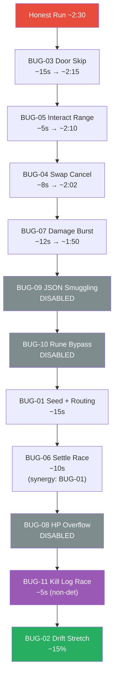
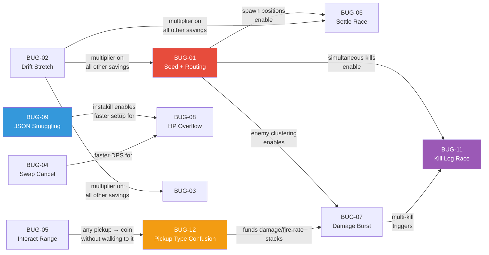

# Intentional Bugs — Central Index

## Philosophy

Every bug here is a **small, bounded advantage**. The leaderboard is won by **stacking** them. Honest run: ~2:30. Perfect stack: ~1:00–1:15.

Bugs are sourced from **real Go pitfalls and known vulnerability classes** — participants are studying real-world security patterns, not contrived game-only puzzles.

**This file is an index only.** Each bug's full body (root cause, exploit path, bound, detection, synergies) lives in the spec file for the component where it surfaces. Follow the links.

### Currently disabled

**BUG-08, BUG-09, BUG-10 are currently DISABLED in the shipping code** — they let a player trivially short-circuit the run (skip rooms via smuggled debug items, instakill the boss via HP overflow). They may be reintroduced in a future round once we've thought about binding them more tightly. Their specs are preserved below so the stacking model and spec history stay readable.

The enabling pieces were removed in two passes:
- `DebugItems` map, `ParseItemCommand` / `dispatchCommand`, and the `!skip_room` command path were deleted from `server/internal/game/items.go`. Only `AllowedItems` (health_potion, speed_boost, shield) now dispatches.
- The `+30000` Heart pickup (BUG-08 payload) was removed from `rooms_data.go` along with speed/damage-boost pickups. Only health potion and ammo crate remain.

## Index

| ID     | Name                                 | Category                           | Difficulty | Savings             | Status            | Body lives in |
| ------ | ------------------------------------ | ---------------------------------- | ---------- | ------------------- | ----------------- | ------------- |
| BUG-01 | Mob Seed Optimization                | Determinism / planning             | Hard       | ~3–5 s/room         | Active            | [features/mob-ai.md#bug-01-mob-seed-optimization](features/mob-ai.md#bug-01-mob-seed-optimization) |
| BUG-02 | Drift Tick Stretching                | Time validation                    | Hard       | ~15–20 % total      | Active            | [foundations/05-server-runtime.md#bug-02-drift-tick-stretching](foundations/05-server-runtime.md#bug-02-drift-tick-stretching) |
| BUG-03 | Door Skip (No Proximity)             | Missing check                      | Easy       | ~2–3 s/room         | Active            | [features/rooms-doors.md#bug-03-door-skip-no-proximity](features/rooms-doors.md#bug-03-door-skip-no-proximity) |
| BUG-04 | Swap Cancel Animation                | Same-tick batching                 | Easy       | ~1–2 s/room         | Active            | [features/combat-weapons.md#bug-04-swap-cancel](features/combat-weapons.md#bug-04-swap-cancel) |
| BUG-05 | Interact Range Bug                   | Off-by-units                       | Easy       | ~1–2 s/pickup       | Active            | [features/pickups.md#bug-05-interact-range-bug](features/pickups.md#bug-05-interact-range-bug) |
| BUG-06 | Concurrent Room Settle Race          | Goroutine timing                   | Hard       | ~3–5 s/room         | Active            | [foundations/05-server-runtime.md#bug-06-concurrent-room-settle-race](foundations/05-server-runtime.md#bug-06-concurrent-room-settle-race) |
| BUG-07 | Damage Batch Overflow                | Same-tick batching                 | Medium     | ~2–3 s/room         | Active            | [features/combat-weapons.md#bug-07-damage-batch-overflow](features/combat-weapons.md#bug-07-damage-batch-overflow) |
| BUG-08 | HP Integer Overflow                  | Go silent overflow (100go #18)     | Medium     | ~5–10 s/boss        | Disabled (may return) | [features/combat-weapons.md#bug-08-hp-integer-overflow-healing-past-max](features/combat-weapons.md#bug-08-hp-integer-overflow-healing-past-max) |
| BUG-09 | JSON Case-Insensitive Field Matching | Go parser footgun (Trail of Bits)  | Medium     | Unlock hidden items | Disabled (may return) | [foundations/02-protocol.md#bug-09-json-case-insensitive-field-smuggling](foundations/02-protocol.md#bug-09-json-case-insensitive-field-smuggling) (+ [features/inventory-items.md#bug-09-json-smuggling-dispatch-side-detail](features/inventory-items.md#bug-09-json-smuggling-dispatch-side-detail)) |
| BUG-10 | Rune vs Byte Item Name Bypass        | Go rune/byte confusion (100go #36) | Medium     | ~3–5 s/room         | Disabled (may return) | [features/inventory-items.md#bug-10-rune-vs-byte-item-length-bypass](features/inventory-items.md#bug-10-rune-vs-byte-item-length-bypass) |
| BUG-11 | Kill Log Race Condition              | Slice append data race (100go #69) | Hard       | ~5–8 s total        | Active            | [foundations/05-server-runtime.md#bug-11-kill-log-append-race](foundations/05-server-runtime.md#bug-11-kill-log-append-race) |
| BUG-12 | Pickup Type Confusion                | Trust-the-client dispatch          | Easy       | ~10–20 s/run        | Active            | [features/shop.md#bug-12-pickup-type-confusion](features/shop.md#bug-12-pickup-type-confusion) |

## Stacking model

With BUG-08/09/10 disabled, the reachable stack floor is ~1:20–1:30 rather than the documented ~1:02. The full chain is kept for reference; greyed-out nodes are currently unreachable.

## Synergy map

## Discovery difficulty tiers

| Tier                                       | Bugs                           | Discovery Path                                                          |
| ------------------------------------------ | ------------------------------ | ----------------------------------------------------------------------- |
| **Surface** (found by reading code)        | BUG-03, BUG-05                 | Missing checks obvious in stripped source                               |
| **Protocol** (found by packet analysis)    | BUG-04, BUG-07, BUG-12         | Requires understanding tick batching / packet payload trust             |
| **Language** (found by Go expertise)       | BUG-08, BUG-09, BUG-10, BUG-11 | Requires deep knowledge of Go's type system, parsers, concurrency model |
| **Systems** (found by full-stack analysis) | BUG-01, BUG-02, BUG-06         | Requires understanding server architecture + building external tools    |

## Rules of engagement

- Bugs are bounded — none is a "win button". A skilled stack is required to reach top-1 time.
- The leaderboard is server-authoritative with replay verification — see [foundations/08-leaderboard-replay.md](foundations/08-leaderboard-replay.md). Runs that can't be reproduced from `(seed, InputLog)` (within tolerance for non-deterministic bugs) are rejected.
- The game server source is published (stripped) through the lobby webapp at `/source/` after every merge to `main`. See [foundations/09-ci-cd-deploy.md#source-code-publishing-served-by-lobby](foundations/09-ci-cd-deploy.md#source-code-publishing-served-by-lobby).
- Bugs in the identity / auth / leaderboard / replay subsystems are NOT intentional. If you find one, report it — the organizers will fix it.

## For implementers

When implementing or modifying code:

1. Read the relevant spec file end-to-end before touching code.
2. Every spec has an "Intentional bugs in this area" section. If your change touches that area, read it.
3. Do NOT "fix" an intentional *active* bug unless explicitly coordinating with whoever owns [bugs.md](bugs.md) and the relevant area.
4. For bugs marked **Disabled (may return)**: the spec is preserved but the enabling code has been removed. Do not reintroduce it ad-hoc — coordinate first so the bound (how the exploit is gated) is thought through before it ships again.
5. Unit tests must NOT catch active intentional bugs. If a test fails because of one, gate the test behind the `norace` build tag (for BUG-11) or rewrite the test to cover adjacent correct behavior without tripping the bug.
