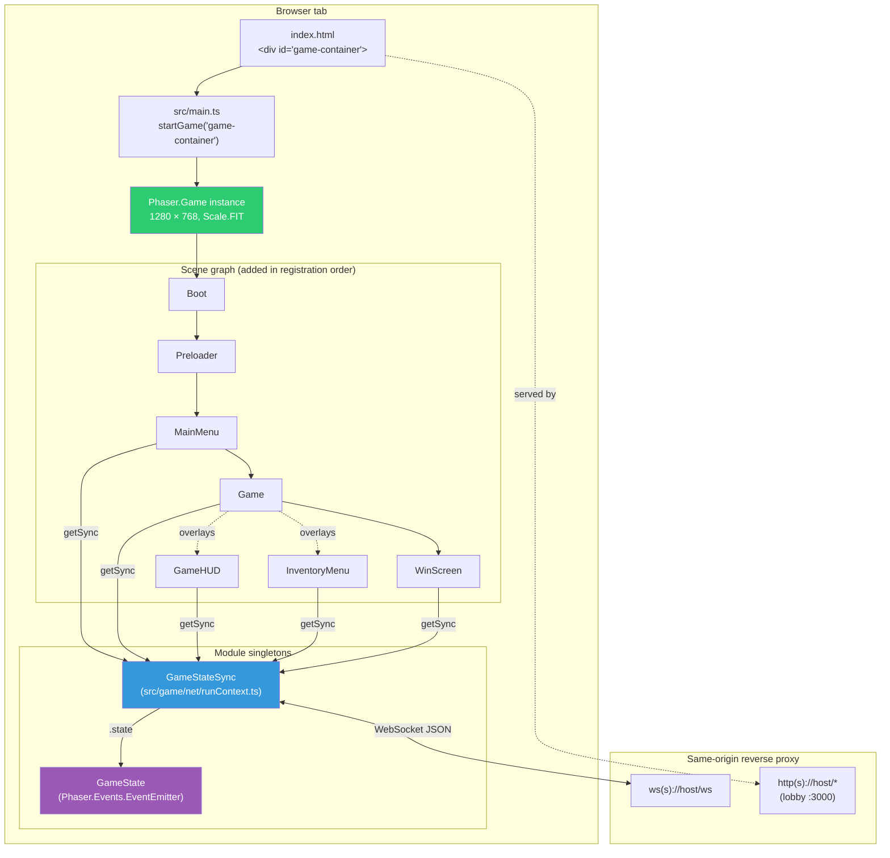
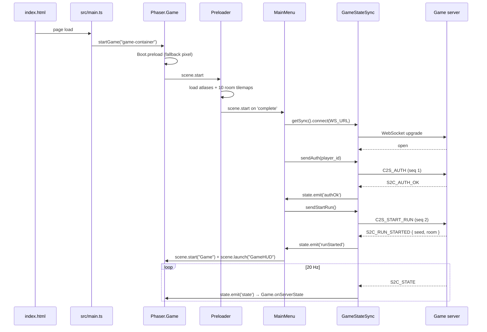

# 01 — Client Architecture

## Purpose

Defines the browser-side topology of the Phaser 3 client: the runtime bootstrap chain, module layout, the two long-lived singletons (`Phaser.Game` and `GameStateSync`), the scene registration order, the build tooling, and where the game-client code terminates vs. where the lobby webapp picks up. The client is deliberately **thin and non-authoritative** — it renders server snapshots and forwards input, nothing else. Every exploit surface lives on the packet boundary, not in scene code, so there are no intentional bugs in client files.

## Runtime topology



## Entry point and bootstrap chain

The bootstrap is three lines deep on purpose:

1. `client/index.html` — declares an empty `<div id="game-container">` and loads `/src/main.ts` as an ES module.
2. `client/src/main.ts` — single call to `startGame("game-container")`.
3. `client/src/game/main.ts` — constructs the `Phaser.Game` config and returns the instance. Scene array determines registration order; **the first scene (`Boot`) starts automatically**.

Bootstrap chain on page load:

```
index.html loaded
    │
    ▼
src/main.ts imports src/game/main.ts and calls startGame()
    │
    ▼
new Phaser.Game({ type: AUTO, width: 1280, height: 768, scene: [...] })
    │
    ▼
Phaser starts the first scene in the array — Boot
    │
    ▼
Boot.preload() loads a 1x1 data-URI fallback pixel → Boot.create() → scene.start("Preloader")
    │
    ▼
Preloader.preload() loads atlases / images / 10 room tilemaps → on complete → scene.start("MainMenu")
    │
    ▼
MainMenu.create() connects the WebSocket → user enters player_id → C2S_AUTH → C2S_START_RUN → scene.start("Game") + scene.launch("GameHUD")
    │
    ▼
(Game + overlays run concurrently until S2C_RUN_COMPLETE → scene.start("WinScreen"))
```

## Phaser configuration

Defined in `client/src/game/main.ts`:

| Config key            | Value                                       | Rationale                                                                                                  |
| --------------------- | ------------------------------------------- | ---------------------------------------------------------------------------------------------------------- |
| `type`                | `Phaser.AUTO`                               | Prefer WebGL, fall back to Canvas.                                                                         |
| `width` × `height`    | `1280 × 768`                                | Same constants exported from `constants.ts`; shared with Tiled maps (all rooms are 40×24 tiles @ 32 px).   |
| `parent`              | `"game-container"`                          | The `<div>` in `index.html`.                                                                               |
| `backgroundColor`     | `"#0d0d10"`                                 | Off-black to match the DEFCON dungeon palette; only visible briefly during scene transitions.              |
| `physics.default`     | `"arcade"`                                  | Arcade is used **only for local smoothing/debug**; no physics decisions are made client-side.              |
| `physics.arcade.gravity` | `{ x: 0, y: 0 }`                         | Top-down game.                                                                                             |
| `scale.mode`          | `Phaser.Scale.FIT`                          | Letterbox to viewport while preserving the 1280×768 aspect ratio.                                          |
| `scale.autoCenter`    | `Phaser.Scale.CENTER_BOTH`                  | Center inside `<div id="app">`.                                                                            |
| `scene`               | `[Boot, Preloader, MainMenu, Game, GameHUD, InventoryMenu, WinScreen]` | Registration order — Phaser starts the first entry automatically. |

Arcade physics runs but is **not load-bearing**: entities store a `targetX/targetY` from the last snapshot and `Phaser.Math.Linear`-lerp toward it each frame. The server-authoritative position always wins on the next snapshot.

## Module layout

```
client/
├── index.html                           ← Vite HTML entry
├── package.json                         ← Phaser 3.90.0, TypeScript, Vite
├── tsconfig.json                        ← strict, ES2020, bundler module resolution
├── vite/
│   ├── config.dev.mjs                   ← dev server on :8080
│   └── config.prod.mjs                  ← terser minify, phaser manualChunk
├── public/
│   ├── style.css
│   ├── leaderboard.html                 ← standalone `/leaderboard` page
│   └── assets/
│       ├── player.png / player.json     ← atlas
│       ├── bg.png / logo.png / title.png
│       ├── tilemap.png                  ← tileset image used by all rooms
│       ├── weapon_*.png / weapon_*.json
│       └── rooms/room-1.json … room-10.json  ← Tiled JSON tilemaps
└── src/
    ├── main.ts                          ← startGame("game-container")
    ├── vite-env.d.ts
    ├── net/
    │   └── packet.ts                    ← typed C2S/S2C envelope + discriminated unions
    └── game/
        ├── main.ts                      ← Phaser.Game config + scene list
        ├── constants.ts                 ← ROOM_WIDTH, ROOM_HEIGHT, WS_URL, etc.
        ├── weapons.ts                   ← client mirror of server weaponSpecs
        ├── net/
        │   ├── runContext.ts            ← module-singleton getSync / resetSync
        │   ├── GameStateSync.ts         ← WS owner, serialize C2S, dispatch S2C
        │   └── GameState.ts             ← mutable mirror + EventEmitter
        ├── world/
        │   └── roomLayout.ts            ← RoomData → Phaser GameObjects
        ├── entities/
        │   ├── Player.ts
        │   ├── Enemy.ts
        │   ├── Bullet.ts
        │   ├── Pickup.ts
        │   └── Door.ts
        └── scenes/
            ├── Boot.ts
            ├── Preloader.ts
            ├── MainMenu.ts
            ├── Game.ts
            ├── GameHUD.ts
            ├── InventoryMenu.ts
            ├── WinScreen.ts
            └── utils/Controls.ts        ← keyboard + pointer facade
```

Each subfolder maps to one client foundation spec:

| Folder                             | Spec                                        |
| ---------------------------------- | ------------------------------------------- |
| `src/net/`                         | [02-net-sync.md](./02-net-sync.md)          |
| `src/game/net/GameState.ts`        | [03-client-state.md](./03-client-state.md)  |
| `src/game/scenes/`                 | [04-scenes.md](./04-scenes.md)              |
| `src/game/entities/`               | [05-entities-rendering.md](./05-entities-rendering.md) |
| `src/game/world/`                  | [06-world-rooms.md](./06-world-rooms.md)    |
| `src/game/scenes/utils/Controls.ts`| [07-input-controls.md](./07-input-controls.md) |
| `public/assets/`                   | [08-assets-pipeline.md](./08-assets-pipeline.md) |
| *(greenfield)*                     | [09-spectator-mode.md](./09-spectator-mode.md) |

## Runtime singletons

Two singletons live for the lifetime of the browser tab. Both are created lazily so unit-test environments (and the future spectator entry point) can mount them differently.

### `Phaser.Game`

Created by `startGame()` on initial page load. Survives until navigation / tab close. All scenes share this instance's registry, input system, and `TextureManager`.

### `GameStateSync` — the network owner

Defined in `client/src/game/net/GameStateSync.ts`. Accessed via `getSync()` in `client/src/game/net/runContext.ts`:

```ts
let sync: GameStateSync | undefined;

export function getSync(): GameStateSync {
    if (!sync) sync = new GameStateSync();
    return sync;
}

export function resetSync(): void {
    sync?.close();
    sync = undefined;
}
```

- One `WebSocket`, one `GameState` mirror. Scenes never hold their own refs to the WS.
- `resetSync()` is called from `WinScreen` → "Play Again" so the next run starts from a fresh connection (fresh `seq`, fresh state). See [02-net-sync.md](./02-net-sync.md) for lifecycle.

Scenes read `getSync().state.*` for render-time data and emit outbound packets through the sync's `send*` helpers. See [03-client-state.md](./03-client-state.md) for the `GameState` contract.

### Why lazy singletons rather than a Phaser plugin

Phaser plugins run per-game and attach to the registry — fine for pure-Phaser state, but `GameStateSync` predates any scene (it's constructed the moment `MainMenu.create()` runs) and survives scene shutdowns. Keeping it module-scoped keeps scene code trivially testable and means the `TypeScript` compiler enforces no accidental double-construction.

## Public exposure and deployment

The client is a static asset bundle served from the **lobby service** (or from Vite in dev). It does not have its own public hostname. Two kinds of traffic leave the browser:

| From the Phaser client                   | To                                 | Protocol |
| ---------------------------------------- | ---------------------------------- | -------- |
| `GameStateSync.connect(WS_URL)`          | Game server `:8080` via `/ws`      | WebSocket (JSON text frames) |
| Asset loads, `/leaderboard`, `/spectate` | Lobby `:3000`                      | HTTP (same public origin)    |

`WS_URL` is resolved at module load in `constants.ts`:

```ts
export const WS_URL = (() => {
  if (typeof window !== "undefined" && window.location) {
    const proto = window.location.protocol === "https:" ? "wss:" : "ws:";
    const override = import.meta.env?.VITE_WS_URL as string | undefined;
    if (override) return override;
    return `${proto}//${window.location.host}/ws`;
  }
  return "ws://localhost:8080/ws";
})();
```

- **Dev**: `VITE_WS_URL=ws://localhost:8080/ws` so `vite dev` on `:8080` can still reach the Go game server on a separate port if developers choose to split them.
- **Prod**: the reverse proxy in front of the Docker Compose stack routes `/ws` → game-server :8080, everything else → lobby :3000. The client needs no knowledge of the split.

See [foundations/01-architecture.md#public-exposure](../foundations/01-architecture.md#public-exposure) for the server-side half.

## Build pipeline

Vite + TypeScript + Phaser 3.

| File                                        | Purpose                                                                 |
| ------------------------------------------- | ----------------------------------------------------------------------- |
| `client/vite/config.dev.mjs`                | `vite dev` on port 8080. `base: "./"` so relative asset paths work from any mount.                            |
| `client/vite/config.prod.mjs`               | `vite build` with Terser `passes: 2`, `mangle: true`, comments stripped. Phaser split into its own chunk via `manualChunks.phaser = ['phaser']`. |
| `client/tsconfig.json`                      | `strict`, `target: ES2020`, `moduleResolution: bundler`, `noUnusedLocals` + `noUnusedParameters` enforced by CI. |
| `client/package.json` → scripts             | `yarn dev` / `yarn build`. No test script currently — see Implementation status. |

The prod build emits static HTML/JS/CSS that the lobby serves from `/` (or that a CDN/static host serves in dev). The game server is not involved in serving frontend assets.

See [08-assets-pipeline.md](./08-assets-pipeline.md) for the asset side of the build.

## Initialization sequence — happy path



See [02-net-sync.md](./02-net-sync.md) for the wire format and dispatch semantics, and [04-scenes.md](./04-scenes.md) for each scene's lifecycle.

## Implementation notes

- The scene array in `src/game/main.ts` is the **source of truth** for what scenes exist. Adding a scene requires (a) creating the file under `src/game/scenes/`, (b) importing it here, (c) appending to the `scene` array, and (d) appending a row to the scene table in [04-scenes.md](./04-scenes.md).
- `startGame()` returns the `Phaser.Game` instance but callers currently ignore it. If we ever need an external "pause" or "destroy" handle, hold the returned reference in `runContext.ts`.
- Prefer module-scoped state (like `runContext.ts`) over `Phaser.Game.registry` for non-Phaser singletons. Phaser's registry is fine for scene-shared game data (e.g., current HUD tint); using it for the WebSocket would couple network lifecycle to scene lifecycle, which is exactly what we want to avoid.
- Strict TypeScript is on by default. Every S2C envelope carries a `type` that narrows its `data` shape through `S2CDataFor<T>`; do not cast around this — if a handler needs a new shape, extend the union in `src/net/packet.ts` and add a row to [foundations/02-protocol.md](../foundations/02-protocol.md).

## Implementation status

- All seven scenes listed above exist and compile.
- `startGame()` path boots and connects in dev (`yarn dev`) and in the current Docker deploy.
- `InventoryMenu` renders from `state.player.inventory` — but the backend item handler is greenfield (see [features/inventory-items.md](../features/inventory-items.md)), so "Use" sends a `C2S_USE_ITEM` the server does not yet act on.
- Spectator mode entry point is **not yet implemented** — see [09-spectator-mode.md](./09-spectator-mode.md).
- `PauseMenu` and `ShopMenu` are listed in some earlier specs but do not exist as files in this repo yet; when introduced, register per the rules in [04-scenes.md](./04-scenes.md).

## Intentional bugs in this area

None. All exploits happen at the packet boundary. The client is the tool competitors use to build custom clients that fire crafted packets — don't put logic here that they'd need to recreate. If gameplay logic sneaks into client code (cooldown enforcement, damage math, item validation), it either becomes a second source of truth the server has to keep in lock-step with or an advantage that only custom-client authors can access. Neither is acceptable.

## Cross-references

- [02-net-sync.md](./02-net-sync.md) — WebSocket owner and envelope dispatch.
- [03-client-state.md](./03-client-state.md) — `GameState` mirror + event bus.
- [04-scenes.md](./04-scenes.md) — scene table, lifecycle, transitions.
- [08-assets-pipeline.md](./08-assets-pipeline.md) — Vite + asset layout.
- [foundations/01-architecture.md](../foundations/01-architecture.md) — two-service topology (lobby + game server).
- [foundations/02-protocol.md](../foundations/02-protocol.md) — packet envelope + registry the client mirrors.
