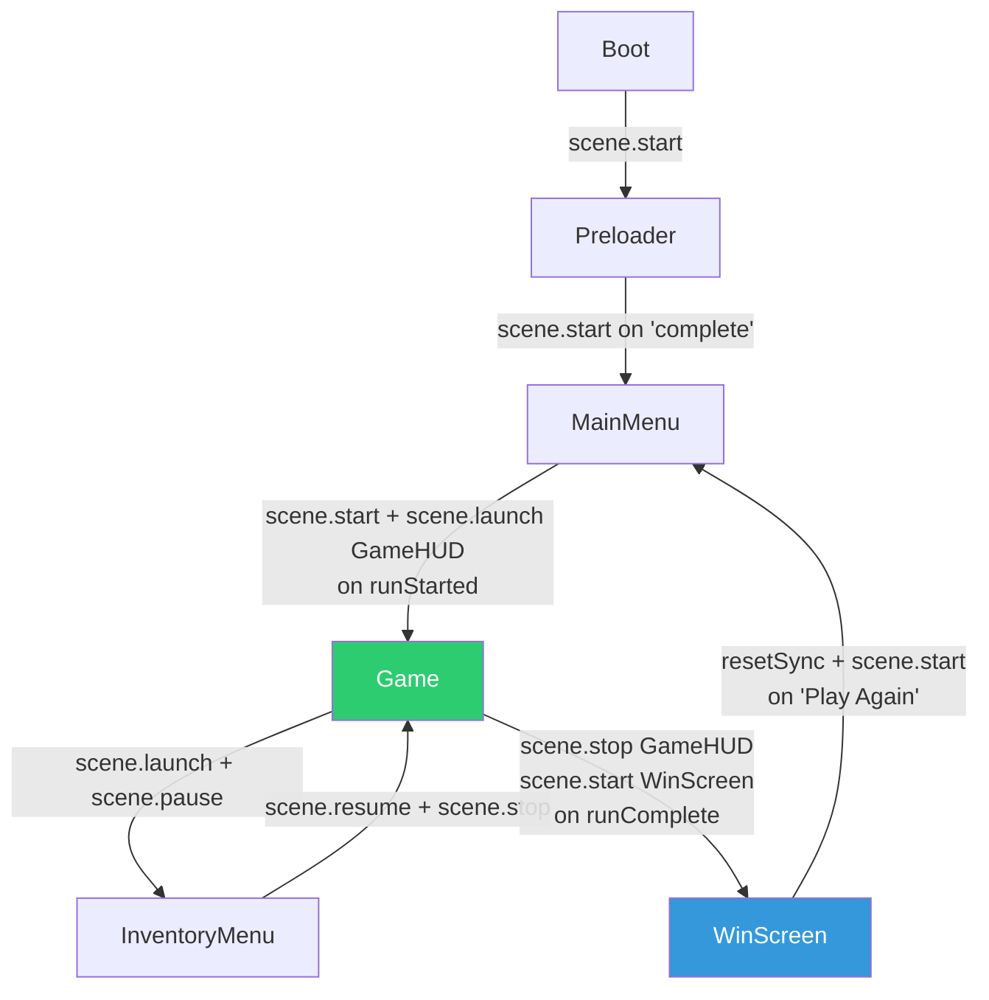

# 04 — Scenes

## Purpose

Defines the scene graph of the Phaser client: the canonical scene table (with file paths, roles, and ownership), the lifecycle pattern every scene follows, scene-to-scene transitions, the Game-plus-overlays concurrency model, and the HTML-overlay input trick that `MainMenu` uses because Phaser has no native text input. This is the client-side analogue of "which goroutines exist and when" on the server — here, "which scenes exist and when".

## Scene table (source of truth)

Append rows here when adding a new scene. Registration order in `client/src/game/main.ts` must match this list (the first entry is auto-started by Phaser).

| Key              | File                                             | Role                                                                     | Runs alongside |
| ---------------- | ------------------------------------------------ | ------------------------------------------------------------------------ | -------------- |
| `Boot`           | `client/src/game/scenes/Boot.ts`                 | Minimal bootstrap; loads a 1×1 fallback pixel so `Preloader` always has at least one texture. | — |
| `Preloader`      | `client/src/game/scenes/Preloader.ts`            | Loads atlases, images, and all 10 room tilemaps. Shows a progress bar.   | — |
| `MainMenu`       | `client/src/game/scenes/MainMenu.ts`             | Connects the WebSocket, takes a `player_id` via HTML overlay, drives `C2S_AUTH` + `C2S_START_RUN`. | — |
| `Game`           | `client/src/game/scenes/Game.ts`                 | Main gameplay: owns entity maps, reconciles S2C snapshots, forwards input. | `GameHUD`, `InventoryMenu` (while paused) |
| `GameHUD`        | `client/src/game/scenes/GameHUD.ts`              | Overlay: HP bar, timer, room indicator, weapon + ammo text. Polls state each frame. | `Game` |
| `InventoryMenu`  | `client/src/game/scenes/InventoryMenu.ts`        | Modal overlay: inventory list, selection, `C2S_USE_ITEM`. Pauses `Game` while open. | `Game` (paused) |
| `WinScreen`      | `client/src/game/scenes/WinScreen.ts`            | Run summary (total time, rank, splits) + live leaderboard + "Play Again". | — |

Scenes **not yet present** in the repo but referenced by older specs:

| Key             | Status       | Notes |
| --------------- | ------------ | ----- |
| `PauseMenu`     | Not created  | Mentioned in earlier `foundations/10-client-architecture.md` scene table. Register when implemented. |
| `ShopMenu`      | Not created  | Same. Scaffold file `client/src/game/shop.ts` exists as a placeholder module. |

When a new scene is added, update:

1. This table.
2. `client/src/game/main.ts` — import + include in the `scene: [...]` array.
3. [01-architecture.md](./01-architecture.md) — module layout tree.

## Canonical lifecycle

Phaser scenes have `preload → create → update → shutdown/destroy`. Our scenes use a consistent pattern:

```ts
export class ExampleScene extends Phaser.Scene {
    constructor() { super({ key: "Example" }); }

    preload(): void { /* per-scene asset loads — rare; Preloader does most */ }

    create(): void {
        // 1. Build Phaser GameObjects.
        // 2. Attach listeners on sync.state (event bus from [03-client-state.md]).
        // 3. Attach scene-local input listeners.
        // 4. Register this.events.on("shutdown", this.cleanup, this);
    }

    update(_time: number, _delta: number): void {
        /* per-frame work — only in scenes that need it (Game, GameHUD) */
    }

    private cleanup(): void {
        // Mirror every on() from create() with a matching off().
        // Destroy any manually-created DOM overlays (see MainMenu).
    }
}
```

Why the explicit `cleanup()` pattern:

- Phaser's `shutdown` event fires when a scene is stopped (but not destroyed). Subsequent `scene.start(...)` of the same key will re-invoke `create()` — so failing to detach listeners leaks them into the next run.
- Listeners on `sync.state` outlive scene instances because the emitter is module-scoped ([03-client-state.md](./03-client-state.md)). Without explicit detach, a stopped scene continues receiving events and touches destroyed `GameObjects`.

## Scene-to-scene transitions



### `scene.start` vs `scene.launch`

- `scene.start(key)` stops the current scene, then starts the target. Used for linear flow (Boot→Preloader→MainMenu, MainMenu→Game, Game→WinScreen).
- `scene.launch(key)` starts the target alongside the current scene. Both `create()` and both `update()`. Used for HUD overlays.
- `scene.pause(key)` freezes a scene's `update()` loop but keeps its `GameObjects` visible. Combined with `launch` to implement a modal overlay: `Game` is paused while `InventoryMenu` runs on top; `InventoryMenu.close()` calls `scene.resume("Game")`.

### Transition endpoints

| From scene       | Triggering event / input                               | Action                                                                           |
| ---------------- | ------------------------------------------------------ | -------------------------------------------------------------------------------- |
| `Boot`           | `create()` runs (after fallback pixel loaded)          | `scene.start("Preloader")`                                                       |
| `Preloader`      | `load.on("complete")`                                  | `scene.start("MainMenu")` (this is in `create()` of `Preloader`; `preload()` hooks `progress` + `loaderror`) |
| `MainMenu`       | user clicks "Start Run" + WebSocket open               | `sync.sendAuth(playerId)` → on `authOk` → `sync.sendStartRun()` → on `runStarted` → `scene.start("Game") + scene.launch("GameHUD")` |
| `Game`           | `E` pressed near pickup → `sync.sendInteract`; near door → `sync.sendEnterDoor`. See [07-input-controls.md](./07-input-controls.md). | No scene transition; server drives room via `S2C_ROOM_LOAD` which reuses `Game`. |
| `Game`           | `I` pressed                                            | `scene.launch("InventoryMenu"); scene.pause();`                                  |
| `InventoryMenu`  | `Esc` / `I` / `Enter` after use                        | `scene.resume("Game"); scene.stop();`                                            |
| `Game`           | `runComplete` event from `sync.state`                  | `scene.stop("GameHUD"); scene.start("WinScreen");`                               |
| `WinScreen`      | "Play Again" clicked                                   | Detach listeners; `resetSync()`; `scene.start("MainMenu");`                      |

### S2C_ROOM_LOAD reuses `Game`

Room transitions do **not** stop and restart the `Game` scene. The scene listens for `roomLoad` on `sync.state` and, in `onRoomLoad`, tears down every existing enemy/projectile/pickup/door GameObject and rebuilds from the new `RoomData`. This preserves the persistent `Player` entity (and its Phaser physics body) across rooms rather than recreating it each time, which gives cleaner visual continuity and stable local lerp targets. See `Game.onRoomLoad()` and [06-world-rooms.md](./06-world-rooms.md).

## Concurrency model — Game plus overlays

Phaser's scene manager runs scenes in the order they were added. During gameplay we have up to three concurrent scenes:

| Layer              | Scene          | Update runs? | Input receives? | GameObjects visible? |
| ------------------ | -------------- | ------------ | --------------- | -------------------- |
| Background         | `Game`         | Yes (or no if paused) | Yes (via `Controls`) | Yes               |
| HUD overlay        | `GameHUD`      | Yes          | No              | Yes (depth 1000+)    |
| Modal overlay (opt)| `InventoryMenu`| Yes          | Yes (captures) | Yes (depth 1001+)    |

When `InventoryMenu` is launched, `Game` is paused — its `update()` loop stops so the player character doesn't keep moving while the menu is open. `GameHUD` keeps running and updates HP / time / weapon text in real time. `InventoryMenu` owns its own keyboard (`Up/Down/Enter/Esc/I`), attached locally rather than through `Controls` (see [07-input-controls.md](./07-input-controls.md)), so there's no chance of an input double-trigger when returning to `Game`.

## `MainMenu` — connection + handoff

`MainMenu` has the most going on because it bridges three things: Phaser scene, HTML DOM overlay, and network bootstrap.

```mermaid
sequenceDiagram
    participant M as MainMenu
    participant S as GameStateSync
    participant DOM as HTML <input>
    participant SRV as Game server

    M->>DOM: mountTextInput(cx, cy) appends <input> to parent
    M->>S: sync.connect(WS_URL)
    S->>SRV: WS upgrade
    SRV-->>S: open
    S-->>M: promise resolves
    M->>M: statusText := "Connected"
    DOM->>M: user types player_id + presses Enter / click Start
    M->>S: sendAuth(playerId)
    S->>SRV: C2S_AUTH
    SRV-->>S: S2C_AUTH_OK { display_name }
    S-->>M: state.emit('authOk', displayName)
    M->>S: sendStartRun()
    S->>SRV: C2S_START_RUN
    SRV-->>S: S2C_RUN_STARTED { seed, room }
    S-->>M: state.emit('runStarted', seed, room)
    M->>M: scene.start("Game") + scene.launch("GameHUD")
```



### The HTML-overlay text input

Phaser has no native text input. `MainMenu.mountTextInput()`:

1. Creates a `<input type="text">` element, styles it with absolute positioning, and appends it to the canvas's parent (or `<body>`).
2. Computes its pixel position from the canvas bounding rect so it lines up with the Phaser-rendered label `"Player ID"` at scene coordinates `(cx, cy)`.
3. Re-positions the DOM input whenever the window resizes (`window.addEventListener("resize", handler)` + `this.scale.on("resize", handler)`).
4. Binds `keydown Enter` to `this.onStart()` so pressing Enter in the input starts the run.
5. Focuses the input via `setTimeout(..., 50)` — immediate focus fights Phaser's own bootstrap.

Cleanup (`MainMenu.cleanup()`) detaches both resize listeners and `.remove()`s the DOM element. Forgetting to detach means a stale input sits on top of `Game` after a run starts.

Note this is a legitimate-but-ugly integration. Future work: a thin `TextInput` utility that other scenes could reuse. For now, `MainMenu` is the only scene with this requirement.

## `Game` — the gameplay scene

`Game` is the single most complex scene and deserves a dedicated summary. Full rendering detail lives in [05-entities-rendering.md](./05-entities-rendering.md); this section covers the scene-lifecycle part.

### Scene-local state

```ts
class Game extends Phaser.Scene {
    player?: Player;
    enemies: Map<number, Enemy> = new Map();
    projectiles: Map<number, Bullet> = new Map();
    pickups: Map<number, Pickup> = new Map();
    doors: Map<number, Door> = new Map();
    backgroundObjs: Phaser.GameObjects.GameObject[] = [];
    controls!: Controls;
    inputSendAcc = 0;
}
```

- `enemies`/`projectiles`/`pickups`/`doors` are **maps keyed by server entity/projectile/door id**, not the scene's own ids. This is the authoritative join key used when reconciling against each `S2C_STATE`.
- `backgroundObjs` is a flat array of everything `paintRoomBackground()` produced (tilemap layers or the fallback tint + walls + badge). It exists solely so `onRoomLoad` can tear them down en masse. See [06-world-rooms.md](./06-world-rooms.md).
- `inputSendAcc` is a millisecond accumulator for the 20 Hz input-throttle (`INPUT_SEND_INTERVAL_MS = 50`). See [07-input-controls.md](./07-input-controls.md).

### Event subscriptions in `Game.create()`

```ts
sync.state.on("state", this.onServerState, this);
sync.state.on("roomLoad", this.onRoomLoad, this);
sync.state.on("doorUnlocked", this.onDoorUnlocked, this);
sync.state.on("entityDied", this.onEntityDied, this);
sync.state.on("runComplete", this.onRunComplete, this);
```

Mirror detach in `Game.cleanup()`. Each handler's responsibility:

| Handler             | Job                                                                                                       |
| ------------------- | --------------------------------------------------------------------------------------------------------- |
| `onServerState`     | Apply `player` snapshot; reconcile enemies against `payload.entities` (create missing, update existing, skip `state===3` dead flag); reconcile projectiles (create + despawn missing); sweep entities whose IDs entered `deadEntities`. |
| `onRoomLoad`        | Tear down `backgroundObjs`, `enemies`, `projectiles`, `pickups`, `doors`; rebuild from `RoomData` via `paintRoomBackground + buildRoom`; reposition persistent `Player`. |
| `onDoorUnlocked`    | `doors.get(id)?.setUnlocked(true);`                                                                       |
| `onEntityDied`      | Both `enemies.get(id)?.markDead()` and `pickups.get(id)?.setConsumed()` (server may reuse entity ids across entity types within a room; defensive handling is cheap). |
| `onRunComplete`     | `scene.stop("GameHUD"); scene.start("WinScreen");`                                                         |

### `Game.update()` responsibilities

`update(time, delta)` runs every frame (~60 FPS under Phaser's default). It does four things:

1. Advance per-entity smoothing: `player.tick(dt)`, `enemy.tick(dt)`, `bullet.tick(dt)`. Each lerps its sprite toward the server-set `targetX/targetY`. See [05-entities-rendering.md](./05-entities-rendering.md).
2. Accumulate `inputSendAcc` and every 50 ms send a `C2S_INPUT { dx, dy }`.
3. On `Controls.shootPressed()`, send a `C2S_SHOOT { aim_angle }`.
4. On `Controls.weaponSwitchPressed()` / `interactPressed()` / `inventoryPressed()`, fire the matching C2S or scene transition.

Input mapping details: [07-input-controls.md](./07-input-controls.md).

## `GameHUD` — read-only overlay

`GameHUD` reads state via polling (`getSync().state` in `update()`) rather than subscribing. It has five `GameObject`s:

| Object       | Source field                       | Notes                                                 |
| ------------ | ---------------------------------- | ----------------------------------------------------- |
| `timeText`   | `state.elapsedMs`                  | Formatted as `MM:SS.mmm`.                             |
| `roomText`   | `state.currentRoom` / `ROOM_COUNT` | `"Room {cur}/{ROOM_COUNT}"`.                          |
| `hpText`     | `state.player?.hp` / `PLAYER_MAX_HEALTH` | Plain text next to the HP bar.                   |
| `hpBarFill`  | same ratio                         | Width proportional to `hp / maxHp`; color shifts (green → yellow → red) at 60 % / 30 %. |
| `weaponText` | `state.player?.weapon_id`, `.ammo` | Looks up display name in `WEAPON_STATS` (see [client/src/game/weapons.ts](../../../client/src/game/weapons.ts) and [features/combat-weapons.md](../features/combat-weapons.md)). |

All HUD GameObjects are `setScrollFactor(0)` + `setDepth(1000+)` so they stay pinned to screen coords above the `Game` scene.

## `InventoryMenu` — modal overlay

- Snapshots `state.player?.inventory` at open time into a local `items` array so a mid-menu `S2C_STATE` doesn't renumber the highlighted row.
- Owns its own `KeyMap` rather than sharing `Controls` — Inventory keys are scene-local (Up/Down/Enter/Esc/I), and isolating them avoids an unintended re-trigger of `interactPressed` / `inventoryPressed` when returning to `Game`.
- `useSelected()` calls `sync.sendUseItem(name)` and then `close()`. The server-side effect (HP bump, time shift, whatever) arrives in the next `S2C_STATE` and is reflected by `GameHUD` without any further scene work.

See [features/inventory-items.md](../features/inventory-items.md) for what the server does with `C2S_USE_ITEM` (and how [BUG-09](../foundations/02-protocol.md#bug-09-json-case-insensitive-field-smuggling) and [BUG-10](../features/inventory-items.md#bug-10-rune-vs-byte-item-length-bypass) land).

## `WinScreen` — end-of-run summary

- Pulls `state.totalMs`, `state.rank`, `state.splits`, and `state.leaderboard` at `create()` time and renders two tables: splits on the left, top-10 leaderboard on the right.
- Subscribes to `state.on("leaderboard")` so late-arriving leaderboard updates refresh the table.
- "Play Again" detaches local listeners, calls `resetSync()` (which destroys the `GameStateSync` singleton), then `scene.start("MainMenu")`. The MainMenu scene's `create()` will create a fresh `GameStateSync` via `getSync()` and re-run the connection flow.

Why the detach-before-reset dance: `resetSync()` invalidates the old `state` emitter entirely. If we let `cleanup()` (run at scene shutdown after `scene.start`) try to `state.off(...)` against the **new** sync, we'd silently remove a listener that was never attached. `resetHandlersAttached = false` prevents the second detach.

## How to add a scene

1. Create `client/src/game/scenes/<Name>.ts` with `class <Name> extends Phaser.Scene { constructor() { super({ key: "<Name>" }); } }`.
2. Implement `create()` + optional `update()`. Use the canonical cleanup pattern above.
3. Import and append to the `scene: [...]` array in `client/src/game/main.ts`.
4. Append a row to the [Scene table](#scene-table-source-of-truth) in this file.
5. If the scene is triggered by a new server event, extend the typed event bus in `GameState.apply()` — see [03-client-state.md](./03-client-state.md).
6. If the scene needs new assets, extend `Preloader.preload()` — see [08-assets-pipeline.md](./08-assets-pipeline.md).

## Implementation notes

- Scene `key` strings should match the class name (e.g. `super({ key: "Game" })` in `class Game`). The transition code assumes this mapping.
- Don't use `scene.bringToTop` casually — the registration order controls depth among running scenes. We rely on `GameHUD` being registered after `Game` so it renders on top.
- If a scene needs to be reinitialised (e.g. after changing player id), use `scene.restart()` — but note that both the sync and the Phaser scene carry state, so in practice `resetSync()` + `scene.start` is clearer.
- Do not store references to other scenes' `GameObject`s. If `GameHUD` needs data from `Game`, read it from `sync.state` (the mirror). Direct cross-scene references break when one scene is stopped.

## Implementation status

Per the [Scene table](#scene-table-source-of-truth): `Boot`, `Preloader`, `MainMenu`, `Game`, `GameHUD`, `InventoryMenu`, `WinScreen` are implemented and wired up. `PauseMenu` and `ShopMenu` are future work; no placeholder files exist (except `client/src/game/shop.ts` which is a client-side data module, not a scene).

The spectator client (a slimmed-down variant that would mount `Game` + `GameHUD` only, bound to `/ws/spectate`) is greenfield — see [09-spectator-mode.md](./09-spectator-mode.md).

## Intentional bugs in this area

None. Scene files are presentation and must stay deterministic about state transitions. A scene that transitions on a client-side timer rather than a server event would skew `elapsedMs` displays and, worse, make replay verification vs. client logs meaningless.

## Cross-references

- [01-architecture.md](./01-architecture.md) — `Phaser.Game` config, scene registration.
- [03-client-state.md](./03-client-state.md) — events each scene subscribes to.
- [05-entities-rendering.md](./05-entities-rendering.md) — per-entity reconciliation inside `Game`.
- [06-world-rooms.md](./06-world-rooms.md) — `paintRoomBackground` / `buildRoom` called from `Game.create()` and `Game.onRoomLoad()`.
- [07-input-controls.md](./07-input-controls.md) — `Controls` facade used by `Game`.
- [08-assets-pipeline.md](./08-assets-pipeline.md) — what `Preloader` loads.
