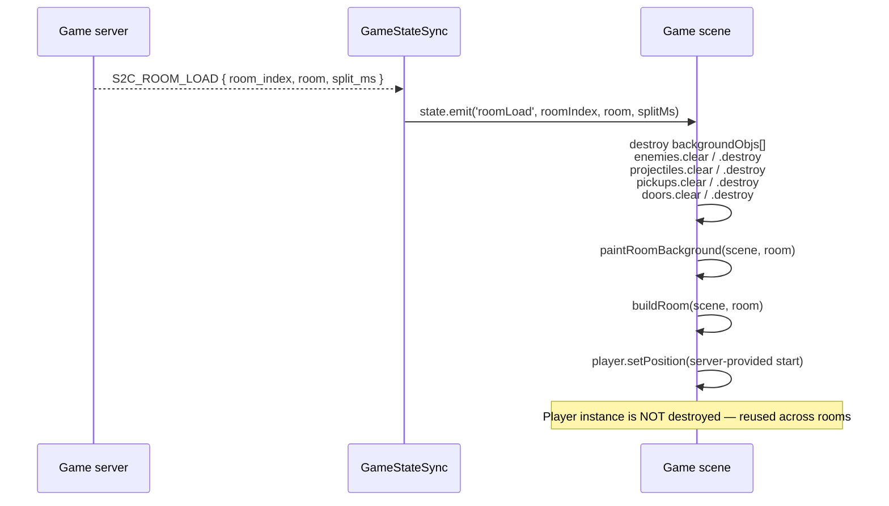

# 06 — World & Rooms

## Purpose

How a server-delivered `RoomData` becomes a rendered Phaser world. Covers `roomLayout.ts` (the only module between the protocol layer and per-entity rendering), the Tiled tilemap pipeline, the fallback-tint path that keeps rooms playable when tilemaps fail to load, the perimeter-wall generation, and the room-transition tear-down + rebuild flow driven by `S2C_ROOM_LOAD`.

## Module surface

`client/src/game/world/roomLayout.ts` exports three functions and two types:

| Export                | Role                                                                                                             |
| --------------------- | ---------------------------------------------------------------------------------------------------------------- |
| `paintRoomBackground` | Lays down the background + walls for a room. Returns every created `GameObject` so the caller can destroy them. |
| `buildRoom`           | Instantiates `Enemy`/`Pickup`/`Door` entities from `RoomData` and returns them in three id-keyed `Map`s.         |
| `clearRoom`           | Destroys every entity in a `RoomObjects` bundle and clears the maps.                                             |
| `RoomObjects`         | `{ enemies: Map<number, Enemy>, pickups: Map<number, Pickup>, doors: Map<number, Door> }`                         |
| `BuiltRoom`           | Alias for `RoomObjects`.                                                                                         |

Only `Game` consumes this module. The module itself has no persistent state — every call produces fresh `GameObject`s owned by the caller.

## Coordinate system and room dimensions

All rooms are **1280×768 pixels = 40×24 tiles at 32 px each**. Constants come from `constants.ts`:

```ts
export const ROOM_WIDTH = 1280;
export const ROOM_HEIGHT = 768;
export const ROOM_COUNT = 11;   // 10 dungeon rooms + 1 boss (boss tilemap TBD)
export const WIN_ROOM = 11;
```

Server and client must agree on these — the server sends pickup/enemy positions in the same coordinate space. The Tiled tilemaps on disk are authored at 40×24 tile grids, which is the source of the 1280×768 pixel size.

Origin `(0, 0)` is the top-left; `y` grows downward (Phaser default). No camera scrolling: the entire room is always on-screen simultaneously. The fit/center Phaser scale mode (see [01-architecture.md](./01-architecture.md)) letterboxes the 1280×768 onto the browser viewport without changing world coordinates.

## `paintRoomBackground` — the tilemap + fallback path

```mermaid
graph TD
    A["Game.create/onRoomLoad"] --> B["paintRoomBackground(scene, RoomData)"]
    B --> C{"tilemap cache<br/>has data.tilemap_id?"}
    C -->|yes| D["scene.make.tilemap({ key })"]
    D --> E["addTilesetImage(tilesetName, 'tilemap' or tilesetName)"]
    E --> F{"tileset ok?"}
    F -->|yes| G["createLayer per Tiled layer<br/>setDepth(-30)<br/>return layers"]
    F -->|no|  H["fall through"]
    C -->|no|  H
    H --> I["tintForRoom(data) → color"]
    I --> J["rectangle(1280×768, tint) depth -100"]
    J --> K["four wall rectangles depth -50"]
    K --> L["room-id debug badge depth -40 alpha 0.35"]
    L --> M["return all created"]

    style G fill:#2ecc71,color:#fff
    style M fill:#3498db,color:#fff
```

### Tilemap path (preferred)

Runs when `scene.cache.tilemap.exists(data.tilemap_id)` is true — i.e. `Preloader` successfully loaded `assets/rooms/<tilemap_id>.json`.

```ts
const map = scene.make.tilemap({ key: data.tilemap_id });
const tilesetNames = map.tilesets.map(t => t.name);
if (tilesetNames.length > 0) {
    const textureKey = scene.textures.exists("tilemap") ? "tilemap" : tilesetNames[0];
    const tileset = map.addTilesetImage(tilesetNames[0], textureKey);
    if (tileset) {
        for (const layerData of map.layers) {
            const layer = map.createLayer(layerData.name, tileset, 0, 0);
            if (layer) { layer.setDepth(-30); created.push(layer); }
        }
        return created;
    }
}
```

- **Why both `tilesetNames[0]` and `"tilemap"`:** Tiled JSON files store the tileset by name (author-chosen, usually the tileset image's base filename). The repo's convention is to have a single tileset image keyed as `"tilemap"` in Phaser's texture cache. We prefer that name when available; otherwise fall back to whatever `tilesetNames[0]` is.
- **Why `setDepth(-30)`:** the tilemap sits below entities (depth 0) and the player (depth 10). See the layering table in [05-entities-rendering.md#depth-layering](./05-entities-rendering.md#depth-layering).
- **Multiple layers:** Tiled files typically have a single `"tiles"` layer, but the code iterates `map.layers` so multi-layer authoring works if introduced later (e.g. a background tiles layer + a collision tiles layer).

### Fallback tint path

Runs when the tilemap cache lacks `tilemap_id`, or when tileset resolution fails, or when the loader throws. A single tinted rectangle covers the room, plus four 16 px perimeter walls in `#0a0a0a`, plus a debug text badge with `data.tilemap_id` in the top-right corner at alpha 0.35.

### `tintForRoom` — room palette

```ts
const ROOM_TINTS = [
    0x1a1a2e, 0x16213e, 0x0f3460, 0x2d2d44, 0x3b2417, 0x1f4529,
    0x402020, 0x254741, 0x3a1f5c, 0x202020, 0x502020, // (bloodroom — boss)
];
```

The tint is chosen by extracting the first integer from `tilemap_id` (e.g. `"room-3"` → 3) and indexing into the palette mod its length. If parsing fails, `room_index` is used instead. Each room gets a distinctive tint so players can tell rooms apart even without art — valuable during a seed-routing session where a player is repeatedly re-running the same room sequence.

Eleven tints for eleven rooms: the final `#502020` ("bloodroom") is reserved for the boss (room 11). The palette is cosmetic only — no gameplay logic depends on tint.

### Perimeter walls (fallback only)

Four `Rectangle`s at 16 px thickness, filled `WALL_COLOR = 0x0a0a0a`, depth -50. They're purely visual — **the client does not do wall collision**. The server owns collision (see [server-side tilemap collision](../../../server/main.go) — referenced in recent commit `55e2a99`). The walls exist so the tint-fallback room reads as "enclosed" rather than "empty colored rectangle."

When the tilemap path succeeds, the walls are skipped. The Tiled map's tile graphics imply wall geometry visually, and the server uses the **same** Tiled JSON for authoritative collision geometry. Source-of-truth alignment: both client visual and server collision read from the same `room-N.json` file.

### Debug badge

Small 12 px monospace text in the top-right of each room, showing `tilemap_id` verbatim (`"room-3"`, `"room-7"`, etc.) at alpha 0.35 and depth -40 (above the background, below entities). Only present in the fallback path. Aesthetic noise during a real run, but saves meaningful time during room-routing debugging.

## `buildRoom` — spawning entities from `RoomData`

```ts
function buildRoom(scene, data: RoomData): RoomObjects {
    const enemies = new Map<number, Enemy>();
    const pickups = new Map<number, Pickup>();
    const doors = new Map<number, Door>();

    for (const spawn of data.enemies)  enemies.set(spawn.entity_id, new Enemy(scene, /* ...as EntitySnapshot */));
    for (const spawn of data.pickups)  pickups.set(spawn.entity_id, new Pickup(scene, spawn));
    for (const def of data.doors)      doors.set(def.door_id, new Door(scene, def));

    return { enemies, pickups, doors };
}
```

Notes:

- **`EnemySpawn` → synthetic `EntitySnapshot`:** `Enemy` is constructed from an `EntitySnapshot`, so `buildRoom` fakes one with `state: 0` (Idle) and the spawn position. The first `S2C_STATE` after the `ROOM_LOAD` quickly replaces the target position with whatever the server's post-settle AI has chosen.
- **Maps keyed by server id:** `entity_id` for enemies/pickups, `door_id` for doors. These are the same keys `Game.onServerState` uses for reconciliation (see [05-entities-rendering.md](./05-entities-rendering.md)).
- **No collision setup:** we don't register Phaser physics bodies for any entity. The visual hit-tests for proximity UI (`nearestPickupId`, `nearestUnlockedDoorId`) are plain squared-distance scans in `Game.handleInput()` — see [07-input-controls.md](./07-input-controls.md).

## `clearRoom` — symmetric teardown

```ts
function clearRoom(objs: RoomObjects): void {
    objs.enemies.forEach(e => e.destroy()); objs.enemies.clear();
    objs.pickups.forEach(p => p.destroy()); objs.pickups.clear();
    objs.doors.forEach(d => d.destroy());   objs.doors.clear();
}
```

`Game` doesn't currently call `clearRoom` directly — it inlines the teardown in `onRoomLoad` alongside `backgroundObjs`. If the inline version and `clearRoom` diverge, consolidate to the single export. Left here as a utility for future scenes that need room-like teardown (e.g. a lobby preview scene).

## Room-transition flow



### Why `Player` survives room transitions

`player` persists because:

- The player's HP / weapon / coins / stacks are run-long state. Re-creating a new `Player` would mean re-reading all that from the next `S2C_STATE` — valid but noisy.
- The `Player` owns the HP-bar Graphics and sprite. Re-creating discards accumulated render state.
- Lerp continuity: the `Player`'s current rendered `(x, y)` is already on screen; on `S2C_ROOM_LOAD` we reposition it to the server-provided start (from `state.player`), and the next `S2C_STATE` re-targets as normal. Zero jitter.

### `split_ms`

Delivered in `S2C_ROOM_LOAD` but **not currently rendered** on the HUD (see [03-client-state.md](./03-client-state.md) implementation status). A future per-room splits column in `GameHUD` would consume this — format is the server's elapsed ms at door entry.

## Tilemap asset contract

Every room tilemap lives at `client/public/assets/rooms/room-N.json` and is registered in `Preloader.preload()`:

```ts
for (let i = 1; i <= ROOM_COUNT; i++) {
    this.load.tilemapTiledJSON(`room-${i}`, `assets/rooms/room-${i}.json`);
}
```

- **Key convention:** `"room-<n>"` (1-indexed). The server's `RoomData.tilemap_id` must match this — e.g. `{ tilemap_id: "room-3", ... }` for room 3.
- **Boss room (room 11):** `tilemap_id` is reserved; asset file is **not yet committed** (see [features/rooms-doors.md](../features/rooms-doors.md)). Until it exists, the fallback tint + walls path runs for room 11 with the bloodroom tint.
- **Tileset image:** `client/public/assets/tilemap.png` (32 px tiles, keyed as `"tilemap"` in Phaser). Tiled JSON references it by name.
- **Extruded variant:** `client/public/assets/topdown-tilesheet-extruded.png` exists for anti-bleeding at tile seams when Phaser filters; current code loads `tilemap.png` by default. If bleeding shows up, swap in the extruded variant.

For the asset pipeline generally, see [08-assets-pipeline.md](./08-assets-pipeline.md).

## Server / client room-data contract

What the client **must** receive on `S2C_RUN_STARTED` / `S2C_ROOM_LOAD`:

| Field              | Type                   | Meaning                                                        |
| ------------------ | ---------------------- | -------------------------------------------------------------- |
| `room_index`       | `uint8`                | Which room this is (1–11).                                     |
| `tilemap_id`       | `string`               | Phaser cache key for the tilemap. Matches `"room-N"`.          |
| `enemies`          | `EnemySpawn[]`         | Initial enemy positions + types + HP. Consumed by `buildRoom`. |
| `pickups`          | `PickupSpawn[]`        | Initial pickup positions + types.                              |
| `doors`            | `DoorDef[]`            | Doors with initial locked state + target room.                 |

The **client trusts all positions verbatim.** If the server's post-settle AI jitter ([foundations/07-determinism-seeding.md](../foundations/07-determinism-seeding.md)) has shifted an enemy, that shift lands in the next `S2C_STATE.entities` and `Game.onServerState` moves the rendered target. The initial paint is the server's own pre-jitter pose.

Client does NOT apply RNG / offsets / spawn validation locally. The Mob RNG is a server-side invariant; any attempt to replicate it on the client would introduce a divergence with no benefit.

## Implementation notes

- `paintRoomBackground` is pure (takes a scene, returns `GameObject[]`). Keep it that way — the return value is the teardown handle.
- The fallback path is **not** conditional on a flag — it's always the runtime safety net. Do not move it behind a `DEV` check.
- Tint selection is by `tilemap_id`, not `room_index`. Reason: if a future feature reuses a tilemap across multiple room indexes (e.g. a procedural retry), the visual tint stays tied to which tilemap, not which slot.
- When adding a new room (room 12+), three coordinated edits are required: bump `ROOM_COUNT`, add the tilemap JSON under `assets/rooms/`, add another tint to `ROOM_TINTS` or accept the mod-wrap. Server-side room wiring lives separately — see [features/rooms-doors.md](../features/rooms-doors.md).
- Do not add client-side walls/collision bodies. Any collision enforcement belongs on the server (see commit `55e2a99`).

## Implementation status

- `paintRoomBackground` + tilemap path: works; loads 10 room tilemaps.
- Fallback path: works; used for room 11 until the boss tilemap ships.
- `buildRoom` / `clearRoom`: implemented and used from `Game`.
- `split_ms` display in HUD: **not implemented** — data is captured in `GameState` events but not rendered.
- Camera following: **not needed** — rooms fit the viewport.
- Transition animation (fade between rooms): **not implemented**; current transition is instantaneous. A 200 ms fade-to-black would improve UX without affecting timing — future polish.

## Intentional bugs in this area

None. Room rendering is cosmetic. Visual bugs here would either hurt UX or (if they let the client walk through a server-blocked wall visually) confuse players about actual server state. Must stay correct.

Note: the server's collision geometry **is** read from the same Tiled JSONs — so if someone ships a malformed room tilemap, both client rendering and server collision drift together. Keep the tilemaps canonical.

## Cross-references

- [04-scenes.md](./04-scenes.md) — `Game.create()` and `Game.onRoomLoad()` are the only callers.
- [05-entities-rendering.md](./05-entities-rendering.md) — `Enemy`/`Pickup`/`Door` classes created here.
- [08-assets-pipeline.md](./08-assets-pipeline.md) — where room tilemaps are loaded.
- [foundations/02-protocol.md](../foundations/02-protocol.md) — `RoomData` shape.
- [foundations/07-determinism-seeding.md](../foundations/07-determinism-seeding.md) — server-side RNG that produces enemy offsets the client just paints.
- [features/rooms-doors.md](../features/rooms-doors.md) — room semantics, door state machine, BUG-03.
