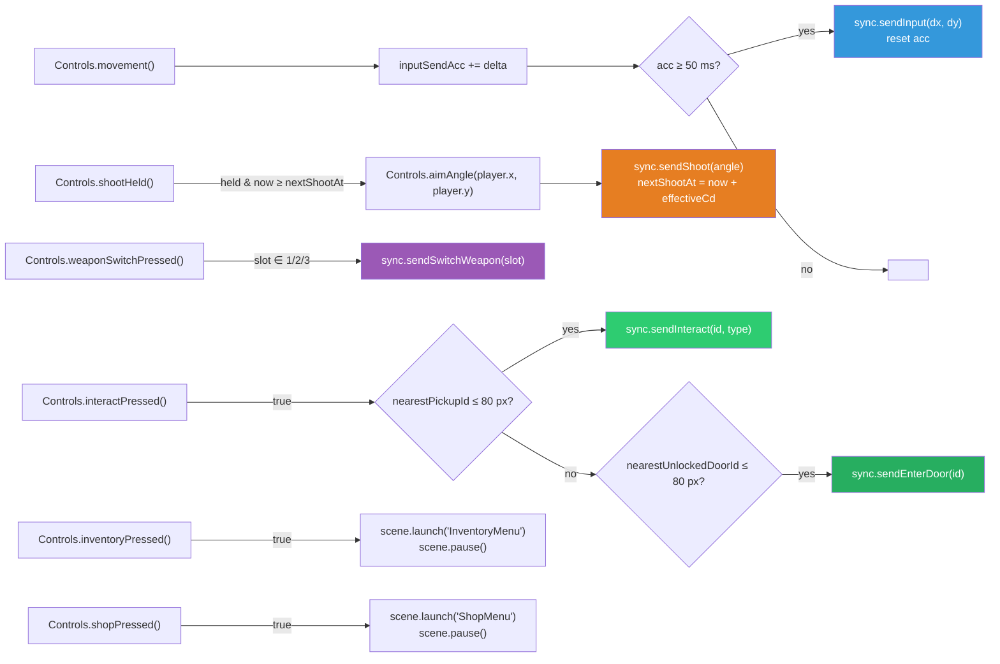

# 07 — Input & Controls

## Purpose

How physical input (keyboard, mouse) becomes C2S packets. Covers the `Controls` facade that abstracts Phaser input, the per-input semantics (held vs just-pressed vs edge-triggered), the outbound throttle, proximity-based target selection for `INTERACT`/`ENTER_DOOR`, and why the client does no gameplay gating. Input is the **only** path from user intent to the server — cheaters exploit the packet boundary; the stock client just feeds it honestly.

## Module surface

- `client/src/game/scenes/utils/Controls.ts` — exports `createControls(scene)` and the `Controls` type. The facade wraps a single Phaser scene's keyboard + pointer.
- `client/src/game/scenes/Game.ts` — the sole consumer. Holds one `Controls` instance and calls its methods from `update()`.
- `client/src/game/constants.ts` — hosts `INPUT_SEND_INTERVAL_MS = 50` (the 20 Hz throttle).

`InventoryMenu` does **not** use `Controls`; it owns its own keyboard bindings locally. Rationale: inventory keys (`Up`/`Down`/`Enter`/`Esc`/`I`) are scene-local and using a separate `KeyMap` avoids an inadvertent `interactPressed`/`inventoryPressed` double-trigger when the menu closes and `Game` resumes.

## `Controls` facade

```ts
export type Controls = {
    movement(): { dx: number, dy: number };
    aimAngle(pivotX: number, pivotY: number): number;
    shootHeld(): boolean;        // pointer button currently down (polled — drives hold-to-shoot)
    interactPressed(): boolean;  // Phaser JustDown on 'E'
    inventoryPressed(): boolean; // Phaser JustDown on 'I'
    shopPressed(): boolean;      // Phaser JustDown on 'B' — opens ShopMenu
    weaponSwitchPressed(): number | null; // 1/2/3 just-pressed → 1/2/3, else null
};
```

All methods are re-queried live — nothing is cached across ticks. Callers invoke them each frame (from `Game.update()`).

### Graceful degradation

If `scene.input.keyboard` is null (Phaser's keyboard plugin disabled or unavailable), `createControls` returns a **no-op facade** whose `movement()` is `{0,0}`, `shootHeld` always `false`, etc. The game still runs — it's just un-steerable. This matters for:

- Testing environments where the DOM / keyboard is absent.
- Future spectator mode ([09-spectator-mode.md](./09-spectator-mode.md)) which should reuse `Game` + `GameHUD` without accepting input.

## Key bindings

| Action                     | Keys                                  | Semantics        | Produces                                |
| -------------------------- | ------------------------------------- | ---------------- | --------------------------------------- |
| Movement                   | `W/A/S/D` + Arrow keys                | Held (per-frame) | `C2S_INPUT { dx, dy }` throttled to 50 ms |
| Aim                        | Mouse position                        | Polled each frame | Used as `aimAngle` argument to `shoot` |
| Shoot                      | Left mouse button (held)              | Polled per frame, throttled to weapon fire rate (½ rate while held — issue #62) | `C2S_SHOOT { aim_angle, released }` |
| Weapon slot 1/2/3          | `1`, `2`, `3` (just-pressed)          | Just-pressed     | `C2S_SWITCH_WEAPON { weapon_id }`       |
| Interact                   | `E`                                   | Just-pressed     | `C2S_INTERACT { target_id, claimed_type }` or `C2S_ENTER_DOOR { door_id }` (whichever is nearest); `claimed_type` is the rendered pickup's type — see [features/shop.md BUG-12](../features/shop.md#bug-12-pickup-type-confusion) |
| Open Inventory             | `I`                                   | Just-pressed     | `scene.launch("InventoryMenu")` (no C2S yet) |
| Open Shop                  | `B`                                   | Just-pressed     | `scene.launch("ShopMenu")` (no `C2S_SHOP_OPEN`; the menu is fully client-side until purchase) |
| Inventory: Up / Down / Enter / Esc / I | same keys (scene-local, in `InventoryMenu`) | Just-pressed | Use selected → `C2S_USE_ITEM`, or close menu |
| Shop: Up / Down / Enter / Esc / B | same keys (scene-local, in `ShopMenu`)      | Just-pressed | Purchase selected → `C2S_SHOP_PURCHASE`, or close menu |

Movement normalization: diagonal input is divided by `Math.hypot(dx, dy)` so the magnitude caps at 1. This is **client-side politeness** — the server is free to ignore or re-normalize. An exploiter who wants to send `dx=5, dy=5` just bypasses the client.

### Why both WASD and arrow keys

DVORAK/non-QWERTY users and left-handed players. Arrow keys provide the "works out of the box" path; WASD is the standard FPS/dungeon convention. `Controls.movement()` OR's them together.

### Aim uses world coordinates

```ts
const worldX = Number.isFinite(p.worldX) ? p.worldX : p.x;
const worldY = Number.isFinite(p.worldY) ? p.worldY : p.y;
return Math.atan2(worldY - pivotY, worldX - pivotX);
```

Preferring `worldX/Y` over screen `x/y` means future camera scrolling wouldn't warp the aim angle. Current rooms fit the viewport so `worldX === x`, but guarding now is free.

### Shoot polling

`Controls.shootHeld()` returns the live pointer state — it is polled every frame from `Game.handleInput()`:

```ts
shootHeld(): boolean {
    return scene.input.activePointer.leftButtonDown();
}
```

- **Hold-to-shoot.** Holding the left mouse button fires continuously, but at **half** the equipped weapon's max rate — `Game` tracks whether the button was released between shots and sets `C2S_SHOOT { released }` accordingly; the server applies `HoldFireCooldownMult` (×2) when `released=false`. Releasing stops fire on the next frame. See issue #62 for rationale.
- **Single click = one shot.** A click is just one frame (or a few) of "held"; the first held frame fires immediately because the throttle gate is reset on release (see [Shoot throttle](#shoot-throttle) below). Each click sends `released=true`, so spam-clicking stays at full weapon rate.
- **No edge detection needed.** The previous `shootPressed()` (frame-bounded just-pressed) was removed. Phaser's pointer API has no frame-bounded just-pressed for the main button, but we don't need one — first-frame-held is functionally equivalent for a hold-to-shoot model.

### Just-pressed for keyboard

`Phaser.Input.Keyboard.JustDown(key)` returns true only on the frame the key transitions from up to down. Used for every single-action key (`E`, `I`, `1`, `2`, `3`). Released → pressed → released → pressed fires once per transition, regardless of how long the key is held.

## Input → packet mapping in `Game.handleInput(delta)`



### Movement throttle

`inputSendAcc` accumulates frame delta in ms. Once it crosses `INPUT_SEND_INTERVAL_MS = 50`, a single `C2S_INPUT { dx, dy }` goes out and the accumulator resets. The server runs its tick at 20 Hz, so flooding input faster than 20/s would just burn bandwidth without changing behavior.

No packet is sent when the player is idle (`dx = dy = 0`), **but** that's an optimization choice, not a requirement: sending a zero-vector every 50 ms even when idle is also valid. The current code unconditionally sends — this is fine. If we ever wanted to drop idle sends, we'd have to make sure the server treats "no recent input" as stationary rather than as "last nonzero vector continues" — currently the server expects fresh input each tick.

### Shoot throttle

While the left mouse button is held, `Game.handleInput` rate-limits outbound `C2S_SHOOT` to the equipped weapon's effective fire rate:

```ts
const id = weaponFromServerId(sp.weapon_id);
const baseCd = WEAPON_STATS[id].cooldownMs;
const stacks = sp.fire_rate_stacks ?? 0;
this.nextShootAt = now + baseCd / (1 + 0.1 * stacks);
```

The formula matches the server's fire-rate stack math (`server/internal/game/combat.go`). On release, `nextShootAt` resets to 0, so a fresh click fires on the very next frame with no perceived delay.

This is a **bandwidth shaper, not a server-policy gate**. The throttle's only job is to avoid spamming packets that are too early for the equipped weapon's current effective cooldown — at 60 fps a held button would otherwise emit ~60 `C2S_SHOOT`/sec for a shotgun whose 520 ms cooldown only accepts ~2/sec. So the client throttle matches the server's **per-weapon fire-rate acceptance rate** (for the equipped weapon, with current upgrade stacks), but it does **not** guarantee that every emitted shoot will be accepted. Specifically, the client does **not**:

- Predict swap cooldowns (the 400 ms post-`C2S_SWITCH_WEAPON` lockout). Shoots fired during a swap lockout are still sent and the server still rejects them.
- Predict damage-batch overflow ([BUG-07](../features/combat-weapons.md)) or any other server-side rejection beyond fire rate.
- Suppress shoots for any reason other than "too soon for the equipped weapon."

So `BUG-04` (swap cancel) and `BUG-07` are still observable from the stock client — the throttle never hides them, because it only filters per-weapon cooldown spam and leaves other server-side checks untouched.

Why we accept the formula coupling now: `WEAPON_STATS` is already mirrored client-side for HUD/shop display, and `fire_rate_stacks` is part of every player snapshot. Computing the effective cooldown costs nothing extra and is necessary to stop shotgun-hold from flooding the wire 30× over.

Visual cooldown polish (greyed-out weapon icon when on cooldown) could be driven from the same `nextShootAt` field if we wanted it later — still as polish, not a gate.

### Interact precedence: pickup before door

```ts
if (Controls.interactPressed()) {
    const nearest = nearestPickup(px, py, 80);   // returns { id, type } | null
    if (nearest !== null) {
        sync.sendInteract(nearest.id, nearest.type);   // claimed_type = the type the client rendered
    } else {
        const doorId = nearestUnlockedDoorId(px, py, 80);
        if (doorId !== null) sync.sendEnterDoor(doorId);
    }
}
```

The honest client always sends `claimed_type = pickup.type` (the type stored client-side from `RoomData` / runtime spawns), so the [BUG-12](../features/shop.md#bug-12-pickup-type-confusion) substrate is invisible to a stock-client player. An exploiter who wants to mint coins from non-coin pickups builds a custom client that sends a different `claimed_type`.

Pickup wins when there's both a pickup and an unlocked door within 80 px. Reason: the player is usually still fighting when doors unlock; they'll want to grab nearby loot before transitioning. If a level ever places a pickup directly on top of a door, the pickup-first rule means the player can grab it then press E again to enter.

80 px is a **client UX constant**, not a server gate. The server's `C2S_INTERACT` handler has its own (buggy, see [features/pickups.md#bug-05-interact-range-bug](../features/pickups.md#bug-05-interact-range-bug)) range of 2500 px. The client's 80 px threshold exists so the player can't accidentally pick up pickups across the room. The server accepts the interact regardless of distance — an exploiter who wants cross-room pickups just builds a custom client that ignores the 80 px gate.

Crucially, this is **not a "fixed version of BUG-05"** — the bug lives server-side, and the stock client's tighter range simply means the honest player has a reasonable UX. If the client used the server's 2500 px check, every `E` press would trigger the nearest pickup anywhere in the room, which is confusing even if it's the server-allowed behavior.

### `nearestPickupId` / `nearestUnlockedDoorId`

```ts
private nearestPickupId(x, y, radius): number | null {
    let bestId: number | null = null;
    let bestDist = radius * radius;
    for (const [id, pk] of this.pickups) {
        const d2 = (pk.x - x) ** 2 + (pk.y - y) ** 2;
        if (d2 <= bestDist) { bestDist = d2; bestId = id; }
    }
    return bestId;
}
```

- Radial (`dx² + dy² ≤ r²`), not axis-separated. The server's pickup handler is deliberately axis-separated + over-large ([BUG-05](../features/pickups.md#bug-05-interact-range-bug)); the client's radial check is just honest UX.
- Iterates all pickups per press. Cheap — rooms have a handful of pickups. If that grows, a spatial hash would help; currently not worth the complexity.
- Skips consumed pickups implicitly because they've already been removed from the `pickups` map in `Game.onServerState`'s dead-entity sweep.

Doors: same pattern, but filtered by `state.unlockedDoors.has(id)` — locked doors are not candidates for `C2S_ENTER_DOOR`. Note: the server-side door handler only cares about `Unlocked` state, not distance ([features/rooms-doors.md#bug-03-door-skip-no-proximity](../features/rooms-doors.md#bug-03-door-skip-no-proximity)). So again, the 80 px client gate is UX-only; a custom client can skip it.

### Inventory toggle

```ts
if (Controls.inventoryPressed()) {
    scene.launch("InventoryMenu");
    scene.pause();
}
```

The `I` key opens the inventory. `InventoryMenu` owns its own keys for while-open (Up/Down/Enter/Esc/I) — pressing `I` inside the menu closes it. See [04-scenes.md#inventorymenu-modal-overlay](./04-scenes.md#inventorymenu--modal-overlay).

### Shop toggle

```ts
if (Controls.shopPressed()) {
    scene.launch("ShopMenu");
    scene.pause();
}
```

The `B` key opens the shop. `ShopMenu` owns its own keys for while-open (Up/Down/Enter/Esc/B) and dispatches `C2S_SHOP_PURCHASE { item_id }` on Enter. The shop is fully client-side until purchase — there is no `C2S_SHOP_OPEN` packet. See [features/shop.md](../features/shop.md).

## No client-side gating

Repeatedly stressed in adjacent specs, worth restating here because input is where the temptation is strongest:

- **Do not** suppress a `sendShoot` because the server *might* reject it (swap lockout, damage batch, etc.). The hold-to-shoot throttle (see [Shoot throttle](#shoot-throttle)) is allowed because it shapes bandwidth using the *exact* server-accepted rate for the equipped weapon — it never refuses a shoot the server would have accepted, so it doesn't divide stock-client behavior from custom-client behavior in any way the player can observe.
- **Do not** suppress a `sendSwitchWeapon` because the weapon is "already equipped." The server tolerates; ignoring it costs nothing.
- **Do not** suppress a `sendInteract` because the nearest pickup is outside 80 px. The 80 px is a target-selection threshold; pressing `E` with no target within range simply sends nothing. That's different from refusing a server-sanctioned interact.
- **Do not** enforce ±30 min window on `start_time` before `sendStartRun`. The server validates that with `|start_time − time.Now()| ≤ 30 min`; the client just passes `Date.now()`.

The one grey area is the 80 px `radius` — that **does** gate the packet, but only because without it there's no natural target to send to. The "gate" is target selection, not server-policy enforcement.

## Edge cases

- **Focus loss / tab switch:** when the browser loses focus, held keys don't fire `keyup`, so `isDown` can get stuck. Phaser's keyboard plugin handles the common case (the `blur` listener resets keys). If a stuck-key bug ever surfaces, the fix is a `window.addEventListener('blur', () => ...)` in `createControls` — not currently needed.
- **Multi-key combinations:** there's no `Shift`/`Ctrl` modifier handling. If combinations are ever needed, extend the `KeyMap` and add a method like `dashPressed(): boolean`.
- **Pointer outside canvas:** aim angle is still computed from pointer world coords. If the pointer leaves the canvas (outside 1280×768), the angle still math-works; the shot goes toward wherever the pointer is, even off-canvas. No clamp needed — server doesn't clamp either; the projectile just flies off.
- **Keyboard IME:** Phaser's input layer doesn't deal with IME composition; since all our keys are single Latin characters, this isn't an issue. If we ever support a chat overlay, we'd use an HTML overlay (same pattern as `MainMenu`'s text input) rather than trying to capture IME through Phaser.

## Implementation notes

- Keep `Controls` stateless across methods except for the `shootEdge` flag. Adding scene-tied input state here couples `Controls` to Phaser's lifecycle; we want it reconstructible.
- When adding a new action, add a method to `Controls` + its key binding + a `KeyMap` field. Do not leak `Phaser.Input.Keyboard.Key` objects to callers — the facade's job is to hide them.
- `INPUT_SEND_INTERVAL_MS` should stay at 50 ms to match the 20 Hz server tick. Sending faster is wasteful; sending slower introduces visible input lag.
- Left-handed WASD-replacement (ESDF, for example) is possible but not currently wired. If a settings menu ever exists, remap through updating the `KeyMap` rather than introducing a key-name indirection layer.
- The movement normalization (`mag > 1` branch) is the current cap. If future mechanics introduce sprint / walk, normalize to a specific length (`dx/mag * speedMult`) rather than raising the cap — the server still expects normalized input in [-1, 1] per axis.

## Implementation status

- `Controls` facade, `Game.handleInput`, and `InventoryMenu`'s local bindings all exist and work.
- `shootHeld()` drives hold-to-shoot for all weapons. The per-weapon throttle is computed from `WEAPON_STATS[id].cooldownMs` and `player.fire_rate_stacks` each fire.
- Weapon slots 1/2/3 map to pistol/rifle/shotgun (server ids 1/2/3). The client uses `weaponFromServerId()` to translate the server's numeric id to the client-side `WeaponId` — do NOT index into `ALL_WEAPON_IDS` with the server id directly.
- No touch / gamepad support — desktop-keyboard-and-mouse only. Adding touch would involve a virtual joystick + tap-to-interact, and is not in scope for DEF CON.

## Intentional bugs in this area

None. Input is the honest-player's conduit; exploits happen on the wire, not here. Do not introduce client-side gates that would make the stock client diverge from what a custom client would send (that only punishes the honest player).

## Cross-references

- [04-scenes.md](./04-scenes.md) — `Game.handleInput()` site and `InventoryMenu` scene-local keys.
- [02-net-sync.md](./02-net-sync.md) — `send*` helpers this module invokes.
- [05-entities-rendering.md](./05-entities-rendering.md) — `Player` position used by `aimAngle`.
- [06-world-rooms.md](./06-world-rooms.md) — `pickups` / `doors` maps that `nearestXxx` scans.
- [features/combat-weapons.md](../features/combat-weapons.md) — server-side weapon model; `WEAPON_STATS` mirror.
- [features/pickups.md](../features/pickups.md) — BUG-05 and the server's axis-separated range.
- [features/rooms-doors.md](../features/rooms-doors.md) — BUG-03 and the server's no-proximity door handler.
