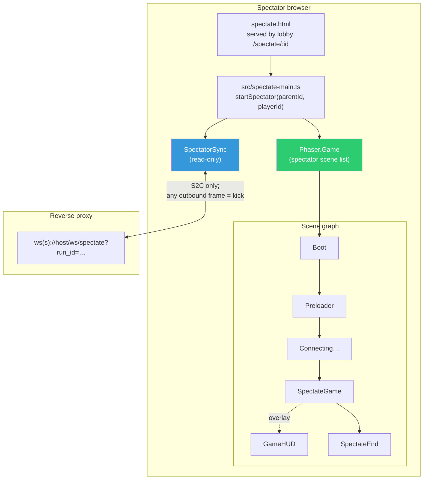
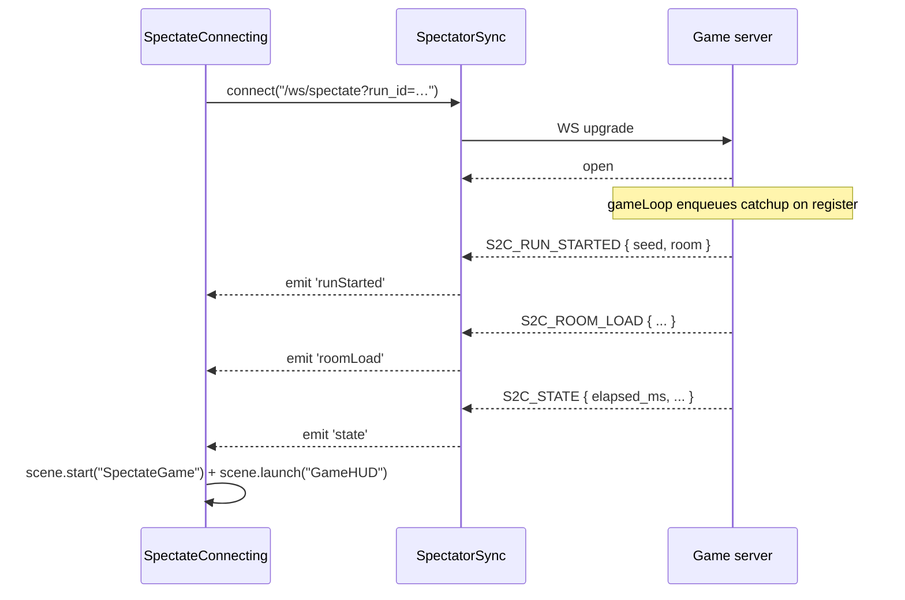
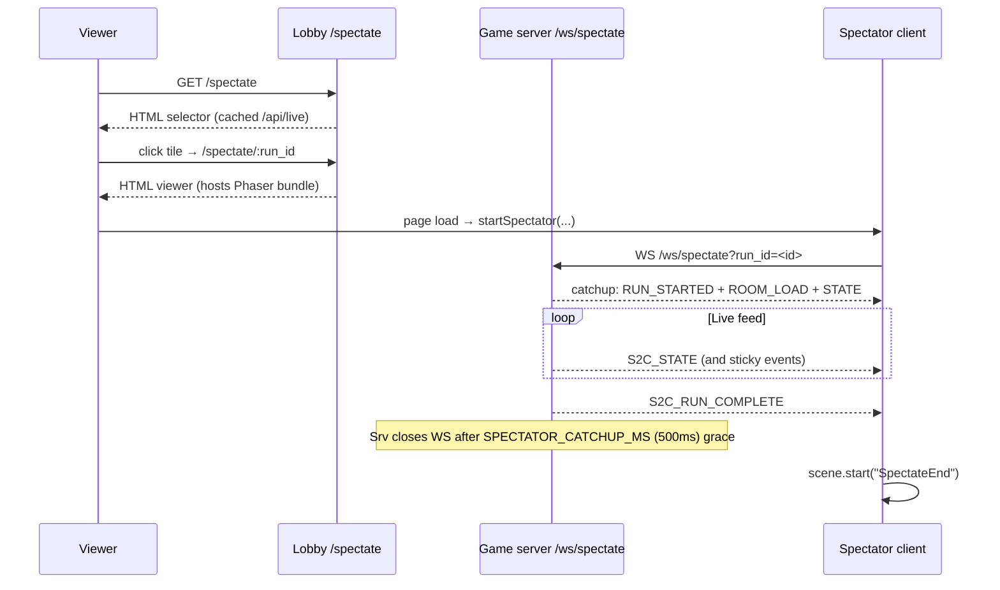

# 09 — Spectator Mode

## Purpose

Defines the client-side variant that renders a live player's run **without participating in it** — the read-only Phaser viewer served at `/spectate/:run_id`. Implemented in #23 alongside server-side spectator fan-out (see [foundations/02-protocol.md#spectator-protocol](../foundations/02-protocol.md#spectator-protocol) and [foundations/05-server-runtime.md#spectator-fan-out](../foundations/05-server-runtime.md#spectator-fan-out)).

## Why a separate client mode

The spectator UX overlaps the player UX almost completely — same rooms, same entities, same HUD metrics — but the differences are **load-bearing for exploit integrity**:

- Spectators must not send C2S packets (the server closes the WS on any frame, with `S2C_ERROR { code: "SPECTATOR_READ_ONLY" }`). A stock spectator client that accidentally fires `C2S_INPUT` bricks itself.
- Spectators attach mid-run; they need a catchup sequence instead of a fresh `RUN_STARTED`.
- Spectators see `seq: 1..N` fresh per attach — they can't assume the stream starts at the run's first tick.

These differences mean the spectator client is **a siblng to the player client**, not a runtime flag inside it. Mixing the two at runtime risks an accidental input path surviving lint and firing on a live spectator session.

## Runtime shape



## Differences from the player client

| Area                       | Player client                                                      | Spectator client                                                              |
| -------------------------- | ------------------------------------------------------------------ | ----------------------------------------------------------------------------- |
| WebSocket URL              | `/ws`                                                              | `/ws/spectate?run_id=<uuid>` (from the URL path)                           |
| First frames received      | `S2C_AUTH_OK` → `S2C_RUN_STARTED`                                   | **Catchup sequence**: `S2C_RUN_STARTED` + most-recent `S2C_ROOM_LOAD` + most-recent `S2C_STATE`, then live stream. See [foundations/02-protocol.md#catchup-snapshot-on-attach](../foundations/02-protocol.md#catchup-snapshot-on-attach). |
| C2S packets sent           | All 8 C2S types                                                    | **None**. `SpectatorSync` has no `send*` methods. Any accidental outbound frame is a programming error. |
| `seq` continuity           | Starts at 1, increments per C2S                                    | Not applicable (no C2S). Inbound `seq` is per-spectator from the server's reset. |
| Controls                   | Full `Controls` facade                                             | No input wiring. `Game`-variant scene ignores keyboard/mouse entirely.         |
| MainMenu                   | Player ID input, auth, start run                                   | Replaced by a minimal "Connecting to {display_name}…" scene that waits for catchup then transitions. |
| WinScreen                  | Shows rank + "Play Again" → resets                                 | Replaced by `SpectateEnd` — shows the player's final time + rank, with "Back to selector" link.   |
| Disconnect behavior        | Hard error; surfaces to UI; no reconnect.                          | Same — if spectator WS drops, user is taken to `SpectateEnd` with a "connection lost" message.   |
| Run-complete behavior      | Transitions to `WinScreen`.                                        | Shows `SpectateEnd`. Server sends final `S2C_RUN_COMPLETE` and closes after the 500 ms `SPECTATOR_CATCHUP_MS` grace window. |

## Module layout (target)

```
client/
└── src/
    ├── spectate-main.ts                       ← entry point (mirrors main.ts)
    ├── net/
    │   └── packet.ts                          ← SHARED with player client; no changes
    └── game/
        ├── spectate-main.ts                   ← Phaser.Game config for spectator scene list
        ├── net/
        │   ├── SpectatorSync.ts               ← read-only WS owner (sibling to GameStateSync)
        │   └── runContext.ts                  ← exposes getSpectatorSync() in addition to getSync()
        └── scenes/
            ├── SpectateBoot.ts                ← trivial; reuse Boot.ts if feasible
            ├── SpectatePreloader.ts           ← reuse Preloader.ts
            ├── SpectateConnecting.ts          ← waits for catchup sequence
            ├── SpectateGame.ts                ← clone of Game.ts with input stripped
            ├── GameHUD.ts                     ← REUSED unchanged (polls state; doesn't send input)
            └── SpectateEnd.ts                 ← terminal screen
```

Alternative: one binary that detects `window.location.pathname.startsWith("/spectate/")` and branches. **Rejected** because the lint surface for "no C2S from spectator" gets harder — better to have two Phaser.Game bootstraps that never share a module that can send.

## `SpectatorSync` contract

Structural sibling of `GameStateSync`:

```ts
class SpectatorSync {
    state = new GameState();     // same GameState class; spectator is just a reader
    private ws?: WebSocket;

    connect(url: string): Promise<void> { /* WS open + onmessage → state.apply */ }
    close(): void;
    isConnected(): boolean;
    // NO send* methods. At all.
}
```

Key invariants:

- **No `send*` methods compiled in.** The class physically cannot send; accidentally calling `ws.send(...)` from this class is a lint-visible change to the file.
- **Accept any `S2CType`.** `GameState.apply()` is already exhaustive on `S2CType`; `SpectatorSync` delegates unchanged.
- **`S2C_AUTH_OK` is not delivered** to spectators (per protocol spec) — so `state.displayName` starts undefined. The lobby's `/api/live` feed can pre-populate it via URL query (`?name=aluminum-fox`) so the `SpectateConnecting` scene can show who you're watching.
- **`S2C_ERROR { code: "SPECTATOR_READ_ONLY" }` handling:** if the server ever sends this (shouldn't, since we never send), `SpectateEnd` surfaces the message. If the spectator client is written correctly, this is unreachable.

### Why reuse `GameState`

`GameState` is pure data + event bus (see [03-client-state.md](./03-client-state.md)). It has no sender affordance. Scenes that subscribe to `state` events work identically whether the backing sync is a player or spectator — this is the clean separation. Duplicating `GameState` would force a second `apply()` switch that could drift.

## `SpectateConnecting` scene

Purpose: bridge from page-load → catchup-received → `SpectateGame` handoff.



The scene shows a message like `Watching aluminum-fox… (waiting for first frame)` and transitions the moment the third catchup packet (`S2C_STATE`) fires. If the server closes the WS mid-handshake (e.g. target player disconnected), transition straight to `SpectateEnd` with the error.

## `SpectateGame` scene

Structural copy of `Game.ts` with deliberate surgery:

| Removed                                                | Kept                                                         |
| ------------------------------------------------------ | ------------------------------------------------------------ |
| `Controls` instance + `update()` input handling        | `update()` entity lerping                                    |
| `sync.sendInput / sendShoot / sendSwitchWeapon / sendInteract / sendEnterDoor` | `sync.state.on('state')` reconciliation                      |
| `inputSendAcc` + 50 ms throttle                        | `onServerState` / `onRoomLoad` / `onDoorUnlocked` / `onEntityDied` |
| `scene.launch("ShopMenu")` on `B`                      | Full entity/projectile rendering                             |
| `onRunComplete → WinScreen`                            | `onRunComplete → SpectateEnd`                                |

Scene listens to the **same events** on the same `GameState`. A spectator sees every visual quirk the player sees — [BUG-11 kill-log corruption](../foundations/05-server-runtime.md#bug-11-kill-log-append-race) shows up as identically-garbaged KillLog entries; [BUG-06 settle race](../foundations/05-server-runtime.md#bug-06-concurrent-room-settle-race) shots visibly land pre-move on the next `S2C_STATE`; [BUG-02 drift](../foundations/05-server-runtime.md#bug-02-drift-tick-stretching) makes physics run fast on the viewer's screen too. **This is the point** — spectating is the show of exploits as they happen. See [foundations/05-server-runtime.md#interaction-with-intentional-bugs](../foundations/05-server-runtime.md#interaction-with-intentional-bugs).

### GameHUD is reused unchanged

`GameHUD` polls `getSpectatorSync().state` (via an updated `runContext` helper) just as it would `getSync().state` in the player client. It shows the player's HP, weapon, room, and timer exactly as the player sees them.

The HUD does NOT distinguish spectator from player — both see the same values. Consider a small badge `"SPECTATOR: aluminum-fox"` in the top-center as polish.

## `SpectateEnd` scene

Terminal screen. Shows:

- `display_name` (from URL query or catchup-received leaderboard).
- Final `total_ms` + `rank` if `S2C_RUN_COMPLETE` was received.
- Reason for end: `"Run complete"` / `"Player disconnected"` / `"Connection lost"` / `"Spectator limit reached"` (from the `S2C_ERROR.code`).
- Top-10 leaderboard (from `state.leaderboard`).
- **"Back to selector"** button → `window.location.href = "/spectate"`.
- **"Watch another live game"** link if `/api/live` lists others — could embed a mini-selector inline.

## Lifecycle



## Read-only enforcement — three layers

1. **Class-level (compile time):** `SpectatorSync` has no `send*` methods. Any attempt to add one reviews poorly.
2. **Scene-level (runtime):** `SpectateGame` never instantiates `Controls`. No call site produces outbound frames.
3. **Server-level (authoritative):** if anything slips through, the server closes the WS with `S2C_ERROR { code: "SPECTATOR_READ_ONLY" }`, and the client routes this to `SpectateEnd`. See [foundations/02-protocol.md#read-only-enforcement](../foundations/02-protocol.md#read-only-enforcement).

The three layers are belt-and-braces: a well-written spectator client never hits layer 3, but the server enforces regardless.

## Caps visible to the client

Spectator caps live on the server (see [foundations/04-lobby.md#caps-and-abuse-resistance](../foundations/04-lobby.md#caps-and-abuse-resistance) and [foundations/05-server-runtime.md#caps-and-configuration](../foundations/05-server-runtime.md#caps-and-configuration)):

- Per-game cap 50; global cap 200; per-IP new-connect rate 5/min; idle timeout 60 s.

When a spectator connects and any cap is exceeded, the server returns HTTP `503` on the WS upgrade with `Retry-After: 5`. The client must handle this by showing a "server is full, try again in a moment" screen and automatically retrying after 5 seconds (up to a couple of tries) before giving up. `SpectateConnecting` owns the retry loop.

## Implementation status

Shipped in #23. Files:

- `client/src/spectate-main.ts` — entry that reads `/spectate/:run_id` from `window.location.pathname` and the optional `?name=…` query, then calls `startSpectator`.
- `client/src/game/spectate-main.ts` — Phaser config with the spectator scene list (`Boot`, `Preloader`, `SpectateConnecting`, `SpectateGame`, `GameHUD`, `SpectateEnd`). Seeds the registry with `nextScene = "SpectateConnecting"` and the run_id / display_name in `callbacks.preBoot`.
- `client/src/game/net/SpectatorSync.ts` — read-only sync, no `send*` methods. Owns the same `GameState` class as the player.
- `client/src/game/scenes/SpectateConnecting.ts` — opens the WS, transitions on the first catchup `STATE`. Cap-503 retry loop: 3 attempts at 5 s spacing; final failure → `SpectateEnd`.
- `client/src/game/scenes/SpectateGame.ts` — structural copy of `Game.ts` with all input wiring stripped. Adds an absence-based prune of `enemies` / `pickups` so dead mobs / consumed pickups from the cached `S2C_ROOM_LOAD` are despawned for spectators that attached after they died (which is everyone, since `S2C_ENTITY_DIED` events for pre-attach kills aren't replayed).
- `client/src/game/scenes/SpectateEnd.ts` — terminal screen with reason / final time / rank / "Back to selector" link.

Player-client surfaces touched:

- `Preloader.create` reads `nextScene` from the registry; defaults to `MainMenu`. Player flow unchanged.
- `runContext` exposes `getSpectatorSync` / `resetSpectatorSync` / `setActiveState` / `getActiveState`. `GameHUD` now reads `getActiveState` so it works for both flows; player flow defaults to `getSync().state`.
- `Player` gains a `useSnapshotAim` constructor flag. When true, `applySnapshot` reads the new `aim_angle` field (radians) from `PlayerSnapshot` and `tick()` skips its cursor read. Player flow defaults to off — local cursor still wins for the actual player.

Vite multi-entry: `client/index.html` (player) + `client/spectate.html` (spectator) both build into `dist/`. Caddy serves `/spectate/:run_id` viewer URLs by rewriting to `/spectate.html` (single non-empty path-segment matcher, with `<base href="/">` in the HTML for asset resolution).

## Implementation notes

- Build the spectator bundle as a second Vite entry point (not a runtime branch). Vite supports multi-entry via `build.rollupOptions.input`. Keeps the player bundle lean.
- Reuse as much as possible: `packet.ts`, `GameState`, `constants.ts`, `weapons.ts`, `entities/*`, `world/roomLayout.ts`, `GameHUD.ts`. Do NOT reuse `Game.ts` or `MainMenu.ts` — they both carry input code.
- Do not add a "lobby spectate pane" inside the player client itself. Spectator mode is a separate URL and a separate bundle; the player client should never be able to open a spectator WS.
- Consider freezing the HUD timer + elapsed_ms on `runComplete` so it stops at the final time rather than continuing to tick server_ts.

## Intentional bugs in this area

None. The spectator client is a presentation surface that must faithfully render the live stream. Bugs here are either (a) cosmetic drift with the player client, or (b) accidental C2S — both strictly unacceptable.

Spectators see intentional-bug **artifacts** in the stream (BUG-02 drift, BUG-06 settle shots, BUG-11 kill-log garbage). This is the entertainment value of the spectator mode, not a separate bug class.

## Cross-references

- [01-architecture.md](./01-architecture.md) — Phaser bootstrap (spectator parallels this).
- [02-net-sync.md](./02-net-sync.md) — the sync class `SpectatorSync` mirrors minus send.
- [03-client-state.md](./03-client-state.md) — shared `GameState`.
- [04-scenes.md](./04-scenes.md) — scene lifecycle pattern used by `SpectateGame`.
- [05-entities-rendering.md](./05-entities-rendering.md) — entity classes reused.
- [06-world-rooms.md](./06-world-rooms.md) — room rendering reused.
- [foundations/02-protocol.md#spectator-protocol](../foundations/02-protocol.md#spectator-protocol) — wire protocol for spectators.
- [foundations/04-lobby.md#live-spectating](../foundations/04-lobby.md#live-spectating) — lobby side (selector, viewer HTML, caps).
- [foundations/05-server-runtime.md#spectator-fan-out](../foundations/05-server-runtime.md#spectator-fan-out) — server fan-out and `registerCh`.
