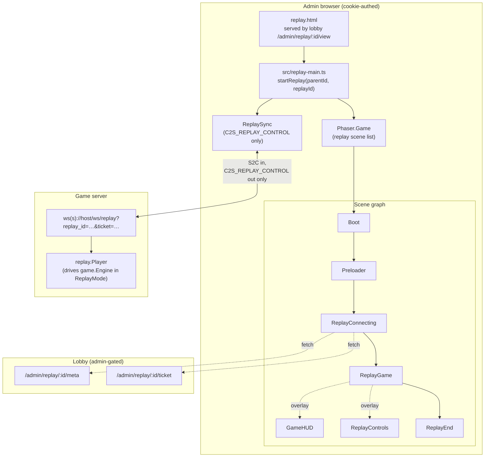
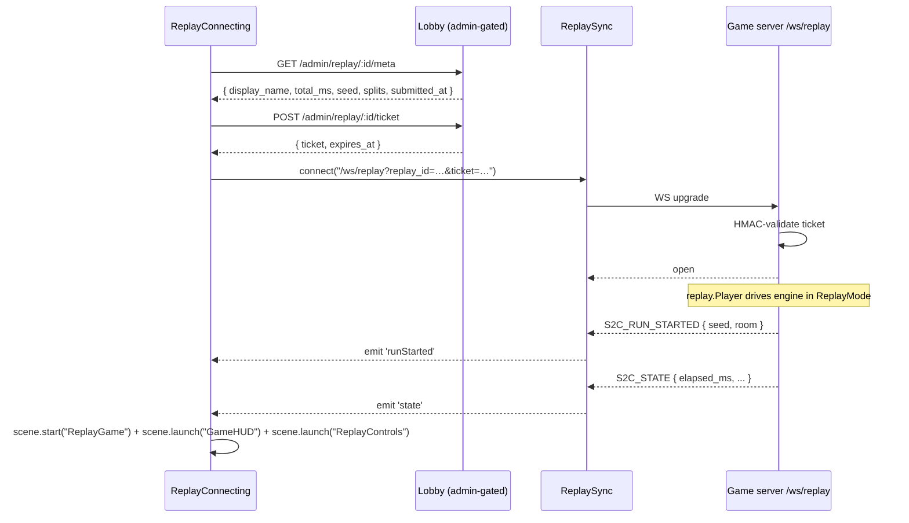
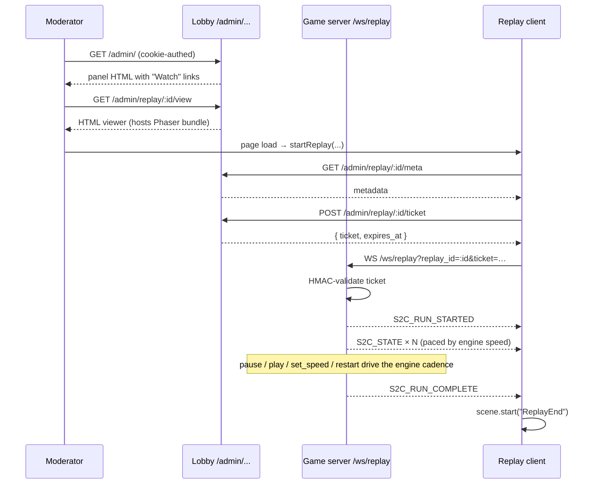

# 11 — Replay Viewer

## Purpose

Defines the third client-side variant: a read-only Phaser viewer that **plays back a saved `CompletedRun`** from `game.db`. Lives at `/admin/replay/:replay_id/view` — **moderator-only**, behind the same Telegram-OTP admin gate as the rest of `/admin/*`. Implementation backed by the server-side replay engine documented in [foundations/08-leaderboard-replay.md#streaming-replay-engine](../foundations/08-leaderboard-replay.md#streaming-replay-engine).

## Why admin-only

The replay reproduces the recorded `InputLog` byte-for-byte. Because the meta-game is exploiting intentional protocol bugs to shave seconds off a run, watching a top run is effectively *reading the exploit recipe*. We do not want one player's discovered exploit to be one click away on the public leaderboard. The lobby has already moved the raw replay download under `/admin/replay/:id` (Phase 4 — see [foundations/04-lobby.md](../foundations/04-lobby.md)) for exactly this reason. The visual viewer inherits the same gate.

A second consequence: the viewer is a moderation tool, not a feature for players. Its primary use is "I see a suspicious time on the leaderboard — let me watch the run before deciding whether to flag." The UX is tuned for that — fast scrub, clear control surface, restart, integration with the existing admin panel.

## Why a separate client mode

The viewer looks almost exactly like a spectator session — same rooms, same entities, same HUD, same protocol packets — but the differences are load-bearing for the UX and for keeping the player and spectator bundles lean:

- Replays have **playback controls**: play / pause / speed (0.25× / 0.5× / 1× / 2× / 4× / 8×) / restart. Spectators have no equivalent surface; the live game advances at wall-clock pace.
- Replays **start from `T0`**: the replay engine emits a fresh `S2C_RUN_STARTED` and the full canonical packet stream from the beginning. There is no spectator-style mid-run catchup.
- The viewer **fetches metadata** from `/admin/replay/:id/meta` (admin-gated) before opening the WS, so the connecting screen shows `Loading replay: aluminum-fox…` and the end screen shows splits even if the WS dropped early.
- The control packet (`C2S_REPLAY_CONTROL`) is **the only outbound type** allowed on `/ws/replay`. Game-affecting C2S types (`C2S_INPUT`, `C2S_SHOOT`, etc.) are rejected with `S2C_ERROR { code: "REPLAY_READ_ONLY" }` and the WS is closed. Enforced by both the server and the client class structure (`ReplaySync` exposes only `sendControl`).

The combination — playback controls plus a fresh canonical stream plus admin gating — makes a third bundle clearly the right shape. Hiding it inside the spectator bundle would force the spectator to pull in playback chrome it never uses, and runtime branching on URL would weaken the "spectator never sends C2S" lint surface.

## Auth flow — admin cookie + WS ticket

The HTML viewer page lives under `/admin/...` so the existing `authSvc.Wrap` gate applies:

```
Browser → GET /admin/replay/:id/view
            ↑ authSvc.Wrap checks admin_session cookie
              (else 303 → /admin/login)
```

The bundle then needs to open a WebSocket to `/ws/replay`. The `admin_session` cookie has `Path=/admin`, so it does not flow to `/ws/replay` — and we deliberately don't widen the cookie path because that would leak the admin cookie onto every player and spectator WS too.

The viewer instead exchanges the cookie for a **short-lived signed ticket** before opening the WS:

```
Browser → POST /admin/replay/:id/ticket
            ↑ admin_session cookie (Path=/admin) flows here
            ↓ returns {ticket: "<replay_id>.<exp>.<hmac>", expires_at: <ms>}

Browser → WS /ws/replay?replay_id=:id&ticket=<ticket>
            ↑ game server validates ticket via shared HMAC secret
```

The ticket is HMAC-signed with `ADMIN_SESSION_SECRET` (already deployed and shared between services via the docker-compose env). Format:

```
<replay_id>.<exp_unix>.<base64url(hmac_sha256(secret, "replay:" + replay_id + ":" + exp_unix))>
```

Domain-separated with the literal `"replay:"` prefix so the same secret cannot be reused to forge admin session cookies (those have no prefix). TTL: 30 minutes — long enough for any single replay watch session, short enough that a leaked ticket has bounded value.

The game server reads `ADMIN_SESSION_SECRET` from env and validates incoming `?ticket=` query params on `/ws/replay`. No DB read needed on the hot path. If the ticket is invalid or expired, the upgrade returns `401`.

## Runtime shape



## Differences from the spectator client

| Area                       | Spectator client                                                     | Replay client                                                                                  |
| -------------------------- | -------------------------------------------------------------------- | ---------------------------------------------------------------------------------------------- |
| Visibility                 | Public — any browser can spectate                                    | **Admin-only** — gated by `admin_session` cookie + WS ticket                                   |
| URL                        | `/spectate/:player_id`                                               | `/admin/replay/:replay_id/view`                                                                |
| WebSocket URL              | `/ws/spectate?player_id=<hex>`                                       | `/ws/replay?replay_id=<uuid>&ticket=<signed>`                                                  |
| First frames               | Catchup: cached `RUN_STARTED` + `ROOM_LOAD` + `STATE` (mid-run)      | Canonical `RUN_STARTED` from `T0`, then `STATE`/`ROOM_LOAD`/etc. as the recorded run unfolds   |
| C2S allowed                | None — any frame closes the WS (`SPECTATOR_READ_ONLY`)              | Only `C2S_REPLAY_CONTROL`. Game-affecting types close the WS (`REPLAY_READ_ONLY`)              |
| Pacing                     | Wall-clock — server fans out at 20 Hz                                | Replay-engine driven — client controls speed via `C2S_REPLAY_CONTROL`                          |
| Termination                | Engine emits `S2C_RUN_COMPLETE` when the live run ends; WS closed after `SPECTATOR_CATCHUP_MS` | Replay engine emits `S2C_RUN_COMPLETE` when the recorded run terminates. Viewer can `restart` instead of leaving |
| HUD elapsed timer          | Tracks the live run                                                  | Tracks the replayed `elapsed_ms` — pauses with the playback                                    |
| Failure modes              | "Player disconnected", "Server full", "Connection lost"              | "Replay not found", "Replay integrity check failed", "Connection lost", "Auth expired"         |
| Selector                   | `/spectate` listing live games                                       | Linked from the existing `/admin/` panel — no separate listing page needed                     |

## Module layout (target)

```
client/
└── src/
    ├── replay-main.ts                          ← entry; mirrors spectate-main.ts
    ├── net/
    │   └── packet.ts                           ← SHARED: adds C2S_REPLAY_CONTROL
    └── game/
        ├── replay-main.ts                      ← Phaser.Game config for replay scenes
        ├── net/
        │   ├── ReplaySync.ts                   ← WS owner; exposes only sendControl()
        │   └── runContext.ts                   ← adds getReplaySync() / resetReplaySync()
        └── scenes/
            ├── ReplayConnecting.ts             ← fetches meta + ticket, opens WS
            ├── ReplayGame.ts                   ← clone of SpectateGame.ts, no input wiring
            ├── ReplayControls.ts               ← overlay scene: play/pause/speed/restart
            └── ReplayEnd.ts                    ← terminal screen with restart + back link
```

`Boot`, `Preloader`, `GameHUD`, all `entities/*`, `world/roomLayout`, `ui/tokens`, `ui/formatters`, `weapons.ts`, `constants.ts` are reused unchanged.

## `ReplaySync` contract

Structural sibling of `SpectatorSync`:

```ts
class ReplaySync {
    state = new GameState();           // same GameState class as player & spectator
    private ws?: WebSocket;
    private nextSeq = 1;

    connect(url: string): Promise<void>;
    close(): void;
    isConnected(): boolean;

    // The ONE allowed outbound type. Action is "play" | "pause" | "set_speed" | "restart".
    // For "set_speed", speed is the multiplier (e.g. 1.0, 0.25, 4.0).
    sendControl(action: ReplayControlAction, speed?: number): void;
}
```

Key invariants:

- **Only `sendControl` exists.** No `sendInput`, `sendShoot`, `sendInteract`, etc. Adding one is a lint-visible change.
- **Accepts every `S2CType`.** Delegates to `GameState.apply()` unchanged.
- **`S2C_AUTH_OK` is not delivered** by the replay engine (no auth handshake) — `state.displayName` is populated from `/admin/replay/:id/meta` instead.

### Why reuse `GameState`

Same reasoning as spectator: `GameState` is a pure data + event bus mirror. Reusing it means the replay viewer inherits every reconciliation rule the player and spectator already use — including absence-based pruning of dead enemies and consumed pickups. The replay engine produces a clean stream from `T0`, but the prune logic is harmless when nothing is missing.

## `C2S_REPLAY_CONTROL`

| Field    | Type      | Notes                                                      |
| -------- | --------- | ---------------------------------------------------------- |
| `action` | string    | `"play"`, `"pause"`, `"set_speed"`, `"restart"`            |
| `speed`  | float?    | Required when `action == "set_speed"`. Range `[0.25, 8.0]` (server clamps). |

`pause` and `play` are idempotent. `restart` resets the engine to `T0` and emits a fresh `RUN_STARTED` immediately. See [foundations/08-leaderboard-replay.md#c2s_replay_control](../foundations/08-leaderboard-replay.md#c2s_replay_control) for the wire-level contract.

## `ReplayConnecting` scene

Purpose: fetch metadata, mint a ticket, open WS, transition once the engine emits the first `S2C_STATE`.



Failure routing:

- Meta `404` → `ReplayEnd` with `"Replay not found"`.
- Meta `500` → `ReplayEnd` with `"Replay integrity check failed"` (checksum mismatch on disk).
- Meta or ticket `401` → `window.location.href = "/admin/login"` (admin session expired since the page loaded).
- WS upgrade 401 → `ReplayEnd` with `"Auth expired"`. Most likely cause: the ticket TTL passed (30 min); the user can hit Restart to mint a new one (which forces a fresh meta+ticket fetch and a fresh engine).
- WS upgrade 503 → `ReplayEnd` with `"Server is busy — try again shortly"` (global cap hit).
- WS upgrade other / mid-stream drop → `ReplayEnd` with `"Connection lost"`.

## `ReplayGame` scene

Structural copy of `SpectateGame.ts`. Same surgery (no `Controls`, no input wiring, server-authoritative aim via `useSnapshotAim: true`), same reconciliation handlers. The only behavioural differences:

- Listens for `runStarted` and resets local maps (so `restart` starts clean).
- A small badge in the top-center reads `REPLAY: {display_name} — {total_ms}` so it's always clear the viewer is watching a recording, not a live game.

## `ReplayControls` overlay scene

A persistent HUD overlay (depth `15000`, above `GameHUD`) with:

- **Play / Pause** toggle button.
- Speed buttons: `0.25× 0.5× 1× 2× 4× 8×`. Active speed is highlighted with `ACCENT_PRIMARY`.
- **Restart** button (re-enters `ReplayConnecting` — re-fetches metadata + new ticket + new engine; this avoids the edge case where the original ticket has expired by the time the user clicks Restart on a long pause).
- Click handlers call `getReplaySync().sendControl(...)`.

Keyboard shortcuts (registered as scene-level input, **not** the player `Controls` facade):

- `Space` — play/pause toggle
- `[` / `]` — slower / faster (cycles the speed list)
- `R` — restart
- `Esc` — close the viewer (returns to `/admin/`)

These shortcuts are deliberately scoped to `ReplayControls` so the player bundle's input semantics are unaffected.

## `ReplayEnd` scene

Terminal screen, reached when the engine emits `S2C_RUN_COMPLETE` (a recorded run always terminates) or when the WS drops mid-stream. Shows:

- `display_name` and `total_ms` (from metadata).
- Reason for end: `"Replay finished"`, `"Connection lost"`, `"Replay not found"`, `"Replay integrity check failed"`, `"Auth expired"`.
- Splits table (from metadata).
- **Restart** button — re-enters `ReplayConnecting` with the same `replay_id` (and re-mints meta + ticket).
- **Back to admin panel** link → `window.location.href = "/admin/"`.

## Lifecycle



## Read-only enforcement — three layers

1. **Class-level (compile time):** `ReplaySync` exposes only `sendControl`. `sendInput`, `sendShoot`, etc. don't exist — adding one is a lint-visible change.
2. **Scene-level (runtime):** `ReplayGame` never instantiates `Controls`. `ReplayControls` only ever calls `sendControl`. No call site produces game-affecting outbound frames.
3. **Server-level (authoritative):** if anything slips through, `/ws/replay` rejects every C2S type other than `C2S_REPLAY_CONTROL` with `S2C_ERROR { code: "REPLAY_READ_ONLY" }` and closes the WS.

## Caps visible to the client

Per-viewer cost is one synthetic engine on the game server (CPU, no shared world, no real player). There is no per-replay cap (a popular replay can be watched by many viewers in parallel) but there is a global cap of `REPLAY_GLOBAL` (default 16 — much smaller than spectator since this is admin-only) on the game server to prevent a runaway moderator panel from fork-bombing. When the cap is hit, the server returns `503` with `Retry-After: 5` on the WS upgrade.

## Implementation status

Greenfield in this branch. Files added:

- `client/replay.html` — entry HTML (sets `<base href="/">`, loads `src/replay-main.ts`).
- `client/src/replay-main.ts` — parses `/admin/replay/:replay_id/view` from `window.location.pathname`, calls `startReplay`.
- `client/src/game/replay-main.ts` — Phaser config with the replay scene list. Seeds the registry with `nextScene = "ReplayConnecting"` and the replay_id in `callbacks.preBoot`.
- `client/src/game/net/ReplaySync.ts` — sync class, `sendControl` only.
- `client/src/game/scenes/ReplayConnecting.ts`, `ReplayGame.ts`, `ReplayControls.ts`, `ReplayEnd.ts`.
- `client/src/net/packet.ts` — `C2S_REPLAY_CONTROL = 0x0A` added to `C2SType`, type wired in `C2SDataFor`.

Player-client surfaces touched (small):

- `client/src/game/net/runContext.ts` — adds `getReplaySync` / `resetReplaySync`.
- `client/vite/config.dev.mjs` and `config.prod.mjs` — `replay: 'replay.html'` added to `rollupOptions.input`.
- `client/Caddyfile` — `/admin/replay/*/view` rewrite to `replay.html`; `/ws/replay` proxied to `game-server:8080`.

## Implementation notes

- Build the replay bundle as a third Vite entry point (sibling to `spectate.html`). Keeps the player and spectator bundles lean.
- Reuse as much as possible. **Do not** reuse `Game.ts`, `MainMenu.ts`, `SpectateGame.ts`, or `SpectateConnecting.ts` directly — they all carry assumptions (input, mid-run catchup) that are wrong for replay. Copy-and-surgery is preferred over a runtime branch.
- Treat `restart` as a fresh viewer load — re-fetch meta and a new ticket. This eliminates the edge case where a long pause has aged the original ticket past its 30 min TTL.
- The engine emits `RUN_COMPLETE` deterministically (modulo the BUG-11 tolerance window). The `ReplayEnd` "Restart" button re-runs the same recording; the metadata's `total_ms` is the canonical leaderboard value and is shown alongside the engine's reproduced `total_ms` if they differ.
- The Caddy routing for `/admin/replay/*/view` rewrites to `replay.html`, but `/admin/replay/:id` (no `/view` suffix — admin JSON download) and `/admin/replay/:id/meta` and `/admin/replay/:id/ticket` continue to fall through to the lobby reverse proxy. Order matters in the Caddyfile.

## Intentional bugs in this area

None. The replay viewer is a presentation surface. Bugs introduced here are either (a) cosmetic drift with the spectator/player clients, or (b) accidental game-affecting C2S — both strictly unacceptable.

The replay engine itself **does** show every intentional bug artifact that the live engine produced. BUG-11 in particular may produce a slightly different reproduced `total_ms` within the documented tolerance — see [foundations/08-leaderboard-replay.md#non-determinism-and-tolerance](../foundations/08-leaderboard-replay.md#non-determinism-and-tolerance).

## Cross-references

- [01-architecture.md](./01-architecture.md) — Phaser bootstrap (replay parallels this).
- [02-net-sync.md](./02-net-sync.md) — sync class pattern; `ReplaySync` mirrors `SpectatorSync` minus everything except `sendControl`.
- [03-client-state.md](./03-client-state.md) — shared `GameState`.
- [04-scenes.md](./04-scenes.md) — scene lifecycle pattern used by `ReplayGame`.
- [05-entities-rendering.md](./05-entities-rendering.md) — entity classes reused.
- [06-world-rooms.md](./06-world-rooms.md) — room rendering reused.
- [09-spectator-mode.md](./09-spectator-mode.md) — sibling read-only viewer; the replay client copies most of the structure.
- [foundations/02-protocol.md#c2s_replay_control](../foundations/02-protocol.md#c2s_replay_control) — wire-level packet.
- [foundations/04-lobby.md](../foundations/04-lobby.md) — admin gate (`authSvc.Wrap`) and the `/admin/replay/:id` JSON download that this viewer is the visual sibling to.
- [foundations/08-leaderboard-replay.md#streaming-replay-engine](../foundations/08-leaderboard-replay.md#streaming-replay-engine) — server-side engine + ticket scheme.
