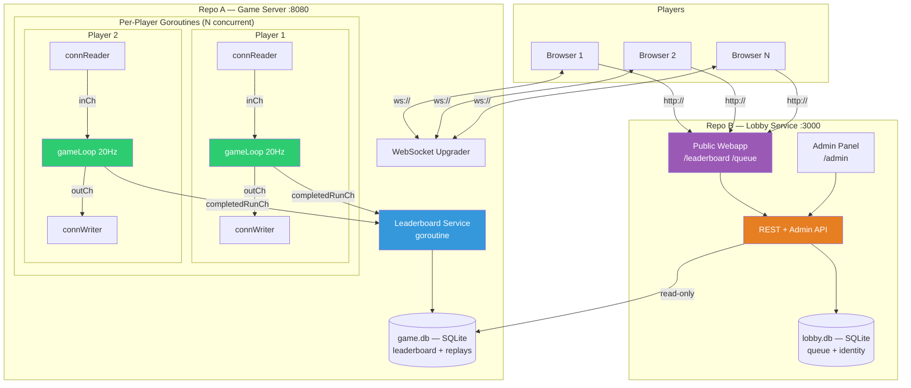
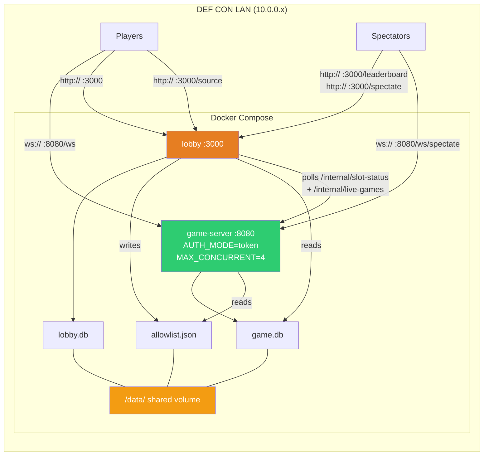

# 01 — Architecture

## Purpose

Defines the system topology for NUS Greyhats DEFCON Dungeon Speedrun: two independent services (game server + lobby), their responsibilities, deployment footprint, and how data moves between them.

## System Topology

Two independent services. The **game server** is self-contained and supports concurrent players (capped by env var). The **lobby service** is a separate repo that manages turn-taking in production, hosts the public-facing leaderboard/queue webapp, and handles player identity.



## Service Separation

| Concern            | Game Server (Repo A)                                                                                             | Lobby Service (Repo B)                                                      |
| ------------------ | ---------------------------------------------------------------------------------------------------------------- | --------------------------------------------------------------------------------- |
| **Responsibility** | Game logic, WebSocket, leaderboard writes, replays                                                               | Queue FIFO, player identity, public webapp, admin tools, serves stripped game-server source |
| **Concurrency**    | `MAX_CONCURRENT` env var. Unlimited in dev/test, `4` in prod                                                     | N/A — manages queue, doesn't run games                                            |
| **Database**       | `game.db` — leaderboard, completed runs, replay data                                                             | `lobby.db` — queue entries, identity. **Reads** `game.db` for leaderboard display |
| **Auth**           | `AUTH_MODE=open` (dev/test): any connection. `AUTH_MODE=token` (prod): require valid hex player ID in `C2S_AUTH` | Issues hex player IDs, manages queue, provides admin panel                        |
| **Repo**           | `defcon-dungeon/game-server`                                                                                     | `defcon-dungeon/lobby`                                                      |
| **Deployed**       | Always                                                                                                           | Prod only (optional in test for queue testing)                                    |

## Deployment Topology (Production)



## Public exposure

The **lobby** is the only publicly-addressable service — it terminates all browser HTTP traffic (register, queue, leaderboard, replay downloads, source browser) and is reachable from the public internet in dev/test and from the DEF CON LAN in prod. The game server's WebSocket is also browser-facing but only used during an active play session.

| Component                | Public? | Where                                                        |
| ------------------------ | ------- | ------------------------------------------------------------ |
| Lobby `:3000`            | **Yes** | Public VPS in dev/test. DEF CON LAN in prod. TLS terminated at a reverse proxy (Caddy or nginx) in front of the Docker Compose stack — the container itself serves plain HTTP. |
| Game server `:8080` (WS) | **Yes** | Same host as lobby. WebSocket, upgraded from the same domain. Reverse proxy routes `/ws` (player) and `/ws/spectate` (read-only spectator) → `:8080`; everything else → `:3000`. See [04-lobby.md#live-spectating](./04-lobby.md#live-spectating) and [02-protocol.md#spectator-protocol](./02-protocol.md#spectator-protocol). |
| Game server `/internal/slot-status` | No | Bound to loopback or a Docker-internal network. Lobby polls it; never exposed externally. |
| Admin panel (`/admin/*`) | **No, in practice** | Lives on the lobby, gated by Telegram-OTP login (see [04-lobby.md § Admin auth](./04-lobby.md#admin-auth-telegram-otp)). |

The dev/test lobby VPS is also the host for the stripped source (served at `/source/`), so there is **one public domain per environment** covering everything a player sees.

## Repo Structure (Target)

```
defcon-dungeon/
├── game-server/              ← Repo A
│   ├── cmd/server/
│   ├── internal/
│   │   ├── game/             (game loop, physics, AI, items)
│   │   ├── protocol/         (packet encode/decode — JSON parsing)
│   │   ├── leaderboard/      (DB, rankings)
│   │   └── auth/             (allowlist check)
│   ├── web/                  (Phaser frontend)
│   ├── Dockerfile
│   ├── .github/workflows/
│   └── go.mod
│
├── lobby/              ← Repo B
│   ├── cmd/admin/
│   ├── internal/
│   │   ├── queue/            (FIFO, slot polling)
│   │   ├── identity/         (registration, bcrypt, AES)
│   │   └── admin/            (admin panel handlers)
│   ├── web/                  (Leaderboard + Queue webapp)
│   ├── Dockerfile
│   ├── .github/workflows/
│   └── go.mod
```

## Data flow (cross-service)

Player journey, prod mode:

1. **Register** (HTTP → lobby): Player hits `POST /api/register` on lobby :3000. Lobby writes to `lobby.db` (or identity DB), returns `player_id`.
2. **Queue** (HTTP → lobby): Player hits `POST /api/queue/join`. Lobby assigns position.
3. **Slot allocation** (lobby → game server): Lobby polls `GET /internal/slot-status` on game server every 2 s. When a slot is free + player is at front, lobby writes `player_id` to the shared `allowlist.json`.
4. **Connect** (WebSocket → game server): Player opens WS to game server :8080, sends `C2S_AUTH { player_id }`. Game server checks `allowlist.json` under `AUTH_MODE=token`.
5. **Play**: See [05-server-runtime.md](./05-server-runtime.md) for the per-player goroutine trio and tick loop.
6. **Run complete** (game server → `game.db`): Leaderboard service persists `CompletedRun`. See [08-leaderboard-replay.md](./08-leaderboard-replay.md).
7. **Read leaderboard** (lobby → `game.db` read-only): Public webapp reads rankings for display.
8. **Read stripped source** (lobby static serve): Players browse the redacted game-server source at `http://:3000/source/`. The lobby is the only public entry point for the published source — see [09-ci-cd-deploy.md](./09-ci-cd-deploy.md#source-code-publishing-served-by-lobby).

`/data/` is the shared Docker volume hosting `game.db`, `lobby.db`, `allowlist.json`, and the stripped-source tree. Lobby writes `allowlist.json`; game server reads it. The stripped source is dropped into `/data/stripped-source/` by CI/CD and served read-only by the lobby.

### Browser client

Both the in-game WebSocket client (`ws:// :8080`) and the leaderboard / queue / source-browser (`http:// :3000`) run in the player's browser. The in-game client is a Phaser 3 app — see the [client/](../client/) tree (start with [client/01-architecture.md](../client/01-architecture.md)) for the scene graph, packet layer, and asset pipeline. The queue / leaderboard webapp is a separate frontend bundled inside the lobby service.

## Implementation status

Current repo is **monolithic** (`server/` and `client/` in one directory, no separate lobby process). Spec calls for two repos deployed via Docker Compose. This split is tracked as future work and does not affect spec breakdown.

- Game server: WebSocket on port 8080 exists (`server/main.go`). `MAX_CONCURRENT` + `AUTH_MODE` env wiring: TBD.
- Lobby service: **not yet implemented** — greenfield.
- `game.db`: TBD. Current leaderboard uses `winners.csv`.
- `allowlist.json`: TBD.
- Live spectating (`/ws/spectate`, `/api/live`, `/spectate` selector): **not yet implemented** — greenfield. See [04-lobby.md#live-spectating](./04-lobby.md#live-spectating) and [05-server-runtime.md#spectator-fan-out](./05-server-runtime.md#spectator-fan-out).

## Intentional bugs in this area

None — architecture itself is invariant. Individual bugs surface inside the service components (see [bugs.md](../bugs.md)).

## Cross-references

- [02-protocol.md](./02-protocol.md) — packet envelope and types over the WebSocket.
- [03-identity-auth.md](./03-identity-auth.md) — `C2S_AUTH`, allowlist, auth modes.
- [04-lobby.md](./04-lobby.md) — lobby detail.
- [05-server-runtime.md](./05-server-runtime.md) — game server goroutines and tick loop.
- [09-ci-cd-deploy.md](./09-ci-cd-deploy.md) — Docker compose, env matrix, stripped-source publishing.
- [../client/01-architecture.md](../client/01-architecture.md) — the Phaser 3 in-game client (entry to the full `client/` tree).
