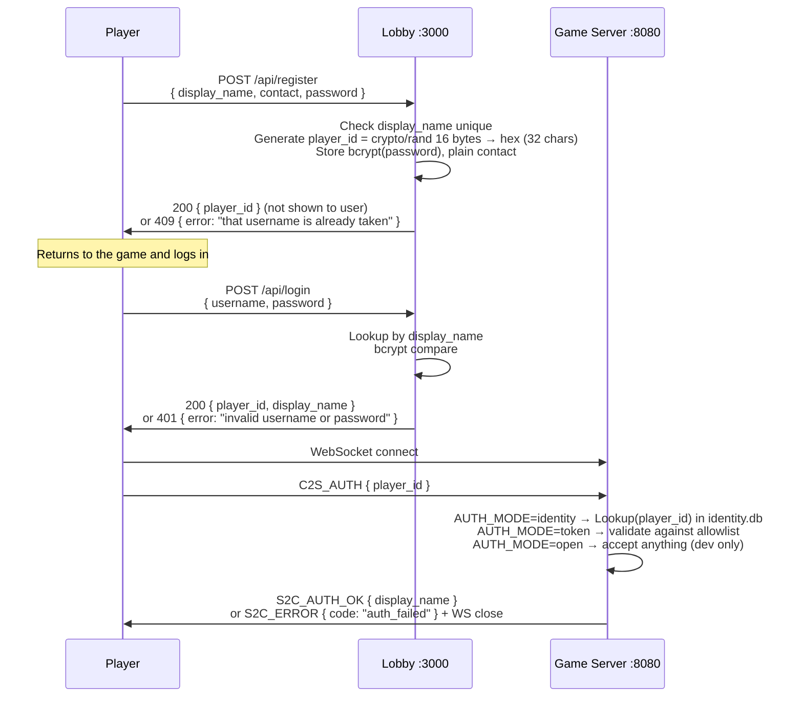

# 03 — Identity & Auth

## Purpose

Player identity scheme. Players register a `username` + `password` (plus a contact field used only for post-event prize-claim outreach) and log in with those credentials before each play session. The server maps `username → player_id` internally; the 32-char hex `player_id` is never shown to players. `AUTH_MODE` gates WebSocket connections on the game server so only registered players can reach the game loop.

## Model

```
Player {
    PlayerID        string      // 32-char hex, server-generated, crypto/rand (internal)
    DisplayName     string      // player-chosen username; UNIQUE, shown everywhere public
    PasswordHash    []byte      // bcrypt(password), required at login time
    Contact         string      // plaintext
    RegisteredAt    time.Time
}
```

- `PlayerID` is 16 random bytes from `crypto/rand`, hex-encoded → 32 chars. **Internal use only** — it's the server-side session key; players never type it. The client obtains it from `/api/login` and passes it straight into `C2S_AUTH`.
- `DisplayName` doubles as the player-facing username. A UNIQUE index enforces collision-free login. 1–32 chars.
- `PasswordHash` is bcrypt(cost 12) over the password the player chose at registration. Verified at every login.
- `Contact` is stored as plain text. The spec originally required AES-256-GCM at rest; the owner has opted out to skip key-management overhead. Treat `identity.db` as sensitive on disk and restrict filesystem access accordingly.

## Registration + login sequence



## `AUTH_MODE`

| Mode       | Environment | Behavior                                                                                                                                   |
| ---------- | ----------- | ------------------------------------------------------------------------------------------------------------------------------------------ |
| `open`     | unsafe, dev | Game server accepts any `C2S_AUTH`. Records whatever `player_id` is supplied. **Never use this in a shared environment.**                  |
| `token`    | prod queue  | Game server validates `player_id` against `allowlist.json` (written by the lobby after queue admission). Rejects with `S2C_ERROR` if absent. |
| `identity` | default     | Game server validates `player_id` against the `players` table in `identity.db`. Rejects unregistered players.                              |

The allowlist is read from disk per-connection (with a short TTL cache). See [04-lobby.md](./04-lobby.md) for the producer side. Identity mode hits SQLite directly — it's fast (prepared statement, primary-key lookup) and always up-to-date.

## Player-facing experience

1. **Open the game** → go to `http://10.0.0.x:3000`. The splash shows a login panel (username + password).
2. **First time?** Click "Register →" to open `/register`, enter username + contact (email/phone/discord) + password. Server returns success (or 409 if the username is taken).
3. **Log in:** Back on the game splash, enter username + password. The client calls `/api/login`, gets the internal `player_id`, and uses it to authenticate the WebSocket — all transparent to the player.
4. **Play.**
5. **Claim prize** (post-event): Organizer looks up the registered contact, contacts the winner. Dispute → player provides password matching bcrypt hash for that username.

## Data flow

- **Register:** HTTP POST `/api/register` → identity service → SQLite `players` table → returns `player_id` (internal; not shown to the player).
- **Login:** HTTP POST `/api/login { username, password }` → identity service → `LookupByDisplayName` → bcrypt compare → returns `{ player_id, display_name }`.
- **Verify (queue join, future lobby):** HTTP POST `/api/verify { player_id, password }` → bcrypt compare. Kept for the queue flow; not used by the game-server login.
- **Game auth:** WS connect → `C2S_AUTH { player_id }` → server runs the `AUTH_MODE` gate (identity = `players` table lookup, token = allowlist, open = no-op) → responds with `S2C_AUTH_OK { display_name }` or closes with `S2C_ERROR` `auth_failed`.

## Implementation notes

- Rate-limited per IP: 3 s register, 1 s login, 1 s verify.
- Timing-leak mitigation: if `username` (login) or `player_id` (verify) is not found, still perform a dummy `bcrypt.CompareHashAndPassword` against a fixed hash so response time doesn't leak existence.
- Same "invalid username or password" error for unknown-username and wrong-password paths, so a login probe can't enumerate registered names.
- SQLite schema:

  ```sql
  CREATE TABLE players (
      player_id      TEXT PRIMARY KEY,
      display_name   TEXT NOT NULL,
      password_hash  BLOB NOT NULL,
      contact        TEXT NOT NULL,
      registered_at  DATETIME NOT NULL
  );
  CREATE UNIQUE INDEX idx_players_display_name ON players(display_name);
  ```

- SQLite opened with WAL mode, foreign keys enabled, 5 s busy timeout.
- Contact info is stored plain. There is no `CONTACT_ENCRYPTION_KEY` — the encryption-at-rest requirement was explicitly dropped by the project owner. Protect `identity.db` via filesystem permissions and backup hygiene instead.

## Implementation status

**Implemented** in `server/internal/identity/` (currently hosted inside the game server repo, not a separate lobby service):

- `POST /api/register` — accepts `display_name`, `contact`, `password`; returns `{ player_id }`. 409 on duplicate display_name.
- `POST /api/login` — accepts `{ username, password }`; returns `{ player_id, display_name }` on success, 401 otherwise.
- `POST /api/verify` — accepts `{ player_id, password }`; returns `{ display_name }`. Kept for the future queue flow.
- `GET /register` — minimal HTML registration page on the game server (dev stand-in for the lobby UI).
- SQLite `identity.db` with the schema above (WAL mode, foreign keys, 5 s busy timeout). UNIQUE index on `display_name` enforces username collision-freeness.
- Per-IP rate limiting (3 s / 1 s / 1 s) and dummy-bcrypt timing-leak mitigation on the lookup endpoints.
- `AUTH_MODE` gate on the WebSocket handler. `identity` mode (default in `docker-compose.yml`) rejects any `player_id` not present in `identity.db` and populates `DisplayName` from the stored username so the leaderboard shows human-friendly names.
- `allowlist.json` reader (`server/internal/auth/allowlist.go`, 2 s TTL cache) for `AUTH_MODE=token`.

**Not yet implemented:**
- Migration of identity endpoints into the separate lobby service (once lobby ships, move `/api/register`, `/api/login`, `/api/verify`, `/register` there and drop from game server).
- Allowlist producer side — lobby is spec'd to write `allowlist.json` after queue admission. Currently no process writes it, so `AUTH_MODE=token` rejects everyone.

## Intentional bugs in this area

None — identity and auth are anticheat-adjacent and must remain correct. Tampering here makes the leaderboard meaningless. Any bugs discovered during review should be **fixed**, not preserved.

## Cross-references

- [02-protocol.md](./02-protocol.md) — `C2S_AUTH` envelope.
- [04-lobby.md](./04-lobby.md) — allowlist producer, queue endpoints.
- [01-architecture.md](./01-architecture.md) — where this service sits in topology.
