# 03 — Identity & Auth

## Purpose

Player identity scheme (no accounts, no sessions, no JWTs — just a hex ID + password hash), registration and verification flows, contact-info encryption, and how `AUTH_MODE` gates WebSocket connections on the game server.

## Model

```
Player {
    PlayerID        string      // 32-char hex, server-generated, crypto/rand
    DisplayName     string      // plaintext, shown everywhere public
    PasswordHash    []byte      // bcrypt(password), for identity proof
    ContactInfo     []byte      // AES-256-GCM encrypted at rest
    RegisteredAt    time.Time
}
```

- `PlayerID` is 16 random bytes from `crypto/rand`, hex-encoded → 32 chars.
- `PasswordHash` is bcrypt over a password the player chose at registration. It exists solely to prove identity at prize claim / queue-join time — there are no logins.
- `ContactInfo` is encrypted at rest using AES-256-GCM under a server-held key (`CONTACT_ENCRYPTION_KEY`). Organizers decrypt post-event to contact winners.

## Registration + verify sequence

```mermaid
sequenceDiagram
    participant P as Player
    participant Q as Lobby :3000
    participant G as Game Server :8080

    P->>Q: POST /api/register<br/>{ display_name, contact, password }
    Q->>Q: Generate player_id = crypto/rand 16 bytes → hex (32 chars)<br/>Store bcrypt(password), encrypt(contact)
    Q->>P: { player_id: "a4f9c2e8..." }

    Note over P: Player writes down player_id

    rect rgb(40, 40, 60)
        Note over Q: PROD ONLY — Queue flow
        P->>Q: POST /api/queue/join { player_id, password }
        Q->>Q: Verify bcrypt(password) matches stored hash
        Q->>P: { position: 3, est_wait_ms: ... }
        Q-->>P: (polling/SSE) position updates
        Note over Q: Front of queue + slot free
        Q->>P: { status: "your_turn" }
    end

    P->>G: WebSocket connect
    P->>G: C2S_AUTH { player_id: "a4f9c2e8..." }
    G->>G: AUTH_MODE=open → accept anyone, record player_id<br/>AUTH_MODE=token → validate against allowlist
    G->>P: S2C_AUTH_OK { display_name }
```



## `AUTH_MODE`

| Mode    | Environment | Behavior                                                                       |
| ------- | ----------- | ------------------------------------------------------------------------------ |
| `open`  | dev / test  | Game server accepts any `C2S_AUTH`. Records whatever `player_id` is supplied. |
| `token` | prod        | Game server validates `player_id` against `allowlist.json` (written by lobby). Rejects with `S2C_ERROR` if absent. |

The allowlist is read from disk per-connection (or with a short TTL cache). See [04-lobby.md](./04-lobby.md) for the producer side.

## Player-facing experience

1. **Walk up to kiosk / open phone browser** → go to `http://10.0.0.x:3000`.
2. **Register:** Enter display name, contact (email/phone/discord), choose a password → get back a **32-char hex player ID** displayed prominently ("**Write this down. You need it to play and to claim prizes.**").
3. **Join queue** (prod): Enter player_id + password → get position → wait.
4. **Play** (when it's your turn or in dev/test anytime): Open game URL, enter player_id → play.
5. **Claim prize** (post-event): Organizer contacts winners via decrypted contact info. Dispute → provide password matching bcrypt hash for that player_id.

## Data flow

- **Register:** HTTP POST → lobby → SQLite `players` table → returns `player_id`.
- **Verify (queue join):** HTTP POST `{ player_id, password }` → bcrypt compare vs stored hash. On match, lobby enqueues the player.
- **Game auth:** WS connect → `C2S_AUTH { player_id }` → game server looks up `player_id` in `allowlist.json` (token mode) or accepts unconditionally (open mode) → responds with `S2C_AUTH_OK { display_name }`.

## Implementation notes

- Registration rate-limited per IP (3 s cooldown). Verification rate-limited per IP (1 s cooldown).
- Timing-leak mitigation: if `player_id` not found, still perform a dummy `bcrypt.CompareHashAndPassword` against a fixed hash so response time doesn't leak user existence.
- SQLite schema:

  ```sql
  CREATE TABLE players (
      player_id      TEXT PRIMARY KEY,
      display_name   TEXT NOT NULL,
      password_hash  BLOB NOT NULL,
      contact_enc    BLOB NOT NULL,
      registered_at  DATETIME NOT NULL
  );
  CREATE INDEX idx_players_display_name ON players(display_name);
  ```

- SQLite opened with WAL mode, foreign keys enabled, 5 s busy timeout.
- `CONTACT_ENCRYPTION_KEY` comes from env var. Default to an all-zeros key in dev with a loud warning log — production must set a real 32-byte hex key.

## Implementation status

**Implemented** in `server/internal/identity/` (currently hosted inside the game server repo, not a separate lobby service):

- `POST /api/register` — accepts `display_name`, `contact`, `password`; returns `player_id`.
- `POST /api/verify` — accepts `player_id` + `password`; bcrypt compare.
- `GET /register` — minimal HTML registration page on the game server (dev stand-in for the lobby UI).
- SQLite `identity.db` with the schema above (WAL mode, foreign keys, 5 s busy timeout).
- AES-256-GCM contact encryption, `CONTACT_ENCRYPTION_KEY` env (zeros default with loud warning).
- Per-IP rate limiting: 3 s register, 1 s verify.
- Dummy bcrypt compare on missing `player_id` for timing-leak mitigation.
- `AUTH_MODE` gate on the WebSocket handler (`auth.Check` in `server/internal/auth/` — open accepts any, token validates against allowlist).
- `allowlist.json` reader (`server/internal/auth/allowlist.go`, 2 s TTL cache).

**Not yet implemented:**
- Migration of identity endpoints into the separate lobby service (once lobby ships, move `/api/register`, `/api/verify`, `/register` there and drop from game server).
- Allowlist producer side — lobby is spec'd to write `allowlist.json` after queue admission. Currently no process writes it, so `AUTH_MODE=token` rejects everyone.

## Intentional bugs in this area

None — identity and auth are anticheat-adjacent and must remain correct. Tampering here makes the leaderboard meaningless. Any bugs discovered during review should be **fixed**, not preserved.

## Cross-references

- [02-protocol.md](./02-protocol.md) — `C2S_AUTH` envelope.
- [04-lobby.md](./04-lobby.md) — allowlist producer, queue endpoints.
- [01-architecture.md](./01-architecture.md) — where this service sits in topology.
