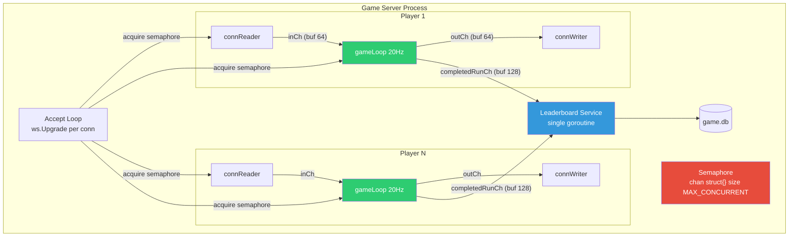
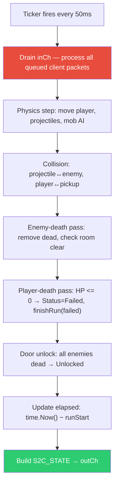

# 05 — Server Runtime

## Purpose

The game server's concurrency model: per-player goroutines, the 20 Hz game loop, channel sizes, the semaphore that caps concurrent players, the `ts` validation policy, the post-door settle window, and the kill-log cleanup goroutines. Three intentional bugs live here because they are all artifacts of *how data moves between goroutines and across a single tick*.

## Goroutine architecture



## Goroutine responsibilities

| Goroutine       | Owns                                           | Lifecycle       |
| --------------- | ---------------------------------------------- | --------------- |
| **connReader**  | Nothing — stateless decoder                    | Per connection  |
| **gameLoop**    | All player + room state (sole owner, no mutex) | Per connection  |
| **connWriter**  | Nothing — stateless encoder                    | Per connection  |
| **leaderboard** | Rankings, DB writes, broadcast                 | Server lifetime |

No shared game state between players. The only cross-player touchpoint is `completedRunCh` → leaderboard.

The **semaphore** (`chan struct{}` sized `MAX_CONCURRENT`) gates the accept loop — unlimited in dev/test, `4` in prod.

## Channels & sizes

| Channel           | Direction                    | Size |
| ----------------- | ---------------------------- | ---- |
| `inCh`            | connReader → gameLoop        | 64   |
| `outCh`           | gameLoop → connWriter        | 64   |
| `completedRunCh`  | gameLoop(s) → leaderboard    | 128  |
| `registerCh`      | spectator accept → gameLoop  | 8    |
| `summaryCh`       | gameLoop(s) → live-games aggregator | `MAX_CONCURRENT` |

## Game loop tick (20 Hz)



- 50 ms ticker fires → drain `inCh` of all queued C2S packets → physics → collision → enemy-death → player-death → door → timer → send.
- All logic runs on a single goroutine per player. No mutex guards player/room state — the goroutine is the sole owner.

### Player-death pass

Runs once per tick, after the enemy-death pass and before the door unlock. Single conditional:

```go
if e.run.Status == RunRunning && e.player.HP <= 0 {
    e.finishRun(tickNow, e.run.ElapsedMs, RunFailed)
    return // skip door/timer/send-state; finishRun sends S2C_RUN_COMPLETE{outcome:"failed"}
}
```

Ordering constraints (each is load-bearing for an existing bug):

- **After `advanceEnemies`** — a kamikaze's melee hit in `advanceEnemies` is the normal death path; the enemy self-destruct (`en.HP=0`) still runs, and the player takes its 5/2-dmg hit before this pass checks.
- **After the drain phase** — `C2S_INTERACT` on a `PickupHeart` applies its `+30000` heal during drain; the wrap-to-negative needs this pass to latch on the same tick. This is the BUG-08 twist — see [combat-weapons.md#bug-08-hp-integer-overflow-healing-past-max](../features/combat-weapons.md#bug-08-hp-integer-overflow-healing-past-max).
- **Before door unlock** — prevents a corpse from advancing rooms via [BUG-03](../features/rooms-doors.md#bug-03-door-skip-no-proximity) on the same tick.
- **Signed `HP <= 0`** — not `== 0`. A wrap to `-32768` must trigger death.

`finishRun(now, elapsedMs, outcome)` gains an `outcome` parameter. On `RunFailed`:

- `e.run.Status = RunFailed`.
- Final split captured same as completion.
- `S2C_RUN_COMPLETE` sent with `outcome: "failed"` (see [02-protocol.md](./02-protocol.md#s2c_run_complete-outcomes)).
- **Not submitted** to `completedRunCh` — failed runs never appear on the leaderboard. The `CompletedRun` struct is only constructed on `RunCompleted`.
- Spectators still receive the `S2C_RUN_COMPLETE`; the 500 ms flush window is unchanged.

No mutex. No new goroutine. The gameLoop remains the sole owner.

## `ts` validation

Each incoming C2S packet has a `ts` field (client wallclock ms). The game server:

- Validates `|ts − time.Now()| ≤ 2 s` per packet (absolute window).
- Uses `ts − prev_ts` as the physics `deltaTime` integration step.
- **Does NOT track cumulative drift** — i.e., there's no rate-of-progression check that compares the sum of `deltaTime` values against wallclock.

This is the design choice that enables BUG-02.

## Spectator fan-out

Live spectating (see [04-lobby.md#live-spectating](./04-lobby.md#live-spectating)) is served by the game server as a read-only WebSocket. Spectators attach to a specific player's gameLoop and receive a subset of the same S2C stream; they never send anything and never occupy a player slot.

### Goroutines and channels

```mermaid
graph TD
    subgraph "Player 1's gameLoop"
        GL1[gameLoop 20Hz]
        REG1[spectatorRegistry<br/>[]*outCh]
        GL1 -.->|reads list each send| REG1
    end

    SPEC_ACC[Spectator Accept Loop<br/>/ws/spectate]
    SPEC1[Spectator 1 connWriter] -->|WS frames| CLIENT1[Viewer browser]
    SPECN[Spectator N connWriter] -->|WS frames| CLIENTN[Viewer browser]

    SPEC_ACC -->|"registerCh (buf 8)<br/>per-game"| GL1
    GL1 -->|"outCh (buf 64)"| SPEC1
    GL1 -->|"outCh (buf 64)"| SPECN

    style GL1 fill:#2ecc71,color:#fff
    style REG1 fill:#9b59b6,color:#fff
    style SPEC_ACC fill:#e67e22,color:#fff
```

- **`spectatorRegistry`** is a slice of `*outCh` owned **exclusively by the gameLoop goroutine** — same ownership rule as player/room state. No mutex.
- Spectators are registered/deregistered via a per-game **`registerCh` (buffered 8)** that the gameLoop drains alongside `inCh` on each tick.
- Each spectator gets its own `connWriter` goroutine reading from its own `outCh` (buffered 64, same as player).
- Fan-out is a synchronous **non-blocking send** from gameLoop to every registered spectator outCh:
  ```go
  // Inside gameLoop, after building the S2C packet
  outCh <- pkt                 // player — blocks if full (correct; it's their slot)
  for _, sp := range spectators {
      select {
      case sp.outCh <- pkt:    // fast path
      default:                 // drop — spectator is lagging
      }
  }
  ```
  **Drop-on-full is required.** A slow spectator must never stall the gameLoop, or every other spectator (and the player) pays. Dropped frames are acceptable — next tick (50 ms later) delivers a complete state.

### Accept path

- Upgrade endpoint: `/ws/spectate?player_id=<hex>`. No `C2S_AUTH` handshake — `player_id` comes from the URL.
- Accept-loop checks:
  1. Global spectator count `< SPECTATOR_GLOBAL` (default 200).
  2. Target player is actively playing (there is a gameLoop for `player_id`).
  3. That player's spectator count `< SPECTATOR_PER_GAME` (default 50).
- On pass: send a `registerCh` message to the target gameLoop with the new spectator's `outCh`; gameLoop appends to its registry and immediately enqueues a **catchup packet** (current `S2C_STATE` + last `S2C_ROOM_LOAD`) so the viewer renders without waiting for the next tick.
- On fail: HTTP `503` with `Retry-After: 5`, WS upgrade refused.

### Deregister / lifecycle

- Spectator disconnect (WS close, read error, or idle timeout) → `connWriter` exits → deregister message on `registerCh` with a "remove" sentinel → gameLoop removes it from the registry on the next drain.
- Player run ends (`S2C_RUN_COMPLETE` or fatal error) → gameLoop enqueues `S2C_RUN_COMPLETE` (or `S2C_ERROR`) to every spectator outCh, then closes each outCh after a 500 ms flush window. `connWriter` closes the WS when the outCh drains.

### Internal endpoint

- `GET /internal/live-games` → returns the list consumed by the lobby's selector cache. Loopback-only / shared-secret-gated (same surface as `/internal/slot-status`).
  ```jsonc
  [
    {
      "player_id": "a3f9…",
      "display_name": "aluminum-fox",
      "room_index": 3,
      "elapsed_ms": 42718,
      "spectator_count": 7,
      "started_at": 1745000000000
    }
  ]
  ```
- Populated by a **registry aggregator goroutine**. Each gameLoop writes a per-tick summary onto a shared `summaryCh` (buffered `MAX_CONCURRENT`, non-blocking); the aggregator maintains a map keyed by `player_id` and serves `/internal/live-games` reads off it. No direct cross-goroutine reads into any gameLoop's state.

### Caps and configuration

| Env var                 | Default | Meaning                                   |
| ----------------------- | ------- | ----------------------------------------- |
| `SPECTATOR_PER_GAME`    | 50      | Max spectators attached to any one gameLoop. |
| `SPECTATOR_GLOBAL`      | 200     | Max spectators across the whole server.   |
| `SPECTATOR_CATCHUP_MS`  | 500     | Grace window on run end; spectators receive a final `S2C_RUN_COMPLETE` within this window, then are closed. |

Reverse-proxy-level connect-rate limiting is the lobby's concern, not the game server's — see [04-lobby.md#caps-and-abuse-resistance](./04-lobby.md#caps-and-abuse-resistance).

### Interaction with intentional bugs

Spectators receive the raw `S2C_STATE` stream, so they **see every intentional-bug artifact as it happens**: kill-log garbage (BUG-11), room-settle shots landing pre-visual-move (BUG-06). This is intentional — the show is the point. No bug's exploit path is altered by the presence of spectators, because spectators are a pure sink (no inputs enter the drain phase from them).

Drop-on-full for spectators also means that a viewer's locally-reconstructed state may briefly diverge from the server's — a lost `S2C_ENTITY_DIED` is not re-sent, but the next `S2C_STATE` (50 ms later) carries the current entity list and resyncs the client. Viewers are not replay-grade; they're good-enough-for-watching.

## Post-door settle window

When a player enters a door and the server transitions the room:

- Spawn the new room's enemies at their base positions.
- Run a **2-tick settle** during which the new enemy positions stabilize (AI initializes, patrol/aggro jitter applied from RNG).
- **`connReader` does NOT block during the settle** — packets continue to flow into `inCh` and get drained on the next tick.

This is the design choice that enables BUG-06.

## Kill log ownership (cleanup goroutines)

When multiple projectiles kill enemies in the same tick, the death processing **spawns per-enemy cleanup goroutines** for visual effects (particle systems, loot drops). These goroutines append to a shared `KillLog` slice **without synchronization**:

```go
// Called from collision pass — one goroutine per dead enemy
func (r *RoomState) processEnemyDeath(entityID uint32) {
    // ... cleanup, spawn particles, etc.

    // BUG: concurrent append to shared slice — no mutex
    r.KillLog = append(r.KillLog, KillRecord{
        EntityID:  entityID,
        Timestamp: time.Now(),
    })
}
```

The server also runs a **reconciliation pass** every 10 ticks (500 ms) that recounts dead enemies and force-unlocks doors if the kill log diverged from reality.

This is the design choice that enables BUG-11.

**IMPORTANT:** Rule from [06-game-state-conventions.md](./06-game-state-conventions.md) says `gameLoop` is the sole owner of player+room state — any cross-goroutine access must go through a channel. The cleanup-goroutine append **intentionally violates** this rule.

## Implementation notes

- Accept loop in `cmd/server/main.go` performs `ws.Upgrade`, then `sem <- struct{}{}` to claim a slot; on disconnect releases.
- Per-connection wiring: `go connReader(conn, inCh)` / `go connWriter(conn, outCh)` / `go gameLoop(inCh, outCh, completedRunCh)`.
- Ticker: `time.NewTicker(50 * time.Millisecond)` in `gameLoop`.
- `MAX_CONCURRENT` read from env at startup; default 4 in prod, unlimited (e.g. 64) in dev/test.

## Implementation status

Three-goroutine model live in `server/cmd/server/main.go` + `server/internal/game/loop.go`:

- `connReader` / `gameLoop` (`game.Engine.Run`) / `connWriter` per connection, with `inCh` (buf 64) and `outCh` (buf 64) wiring them. `gameLoop` owns all player + room state; no mutex on game state.
- 20 Hz `time.NewTicker(50ms)` in `Engine.tickLoop` drives drain → physics → collision → death → wave → door → timer → send.
- `leaderboard.Service.Submit` is the channel out to the leaderboard goroutine (buf 128); spec called this `completedRunCh`. When `LEADERBOARD_ENABLED=false` (see [08-leaderboard-replay.md](./08-leaderboard-replay.md#deployment-toggle)) the engine receives a `nil` Submit callback; the existing `if e.Submit != nil` guard in `loop.go` then skips `CompletedRun` construction entirely on RUN_COMPLETED — no engine code change needed beyond the wiring in `main.go`.
- `MAX_CONCURRENT` semaphore lives in `main.go` accept loop; defaults to 64 in dev/test.
- **Spectator fan-out** shipped in #23: each engine owns a `spectators []*spectator.Conn` slice, drains `RegisterCh` (buf 8) at the start of each tick, and fan-outs every non-`AUTH_OK` S2C type to attached spectators with per-spectator seq + drop-on-full. Catchup (cached `RUN_STARTED` / `ROOM_LOAD` / `STATE`) on register; 500 ms grace flush on run end.
- **Live-games registry** (`server/internal/spectator.LiveRegistry`) is a separate aggregator goroutine; engines push a `Summary` per tick non-blocking, and `/internal/live-games` serves a sorted snapshot. Lobby polls every 2 s.

## Intentional bugs in this area

### BUG-02 Drift Tick Stretching

**Design choice enabling the bug:** per-packet absolute `ts` validation with no cumulative drift check, and `ts` used directly as physics `deltaTime`.

**Root cause sketch:** `deltaTime := ts - prev_ts` fed into the physics integrator. Because the check is `|ts − wallclock| ≤ 2 s` per packet and nothing else, a client can advance `ts` slightly faster than real time — say 10–15 % faster — and the server's physics will run that much faster.

**Exploit path:** Client smoothly inflates `ts` increments. Over the run, player movement, projectile travel, and mob AI all step faster.

**Bound:** Cumulative drift > 2 s invalidates the run (the absolute window catches over-eager stretching). Sustainable zone is ~15–20 %.

**Detection:** Leaderboard replay re-runs the InputLog with server-authoritative time. Any detectable mismatch between InputLog and recorded `total_ms` fails verification. Do NOT add cumulative-drift checks to the live path — the exploit is the point.

**Synergies:** Acts as a multiplier on every other time savings (BUG-01, BUG-03, BUG-06). See [../bugs.md](../bugs.md#synergy-map).

**Savings:** ~15–20 % of total run time.

**See also:** [BUG-06](#bug-06-concurrent-room-settle-race), [BUG-11](#bug-11-kill-log-append-race).

---

### BUG-06 Concurrent Room Settle Race

**Design choice enabling the bug:** `connReader` does not block during the 2-tick settle window after a room transition. Packets queued during settle are drained on the next tick and processed against already-spawned enemies at their **initial** (pre-jitter) positions.

**Root cause sketch:** Between door-enter and settle-complete, enemies exist at their base positions and `inCh` is still accepting C2S packets. Any `C2S_SHOOT` fired while the player still sees the previous room arrives at the new room's handler with no guard.

**Exploit path:** Client knows (from BUG-01 seed planning) where enemies will spawn in the new room. Immediately after sending `C2S_ENTER_DOOR`, the client bursts `C2S_SHOOT` packets aimed at the predicted initial positions. Those shots resolve against the freshly-spawned enemies before the player sprite has even visually moved.

**Bound:** 2-tick window (100 ms). Only the first few shots land; subsequent fire-rate cooldown kicks in. Most useful when seed + routing (BUG-01) predicts tight clusters near doorways.

**Detection:** The InputLog replay will reproduce the same behavior — this bug is deterministic given seed + InputLog, so it does NOT fail replay verification. This is intentional.

**Synergies:** Requires seed knowledge ([BUG-01](../features/mob-ai.md#bug-01-mob-seed-optimization)) for reliable target prediction. Composes with same-tick damage batching ([BUG-07](../features/combat-weapons.md#bug-07-damage-batch-overflow)) for higher kills per burst.

**Savings:** ~3–5 s per room.

---

### BUG-11 Kill Log Append Race

**Source:** [100 Go Mistakes #69 — Creating data races with append](https://100go.co/#creating-data-races-with-append-69). In Go, concurrent `append` to a shared slice is **not safe** — it causes silent data loss (not a panic), where elements are overwritten or lost.

**Design choice enabling the bug:**

1. Per-enemy cleanup goroutines spawned from the collision pass append to `r.KillLog` without synchronization.
2. Room-clear check uses `len(r.KillLog) >= len(r.Enemies)`.
3. Reconciliation pass runs every 10 ticks (500 ms) to force-unlock doors if the count diverges from actual dead enemies.
4. Room bonus is computed from `KillLog[0].Timestamp` vs `KillLog[len-1].Timestamp`.

**Root cause sketch:**

```go
// Room clear check
func (r *RoomState) checkRoomClear() bool {
    return len(r.KillLog) >= len(r.Enemies)
}

// Reconciliation (runs every 10 ticks)
func (r *RoomState) reconcileKillLog() {
    actualDead := 0
    for _, e := range r.Enemies {
        if e.HP <= 0 {
            actualDead++
        }
    }
    if actualDead >= len(r.Enemies) && !r.AllEnemiesDead {
        r.AllEnemiesDead = true
        // force unlock doors
    }
}

// Room bonus (time savings from fast clears)
func computeRoomBonus(log []KillRecord) int64 {
    if len(log) == 0 {
        return 0
    }
    duration := log[len(log)-1].Timestamp.Sub(log[0].Timestamp)
    if duration < 2*time.Second {
        return -500  // 500ms bonus (subtracted from room time)
    }
    return 0
}
```

Append in Go is three operations: read length → write element at index → update length. Two goroutines can read the same length, write the same index (one clobbers the other), and both increment length → lost kill record + duplicate/garbage entry.

**Exploit path:**

1. **Happy-path softlock avoidance:** If the player kills enemies one at a time, the log stays accurate and the door unlocks immediately.
2. **Race-for-negative-bonus:** Using [BUG-07](../features/combat-weapons.md#bug-07-damage-batch-overflow) to kill 3+ enemies on the same tick triggers the race. A garbage entry with zero-value `time.Time{}` can land in the last position, producing a **negative** duration in `computeRoomBonus` → underflow → massive time subtraction.

**Bound:**

- Non-deterministic. Players who understand Go's slice internals can bias timing to improve odds.
- Softlock recovery: reconciliation pass always unlocks within 500 ms, so worst case is a 500 ms delay (not a hung run).
- Replay system must tolerate the non-determinism — see [08-leaderboard-replay.md](./08-leaderboard-replay.md).

**Detection:** CI `go test -race` is intentionally disabled for the file containing `processEnemyDeath` via `//go:build !norace` build tag. See [09-ci-cd-deploy.md](./09-ci-cd-deploy.md) for the build-tag strategy. Do NOT add a mutex.

**Synergies:** Requires simultaneous kills ([BUG-07](../features/combat-weapons.md#bug-07-damage-batch-overflow) damage burst) and favorable spawn positions ([BUG-01](../features/mob-ai.md#bug-01-mob-seed-optimization)). See [../bugs.md](../bugs.md#synergy-map).

**Savings:** ~5–8 s total across a run (when corruption is favorable).

## Cross-references

- [02-protocol.md](./02-protocol.md) — envelope, dispatch, drain-phase inputs.
- [06-game-state-conventions.md](./06-game-state-conventions.md) — `RoomState.KillLog`, ownership rules.
- [07-determinism-seeding.md](./07-determinism-seeding.md) — RNG use during settle.
- [08-leaderboard-replay.md](./08-leaderboard-replay.md) — `completedRunCh` consumer, replay semantics for non-deterministic bugs.
- [09-ci-cd-deploy.md](./09-ci-cd-deploy.md) — build tags that exclude the race file from `-race`.
- [../features/combat-weapons.md](../features/combat-weapons.md) — same-tick damage batching (BUG-07).
- [../features/mob-ai.md](../features/mob-ai.md) — seed-driven spawn positions (BUG-01).
