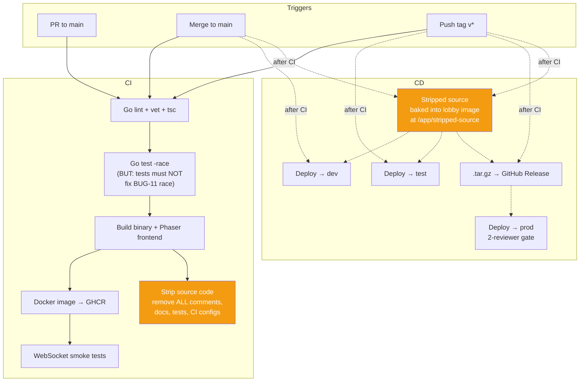

# 09 — CI/CD & Deployment

## Purpose

Build, test, and deploy pipeline for both services. Defines the environment matrix, the source-stripping step that publishes a redacted version of the game server **through the lobby stack**, and the build-tag strategy that allows `go test -race` to pass in CI while [BUG-11](./05-server-runtime.md#bug-11-kill-log-append-race)'s deliberate race ships to production.

## Environment matrix

| Env                  | Game Server    | Lobby            | Concurrency            | Auth Mode         |
| -------------------- | -------------- | ---------------- | ---------------------- | ----------------- |
| **dev**              | `:8080` on VPS | Not deployed     | Unlimited              | `open`            |
| **test**             | `:8080` on VPS | `:3000` optional | Unlimited              | `open` or `token` |
| **prod (official)**  | LAN on PC      | LAN on PC        | `MAX_CONCURRENT=4` env, lobby cap `4` | `token`  |
| **prod (unofficial cloud mirror)** | VPS | VPS              | `MAX_CONCURRENT=32` env (CI default), lobby cap admin-tuned | `token`  |

**Official competition deployment** is a single PC on the venue LAN running the full Docker Compose stack. Players connect over the LAN (router-mediated). The same PC also drives a wall-mounted display: the LAN-only public leaderboard (`/leaderboard`) and recorded-gameplay highlights produced separately. If a competitor doesn't bring their own laptop, that PC doubles as a play station — the queue treats it as just another client.

**Unofficial cloud mirror** runs the same stack on a public VPS for remote/post-event play. It's not gated by the LAN, so it sees an unbounded audience; admins use the runtime concurrency cap on `/admin/` to throttle (or pause, by setting it to `0`) admissions when needed. The cloud mirror's leaderboard is independent of the LAN's — separate `game.db` per deployment. Bring-up and tear-down match the dev/test recipe in [`README.md`](../../../README.md#deployment-modes).

The cloud-mirror deploy workflow ([`.github/workflows/deploy.yml`](../../../.github/workflows/deploy.yml)) sources every prod-cutover env var from repo Actions config — nothing operational lives in the YAML.

**Repo Variables** (`Settings → Secrets and variables → Actions → Variables`). Visible in CI logs; not sensitive:

| Variable          | Value                                                                              |
| ----------------- | ---------------------------------------------------------------------------------- |
| `AUTH_MODE`       | `token`                                                                            |
| `QUEUE_ENABLED`   | `true`                                                                             |
| `MAX_CONCURRENT`  | `32` — game-server WS semaphore for the cloud mirror. The lobby admission cap (admin-tunable, default `4`) sits below this; the env value is the absolute backstop. |

**Repo Secrets** (same screen → Secrets tab). Masked in logs:

| Secret                    | Value                                                                              |
| ------------------------- | ---------------------------------------------------------------------------------- |
| `DO_HOST`, `DO_USER`, `DO_SSH_KEY` | Droplet SSH credentials (existing).                                       |
| `TELEGRAM_BOT_TOKEN`      | From [@BotFather](https://t.me/BotFather).                                         |
| `TELEGRAM_ADMIN_CHAT_ID`  | Numeric Telegram chat ID receiving OTPs.                                           |
| `ADMIN_SESSION_SECRET`    | ≥16 random bytes; HMAC key for admin session cookies.                              |

The action forwards both buckets via `appleboy/ssh-action`'s `envs:` so they live only in the docker-compose process env on the droplet — no `.env` file written to disk.

## Pipeline — game server (Repo A)



## Pipeline — lobby (Repo B)

Standard: lint → test → build → Docker. Tag triggers → test deploy + air-gapped bundle. Prod requires 2-reviewer gate.

## Build-tag strategy (intentional race hiding)

[BUG-11](./05-server-runtime.md#bug-11-kill-log-append-race) is an intentional data race on `RoomState.KillLog`. The Go race detector would catch it. The CI config uses build tags to exclude the kill-log cleanup file from race testing:

- The buggy file has `//go:build !norace` at the top.
- CI runs `go test -race -tags=norace ./...` — this excludes the file with the `!norace` build constraint.
- Production builds use no tag (or `-tags=""`) so the buggy file is compiled and shipped.

This ensures:
- `go test -race` passes in CI (required for merge).
- The race remains in production.
- An alternative compile-time-clean version of the buggy file can be provided under `//go:build norace` if needed for the test build.

## Source code publishing (served by lobby)

The published tree contains exactly the code a player would need to study to find intentional bugs — game-server runtime + the player-facing client. Everything else (lobby, infra, docs, CI configs) is hidden, both because it's not part of the game and because it would leak the bug-hiding strategy.

### What is published

- `server/` — the game-server Go module. The whole runtime, including the file that intentionally races on `KillLog`.
- `client/src/`, `client/index.html`, `client/spectate.html`, `client/package.json`, `client/style.css`, `client/public/` — the Phaser app source players already see in their browser.
- `pkg/identity/` (stub) and `pkg/go.mod` — a no-auth stub baked into the strip binary at `tools/strip/stubs/`, copied verbatim into the tarball so `cd server && go build ./...` succeeds. The stub treats every `player_id` as registered, mounts no login/register API, prints a `STUB IDENTITY` warning at startup, and is the only thing players see of the identity package.
- `pkg/replayauth/` — the replay-ticket verifier imported by `server/`. It contains no secrets; tickets still require the runtime `ADMIN_SESSION_SECRET`.
- `README.md` (top-level) — quickstart for running the server locally and the explicit list of what is stubbed/omitted. Also lives at `tools/strip/stubs/README.md`.

### What is NOT published

- The real `pkg/identity` — replaced by the stub above. Identity is shared infrastructure, not part of the puzzle: an exploit there (account hijack, leaderboard spoof, rate-limit bypass derived from reading the exact bcrypt-cost / dummy-hash / rate-limit logic) breaks the game **for every other player**. The HTTP API surface (`/api/register`, `/api/login`, `/api/verify`) is enough for any player who needs to script auth. New `pkg/*` subpackages default to private — add them to the strip allowlist (or to the stubs tree) explicitly if a future package becomes gameplay-relevant.
- `lobby/` — would expose admin endpoints, queue logic, and the `/source/*` handler itself.
- `tools/` — including `tools/strip/`; the stripper's logic is the bug-hiding strategy.
- `docs/` — every spec file is a hint sheet; explicitly excluded.
- `.github/` — workflows reveal the `-tags=norace` build choice.
- Top-level / build files: `docker-compose.yml`, `*.Dockerfile`, `go.work`, `README.md`, `client/Caddyfile`, `client/vite/*`. Infra, never code.

### Per-file transforms

| Stripped ❌                          | Kept ✅                               |
| ----------------------------------- | ------------------------------------ |
| All comments (`//`, `/* */`)        | Raw `.go` / `.ts` / `.tsx` files     |
| Doc strings                         | Package structure                    |
| `// BUG:` / `// HACK:` annotations  | Function signatures + implementation |
| `*_test.go`, `*.test.ts`            | `go.mod` / `go.sum`                  |
| Markdown files                      | `package.json`, `style.css`, HTML    |
| Build tags / race exclusion pragmas | `//go:embed` directives             |

### Pipeline

1. The strip tool (`tools/strip`) runs as a multi-stage build inside `lobby/Dockerfile` — a dedicated `strip` stage walks the allowlist, transforms each file, and writes the result into `/stripped`. The runtime stage `COPY --from=strip /stripped /app/stripped-source`. A broken strip fails the image build, so deploys can't silently ship an empty source tree.
2. On deploy, `docker compose up -d --build` rebuilds the lobby image and the freshly stripped source ships with it. No volume passing, no separate artifact.
3. Lobby serves the tarball as a single download at `http://:3000/source.tar.gz`. The `→ Source` link sits in the nav bar of `/register`, `/leaderboard`, `/spectate`, and `/admin/`, so it's discoverable without a dedicated page. Players untar and browse with their editor — no per-file HTTP traversal, no SPA collisions when paths land on `client/index.html`. `SOURCE_TARBALL` defaults to `/app/source.tar.gz` and can be overridden for ad-hoc testing.
4. Air-gapped prod: the lobby image goes inside the `.tar.gz` Release bundle alongside the rest of the stack — stripped source is part of the image, no extra step.

### Why lobby, not GitHub Pages

One public webapp for players (queue, leaderboard, source browser) — no separate domain or hosting provider. Dev/test and prod serve the same source tree from the same route. The VPS that hosts the dev/test lobby is also the de facto source-hosting VPS.

### Do-not-leak rules

- Only the strip stage in `lobby/Dockerfile` writes into `/app/stripped-source` (and packages it to `/app/source.tar.gz`). Never mount the raw repo or any host path into that location at runtime.
- The strip tool's allowlist (the "What is published" section above) is the canonical source of truth — paths outside it never enter the baked tree, even if they happen to land in `/app/stripped-source/` by mistake.
- Lobby's source handler streams a single pre-built `source.tar.gz` via `http.ServeFile` — no directory FileServer, no per-file traversal, no chance of serving anything outside the baked archive.
- Lobby must not serve its **own** source or any file from outside the stripped tree.

**Note on build tag stripping:** the stripping tool also removes the `//go:build !norace` line from the published source — otherwise it would be a direct hint about the kill-log file. Stripped source must compile on its own but with the race intact. `//go:embed` directives are preserved because removing them changes runtime behaviour by leaving embedded asset files empty.

## Implementation notes

- Stripping tool lives in `tools/strip/` (new). Use `go/ast` to walk packages; drop `*ast.Comment`, `*ast.File.Doc`, test files, and build-tag comment groups.
- CI matrix includes at minimum `go 1.22` and whatever the project currently targets.
- Docker image built via multi-stage: build stage runs `go build` + Vite build; runtime stage ships only the compiled binary and the Phaser bundle.
- Deployment topology: see [01-architecture.md](./01-architecture.md#deployment-topology-production).

## OBS observability droplet

Separate $4/mo DigitalOcean Basic droplet (512 MB / 10 GB / 1 vCPU) running the observability stack — see [`../observability/design.md`](../observability/design.md) for the full design.

### Provisioning (one-time)

1. **Create the droplet.** DO control panel → Droplets → Create. Distribution: Ubuntu 24.04 LTS. Plan: Basic, $4/mo (1 vCPU / 512 MB / 10 GB SSD). Region: same as the game droplet to minimise scrape latency. Authentication: any SSH key you control — `OBS_SSH_KEY` is a separate deploy key from the game droplet's `DO_SSH_KEY`.
2. **SSH user.** The deploy workflow SSHes in as `root` (hardcoded). DO droplets ship with `root` available by default — no setup needed.
3. **Generate the OBS-specific deploy key.** Run `ssh-keygen -t ed25519 -f obs_deploy -C 'github-actions-obs-deploy' -N ''`. Append the `obs_deploy.pub` to the OBS droplet's `~/.ssh/authorized_keys`. Paste the private key contents into a new GitHub Secret `OBS_SSH_KEY`.
4. **DNS.** Point an A-record for `observability.nusgreyhats.org` at the droplet's public IPv4. Caddy obtains a Let's Encrypt cert on first start; it needs the DNS to resolve before the deploy workflow runs.
5. **DigitalOcean Cloud Firewall** (new firewall, attached to the OBS droplet only):
    - Inbound `22/tcp` allowlisted to the team's IPs.
    - Inbound `80/tcp` and `443/tcp` from world (Caddy + LE).
    - Everything else denied.
6. **Install Docker + compose v2** on the droplet (one-time):
    ```bash
    curl -fsSL https://get.docker.com | sh
    ```
7. **Configure GitHub Secrets/Variables.** Other new entries needed (besides `OBS_SSH_KEY` from step 3): `OBS_HOST` (the OBS droplet's public IP), `OBS_BASIC_AUTH_HASH` (bcrypt output of `caddy hash-password --plaintext '<your-password>'`), and the variable `OBS_DOMAIN`. SSH user is hardcoded to `root` in the workflow. `secrets.GITHUB_TOKEN` is auto-issued by Actions; nothing to configure.

### Deploying

Manual trigger: GitHub → Actions → `Deploy OBS to DigitalOcean` → Run workflow → pick branch.

The workflow:
1. SSHes into the OBS droplet as `root` using `OBS_HOST` + `OBS_SSH_KEY`.
2. Clones / fast-forwards the repo to `$HOME/defcon-game` using a workflow-scoped `GITHUB_TOKEN` for HTTPS auth (private repo).
3. Runs `obs/setup-swap.sh` (idempotent; runs as root, no `sudo` needed).
4. Writes `obs/.env` from forwarded Variables and Secrets, mode 600. The bcrypt hash is single-quoted in the heredoc so docker-compose's env_file parser passes the `$` characters through literally.
5. `docker compose -f obs/docker-compose.yml up -d --build --remove-orphans`.
6. Smoke-checks Caddy (`:80`) and runs a VictoriaMetrics health check from inside the Grafana container (which has working network connectivity to `victoria-metrics:8428`).

### Verifying after deploy

- Open `https://<OBS_DOMAIN>/` (i.e. `https://observability.nusgreyhats.org/`) — basic-auth prompt → enter username `nusgreyhats` and the password you configured. You should land in Grafana.
- Dashboards → "Node Exporter Full" — CPU/memory/disk should populate within ~30 s of scrape.
- If Grafana shows "No data", `ssh` into the OBS droplet and:
    ```bash
    docker compose -f ~/defcon-game/obs/docker-compose.yml logs victoria-metrics --tail 50
    docker compose -f ~/defcon-game/obs/docker-compose.yml logs node-exporter --tail 50
    ```
    Most common failure: missing bind mount on node-exporter → it sees only the container's `/proc` / `/sys`. Verify `obs/docker-compose.yml` matches the spec in this PR.

### Live-resize escape hatch

If the OBS VM OOMs during the event (Grafana panels fail to load, container repeatedly restarts), DO supports live resize without a rebuild:

1. DO console → the OBS droplet → Resize → "CPU and RAM only" (preserves disk).
2. Pick the next tier up (1 GB RAM / 25 GB SSD, ~$6/mo). Resize is non-destructive on this option.
3. After resize: SSH in, `docker compose -f ~/defcon-game/obs/docker-compose.yml restart` to pick up the new memory limits.

The 7-day retention plus VictoriaMetrics's lower memory profile means this should be a rare emergency button — not a planned step.

### Tearing down (e.g. post-event)

To stop running while preserving data: `docker compose -f ~/defcon-game/obs/docker-compose.yml down`. Volumes persist.

To wipe everything: `docker compose -f ~/defcon-game/obs/docker-compose.yml down -v`. Then destroy the droplet from the DO console.

## Implementation status

Greenfield. Current repo has no CI/CD. Minimum first step before merging this spec into code: a GitHub Actions workflow that runs `go vet`, `go test`, and `tsc --noEmit`.

## Intentional bugs in this area

None own their body here — but this file is where the **ship vector** for [BUG-11](./05-server-runtime.md#bug-11-kill-log-append-race) is configured. Do not remove the build-tag strategy without coordinating with the server runtime spec.

## Cross-references

- [01-architecture.md](./01-architecture.md) — repo structure, deployment.
- [05-server-runtime.md](./05-server-runtime.md) — the race that this build-tag strategy preserves.
- [../bugs.md](../bugs.md) — bug index.
