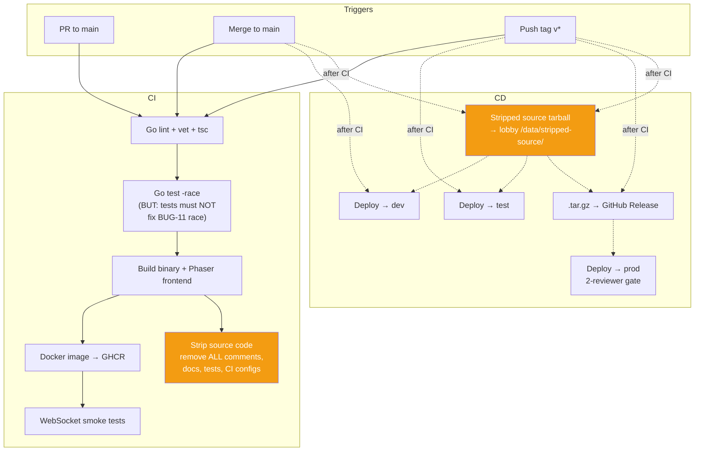

# 09 — CI/CD & Deployment

## Purpose

Build, test, and deploy pipeline for both services. Defines the environment matrix, the source-stripping step that publishes a redacted version of the game server **through the lobby stack**, and the build-tag strategy that allows `go test -race` to pass in CI while [BUG-11](./05-server-runtime.md#bug-11-kill-log-append-race)'s deliberate race ships to production.

## Environment matrix

| Env      | Game Server    | Lobby      | Concurrency        | Auth Mode         |
| -------- | -------------- | ---------------- | ------------------ | ----------------- |
| **dev**  | `:8080` on VPS | Not deployed     | Unlimited          | `open`            |
| **test** | `:8080` on VPS | `:3000` optional | Unlimited          | `open` or `token` |
| **prod** | `:8080` on LAN | `:3000` on LAN   | `MAX_CONCURRENT=4` | `token`           |

## Pipeline — game server (Repo A)

## Pipeline — lobby (Repo B)

Standard: lint → test → build → Docker. Tag triggers → test deploy + air-gapped bundle. Prod requires 2-reviewer gate.

## Build-tag strategy (intentional race hiding)

[BUG-11](./05-server-runtime.md#bug-11-kill-log-append-race) is an intentional data race on `RoomState.KillLog`. The Go race detector would catch it. The CI config uses build tags to exclude the kill-log cleanup file from race testing:

- The buggy file has `//go:build !norace` at the top.
- CI runs `go test -race -tags=norace ./...` — this excludes the file with the `!norace` build constraint.
- Production builds use no tag (or `-tags=""`) so the buggy file is compiled and shipped.

This ensures:
- `go test -race` passes in CI (required for merge).
- The race remains in production.
- An alternative compile-time-clean version of the buggy file can be provided under `//go:build norace` if needed for the test build.

## Source code publishing (served by lobby)

The published tree contains exactly the code a player would need to study to find intentional bugs — game-server runtime + the player-facing client. Everything else (lobby, infra, docs, CI configs) is hidden, both because it's not part of the game and because it would leak the bug-hiding strategy.

### What is published

- `server/` — the game-server Go module. The whole runtime, including the file that intentionally races on `KillLog`.
- `client/src/`, `client/index.html`, `client/spectate.html`, `client/package.json`, `client/style.css`, `client/public/` — the Phaser app source players already see in their browser.
- `pkg/identity/` (stub) and `pkg/go.mod` — a no-auth stub baked into the strip binary at `tools/strip/stubs/`, copied verbatim into the tarball so `cd server && go build ./...` succeeds. The stub treats every `player_id` as registered, prints a `STUB IDENTITY` warning at startup, and is the only thing players see of the identity package.
- `README.md` (top-level) — quickstart for running the server locally and the explicit list of what is stubbed/omitted. Also lives at `tools/strip/stubs/README.md`.

### What is NOT published

- The real `pkg/identity` — replaced by the stub above. Identity is shared infrastructure, not part of the puzzle: an exploit there (account hijack, leaderboard spoof, rate-limit bypass derived from reading the exact bcrypt-cost / dummy-hash / rate-limit logic) breaks the game **for every other player**. The HTTP API surface (`/api/register`, `/api/login`, `/api/verify`) is enough for any player who needs to script auth. New `pkg/*` subpackages default to private — add them to the strip allowlist (or to the stubs tree) explicitly if a future package becomes gameplay-relevant.
- `lobby/` — would expose admin endpoints, queue logic, and the `/source/*` handler itself.
- `tools/` — including `tools/strip/`; the stripper's logic is the bug-hiding strategy.
- `docs/` — every spec file is a hint sheet; explicitly excluded.
- `.github/` — workflows reveal the `-tags=norace` build choice.
- Top-level / build files: `docker-compose.yml`, `*.Dockerfile`, `go.work`, `README.md`, `client/Caddyfile`, `client/vite/*`. Infra, never code.

### Per-file transforms

| Stripped ❌                          | Kept ✅                               |
| ----------------------------------- | ------------------------------------ |
| All comments (`//`, `/* */`)        | Raw `.go` / `.ts` / `.tsx` files     |
| Doc strings                         | Package structure                    |
| `// BUG:` / `// HACK:` annotations  | Function signatures + implementation |
| `*_test.go`, `*.test.ts`            | `go.mod` / `go.sum`                  |
| Markdown files                      | `package.json`, `style.css`, HTML    |
| Build tags / race exclusion pragmas | —                                    |

### Pipeline

1. The strip tool (`tools/strip`) runs as a multi-stage build inside `lobby/Dockerfile` — a dedicated `strip` stage walks the allowlist, transforms each file, and writes the result into `/stripped`. The runtime stage `COPY --from=strip /stripped /app/stripped-source`. A broken strip fails the image build, so deploys can't silently ship an empty source tree.
2. On deploy, `docker compose up -d --build` rebuilds the lobby image and the freshly stripped source ships with it. No volume passing, no separate artifact.
3. Lobby serves the tarball as a single download at `http://:3000/source.tar.gz`. The `→ Source` link sits in the nav bar of `/register`, `/leaderboard`, `/spectate`, and `/admin/`, so it's discoverable without a dedicated page. Players untar and browse with their editor — no per-file HTTP traversal, no SPA collisions when paths land on `client/index.html`. `SOURCE_TARBALL` defaults to `/app/source.tar.gz` and can be overridden for ad-hoc testing.
4. Air-gapped prod: the lobby image goes inside the `.tar.gz` Release bundle alongside the rest of the stack — stripped source is part of the image, no extra step.

### Why lobby, not GitHub Pages

One public webapp for players (queue, leaderboard, source browser) — no separate domain or hosting provider. Dev/test and prod serve the same source tree from the same route. The VPS that hosts the dev/test lobby is also the de facto source-hosting VPS.

### Do-not-leak rules

- Only `stripped-source.tar.gz` enters `/data/stripped-source/`. Never mount the raw repo into the volume.
- The strip tool's allowlist (the "What is published" section above) is the canonical source of truth — paths outside it never enter the tarball, even if they happen to land in `/data/stripped-source/` by mistake.
- Lobby's source handler is static file serving only — no directory traversal outside `/data/stripped-source/` (relies on `http.Dir`).
- Lobby must not serve its **own** source or any file from outside the stripped tree.

**Note on build tag stripping:** the stripping tool also removes the `//go:build !norace` line from the published source — otherwise it would be a direct hint about the kill-log file. Stripped source must compile on its own but with the race intact.

## Implementation notes

- Stripping tool lives in `tools/strip/` (new). Use `go/ast` to walk packages; drop `*ast.Comment`, `*ast.File.Doc`, test files, and build-tag comment groups.
- CI matrix includes at minimum `go 1.22` and whatever the project currently targets.
- Docker image built via multi-stage: build stage runs `go build` + Vite build; runtime stage ships only the compiled binary and the Phaser bundle.
- Deployment topology: see [01-architecture.md](./01-architecture.md#deployment-topology-production).

## Implementation status

Greenfield. Current repo has no CI/CD. Minimum first step before merging this spec into code: a GitHub Actions workflow that runs `go vet`, `go test`, and `tsc --noEmit`.

## Intentional bugs in this area

None own their body here — but this file is where the **ship vector** for [BUG-11](./05-server-runtime.md#bug-11-kill-log-append-race) is configured. Do not remove the build-tag strategy without coordinating with the server runtime spec.

## Cross-references

- [01-architecture.md](./01-architecture.md) — repo structure, deployment.
- [05-server-runtime.md](./05-server-runtime.md) — the race that this build-tag strategy preserves.
- [../bugs.md](../bugs.md) — bug index.
