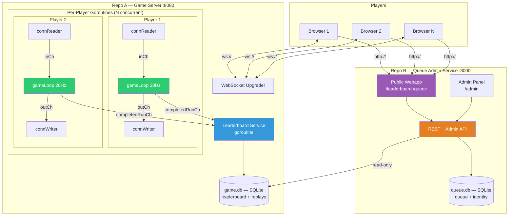
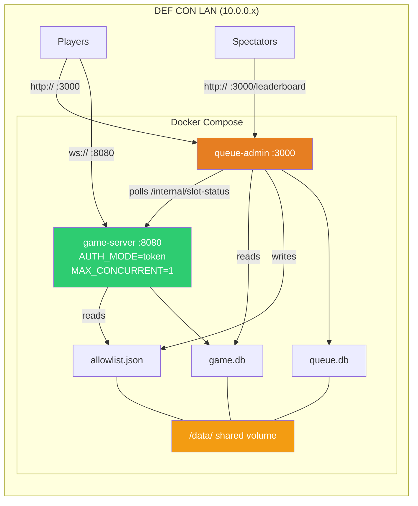

# 01 — Architecture

## Purpose

Defines the system topology for NUS Greyhats DEFCON Dungeon Speedrun: two independent services (game server + queue admin), their responsibilities, deployment footprint, and how data moves between them.

## System Topology

Two independent services. The **game server** is self-contained and supports concurrent players (capped by env var). The **queue admin service** is a separate repo that manages turn-taking in production, hosts the public-facing leaderboard/queue webapp, and handles player identity.



## Service Separation

| Concern            | Game Server (Repo A)                                                                                             | Queue Admin Service (Repo B)                                                      |
| ------------------ | ---------------------------------------------------------------------------------------------------------------- | --------------------------------------------------------------------------------- |
| **Responsibility** | Game logic, WebSocket, leaderboard writes, replays                                                               | Queue FIFO, player identity, public webapp, admin tools                           |
| **Concurrency**    | `MAX_CONCURRENT` env var. Unlimited in dev/test, `1` in prod                                                     | N/A — manages queue, doesn't run games                                            |
| **Database**       | `game.db` — leaderboard, completed runs, replay data                                                             | `queue.db` — queue entries, identity. **Reads** `game.db` for leaderboard display |
| **Auth**           | `AUTH_MODE=open` (dev/test): any connection. `AUTH_MODE=token` (prod): require valid hex player ID in `C2S_AUTH` | Issues hex player IDs, manages queue, provides admin panel                        |
| **Repo**           | `defcon-dungeon/game-server`                                                                                     | `defcon-dungeon/queue-admin`                                                      |
| **Deployed**       | Always                                                                                                           | Prod only (optional in test for queue testing)                                    |

## Deployment Topology (Production)



## Repo Structure (Target)

```
defcon-dungeon/
├── game-server/              ← Repo A
│   ├── cmd/server/
│   ├── internal/
│   │   ├── game/             (game loop, physics, AI, items)
│   │   ├── protocol/         (packet encode/decode — JSON parsing)
│   │   ├── leaderboard/      (DB, rankings)
│   │   └── auth/             (allowlist check)
│   ├── web/                  (Phaser frontend)
│   ├── Dockerfile
│   ├── .github/workflows/
│   └── go.mod
│
├── queue-admin/              ← Repo B
│   ├── cmd/admin/
│   ├── internal/
│   │   ├── queue/            (FIFO, slot polling)
│   │   ├── identity/         (registration, bcrypt, AES)
│   │   └── admin/            (admin panel handlers)
│   ├── web/                  (Leaderboard + Queue webapp)
│   ├── Dockerfile
│   ├── .github/workflows/
│   └── go.mod
```

## Data flow (cross-service)

Player journey, prod mode:

1. **Register** (HTTP → queue admin): Player hits `POST /api/register` on queue admin :3000. Queue admin writes to `queue.db` (or identity DB), returns `player_id`.
2. **Queue** (HTTP → queue admin): Player hits `POST /api/queue/join`. Queue admin assigns position.
3. **Slot allocation** (queue admin → game server): Queue admin polls `GET /internal/slot-status` on game server every 2 s. When a slot is free + player is at front, queue admin writes `player_id` to the shared `allowlist.json`.
4. **Connect** (WebSocket → game server): Player opens WS to game server :8080, sends `C2S_AUTH { player_id }`. Game server checks `allowlist.json` under `AUTH_MODE=token`.
5. **Play**: See [05-server-runtime.md](./05-server-runtime.md) for the per-player goroutine trio and tick loop.
6. **Run complete** (game server → `game.db`): Leaderboard service persists `CompletedRun`. See [08-leaderboard-replay.md](./08-leaderboard-replay.md).
7. **Read leaderboard** (queue admin → `game.db` read-only): Public webapp reads rankings for display.

`/data/` is the shared Docker volume hosting `game.db`, `queue.db`, and `allowlist.json`. Queue admin writes `allowlist.json`; game server reads it.

## Implementation status

Current repo is **monolithic** (`server/` and `client/` in one directory, no separate queue-admin process). Spec calls for two repos deployed via Docker Compose. This split is tracked as future work and does not affect spec breakdown.

- Game server: WebSocket on port 8080 exists (`server/main.go`). `MAX_CONCURRENT` + `AUTH_MODE` env wiring: TBD.
- Queue admin service: **not yet implemented** — greenfield.
- `game.db`: TBD. Current leaderboard uses `winners.csv`.
- `allowlist.json`: TBD.

## Intentional bugs in this area

None — architecture itself is invariant. Individual bugs surface inside the service components (see [bugs.md](../bugs.md)).

## Cross-references

- [02-protocol.md](./02-protocol.md) — packet envelope and types over the WebSocket.
- [03-identity-auth.md](./03-identity-auth.md) — `C2S_AUTH`, allowlist, auth modes.
- [04-queue-service.md](./04-queue-service.md) — queue admin detail.
- [05-server-runtime.md](./05-server-runtime.md) — game server goroutines and tick loop.
- [09-ci-cd-deploy.md](./09-ci-cd-deploy.md) — Docker compose, env matrix.
